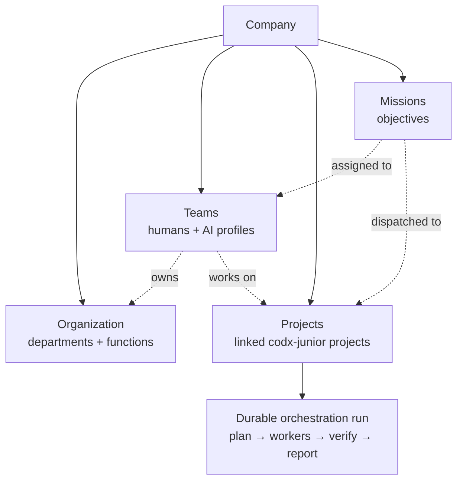
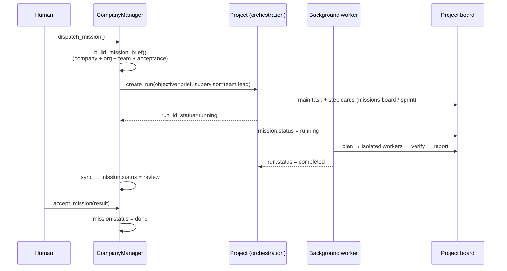
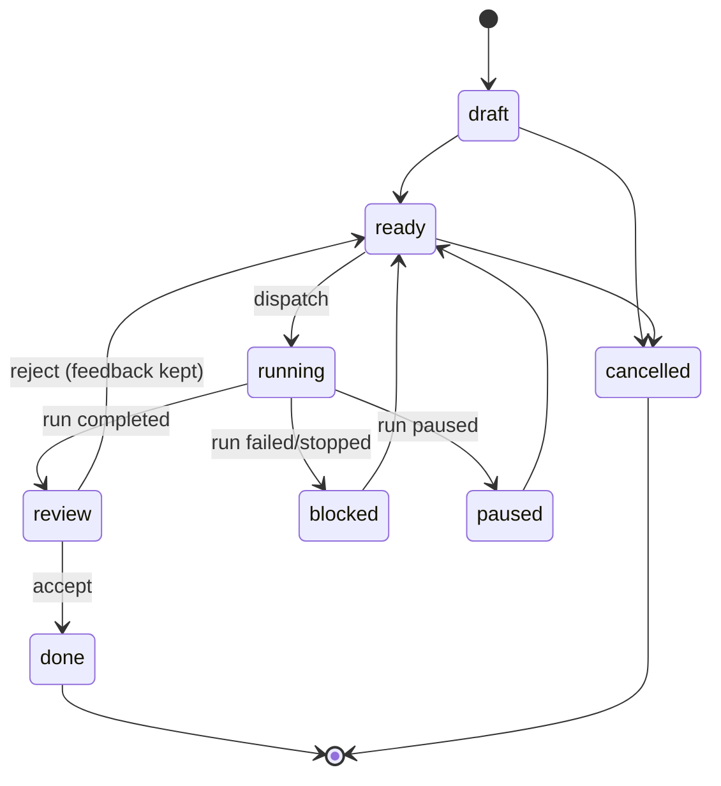

# Company — run a hybrid organization of humans and AI

A **company** is the new top-level entity of codx-junior. It sits above projects
and owns everything needed to run an organization:



A company can be run like a real organization:

* **Organization** — departments/functions with a tree, a lead and concrete
  responsibilities.
* **Teams** — hybrid rosters made of human users **and** AI profiles, each with a
  role and a responsibility. The lead is always part of the roster.
* **Projects** — linked codx-junior projects with the role they play in the
  company, the owning team and a priority.
* **Missions** — outcomes assigned to a team and a project. Dispatching a
  mission starts a real durable orchestration run in that project, so the AI
  team works on the project board and the result comes back for review.
* **Autopilot** — an opt-in, guard-railed cycle that dispatches `auto` missions
  on an interval, respecting concurrency and budget limits.

The canonical example is **codx-junior cloud**: a SaaS company that offers
codx-junior as a service (like Shopify, but for an AI development workspace).
Create it with the `saas` template and the app seeds Leadership, Product,
Engineering, Growth and Customer Success, five hybrid teams and four draft
missions — ready for a human to review before anything is dispatched.

## Where it lives

| Layer | Path |
| --- | --- |
| Domain model | `api/codx/junior/company/models.py` |
| Persistence + journal | `api/codx/junior/company/store.py` |
| Business operations | `api/codx/junior/company/manager.py` |
| Starter organizations | `api/codx/junior/company/templates.py` |
| Background autopilot | `api/codx/junior/company/autopilot.py` |
| REST API | `api/codx/junior/api/company.py` |
| AI profile tool | `api/codx/junior/tools/company_tools.py` |
| UI | `client/src/views/CompanyView.vue` + `client/src/components/company/` |
| Tests | `tests/test_company.py` |

## Storage

Companies are **global** (not project-scoped), so one company can orchestrate
projects anywhere in the installation.

```text
$CODX_JUNIOR_COMPANIES_PATH/          # default: /home/codx-junior/companies
└── <company_id>/
    ├── company.json                  # org chart, teams, projects, missions, autonomy
    └── journal.jsonl                 # append-only audit trail
```

* The folder is named after the **id**, never the name: renaming a company never
  moves files or breaks references.
* `company.json` is written atomically (temp file + `os.replace`), and a
  per-company file lock serializes read-modify-write between the API and the
  autopilot.
* `journal.jsonl` is append-only and line-delimited: a crash cannot corrupt the
  events already written, and a human can read it with `tail -f`.

Configure the root with:

```bash
export CODX_JUNIOR_COMPANIES_PATH=/path/to/companies
```

## Using it

### From the UI

Open **Company** in the left navigation (or `/<project>/company`).

1. **New company** → pick a name and the **SaaS — codx-junior cloud** template.
2. **Organization** → adjust the departments/functions and their leads.
3. **Teams** → review the hybrid rosters, add humans (`user:alice`) or AI
   profiles, pick the lead and the projects each team works on.
4. **Projects** → link the real codx-junior projects and assign the owning team.
5. **Missions** → review/edit the draft missions, set a team and project, then
   **Dispatch**. The mission card shows the live orchestration run and its
   progress.
6. When the run completes the mission moves to **In review**. Accept it (it
   becomes **Done**) or reject it with feedback (it returns to **Ready** and the
   feedback is included in the next brief).
7. Turn on **Autopilot** in the Overview when you want `auto` missions to be
   dispatched automatically.

### From an AI profile

Every profile can use the `company_management` tool. It exposes 28 actions:

```text
list, get, create, update, delete, references, snapshot,
add_org_unit, update_org_unit, delete_org_unit,
add_team, update_team, delete_team,
add_team_members, remove_team_members, set_team_lead,
link_project, unlink_project,
add_mission, update_mission, delete_mission,
dispatch_mission, accept_mission, reject_mission, transition_mission,
sync, configure_autonomy, run_cycle
```

Example (the model can run this):

```python
company_management("create", name="codx-junior cloud", template="saas",
                   project_ids=["<project_id>"])
company_management("add_mission", company_id="<id>",
                   title="Ship the hosted provisioning flow",
                   objective="A tenant can sign up and start a project.",
                   acceptance="Provisioning works end to end.",
                   team_id="<team_id>", project_id="<project_id>",
                   dispatch_mode="manual")
company_management("dispatch_mission", company_id="<id>", mission_id="<mission_id>")
company_management("snapshot", company_id="<id>")
```

Safety in the tool:

* `delete` (company) and turning autonomy **on** require `confirm=true`.
* Missions default to `dispatch_mode="manual"`; the model must explicitly choose
  `auto` or call `dispatch_mission`.
* The tool never bypasses the company policy (concurrency, budget, human
  acceptance).

### From the REST API

All routes are under `/api/companies` (authenticated user required; writes are
limited to the company owner or an admin).

```bash
# List / create
curl /api/companies
curl -X POST /api/companies \
  -H 'content-type: application/json' \
  -d '{"name":"codx-junior cloud","template":"saas","project_ids":["proj_123"]}'

# Dashboard
curl /api/companies/<id>/snapshot
curl /api/companies/<id>/journal

# Organization and teams
curl -X POST /api/companies/<id>/org-units -d '{"name":"Engineering","kind":"department"}'
curl -X POST /api/companies/<id>/teams \
  -d '{"name":"Platform","org_unit_id":"<org>","lead_kind":"profile",
       "lead_name":"orchestrator","members":["software_developer","user:alice"],
       "project_ids":["proj_123"]}'

# Missions
curl -X POST /api/companies/<id>/missions \
  -d '{"title":"Ship provisioning","objective":"...","team_id":"<team>",
       "project_id":"proj_123","dispatch_mode":"auto","status":"ready"}'
curl -X POST /api/companies/<id>/missions/<mission>/dispatch
curl -X POST /api/companies/<id>/missions/<mission>/accept \
  -d '{"result":"Provisioning works"}'
curl -X POST /api/companies/<id>/missions/sync

# Autonomy
curl -X PUT /api/companies/<id>/autonomy \
  -d '{"enabled":true,"level":"supervised","interval_minutes":60,
       "max_concurrent_missions":2,"max_missions_per_cycle":1}'
curl -X POST /api/companies/<id>/cycle -d '{"force":true}'
```

## How dispatch works



The brief is important: the AI team receives the company mission/vision/values,
the project role, the org unit, the full team roster with responsibilities and
the acceptance criteria — not just a title.

Board titles are sanitized before they are used as folders under
`.codx/tasks`, so a company/mission name can never escape the project.

## Autonomy guard rails

`AutonomyPolicy` is **off by default** (`enabled=false`).

| Field | Default | Meaning |
| --- | --- | --- |
| `enabled` | `false` | The background loop may run cycles |
| `level` | `supervised` | `off` / `supervised` / `autonomous` |
| `interval_minutes` | `60` | Minimum time between automatic cycles (5–1440) |
| `max_concurrent_missions` | `2` | Running missions allowed at once |
| `max_missions_per_cycle` | `1` | Missions dispatched by one cycle |
| `daily_budget_cxjcoins` | `0` | Soft daily budget (0 = no limit) |
| `require_human_acceptance` | `true` | Completed runs stop at `review` |

A cycle:

1. syncs running missions from their orchestration runs,
2. selects `ready` missions with `dispatch_mode=auto` whose team is not
   `manual` (a manual team only accepts human dispatches),
3. dispatches up to `max_missions_per_cycle` while staying under
   `max_concurrent_missions`,
4. records the cycle in the autonomy policy and the journal.

The background loop is started by `codx.junior.background` when background
services are enabled. It can be disabled independently:

```bash
export CODX_JUNIOR_COMPANY_AUTOPILOT=false
export CODX_JUNIOR_COMPANY_AUTOPILOT_TICK_SECONDS=60
```

## Mission lifecycle



Transitions are validated by the model (`MISSION_TRANSITIONS`), so a tool or a
UI cannot move a mission into an impossible state.

## Testing

```bash
# Pure domain tests (no AI stack, no project required)
pytest tests/test_company.py -q
# or
PYTHONPATH=api python -m unittest discover -s tests -p 'test_company.py' -v
```

The tests cover persistence/journaling, the SaaS template, hybrid rosters,
profile validation, project linking, dispatch, run sync, accept/reject,
transition validation, the autonomy guard rails and the dashboard snapshot.

## Next steps

* **Employee directory** — a company-level view of every human and AI profile
  with their teams, projects and missions.
* **Budget ledger** — aggregate `cxjcoins` across the company's runs and pause
  teams that exceed their budget.
* **Approvals** — per-team policies for risky actions (deploy, spend, delete).
* **Company chat** — a channel per company/team where humans and profiles plan
  together before creating missions.
* **Multi-company** — the storage and API already support it; the UI needs a
  workspace switcher.

Made with ❤️ by codx-junior
