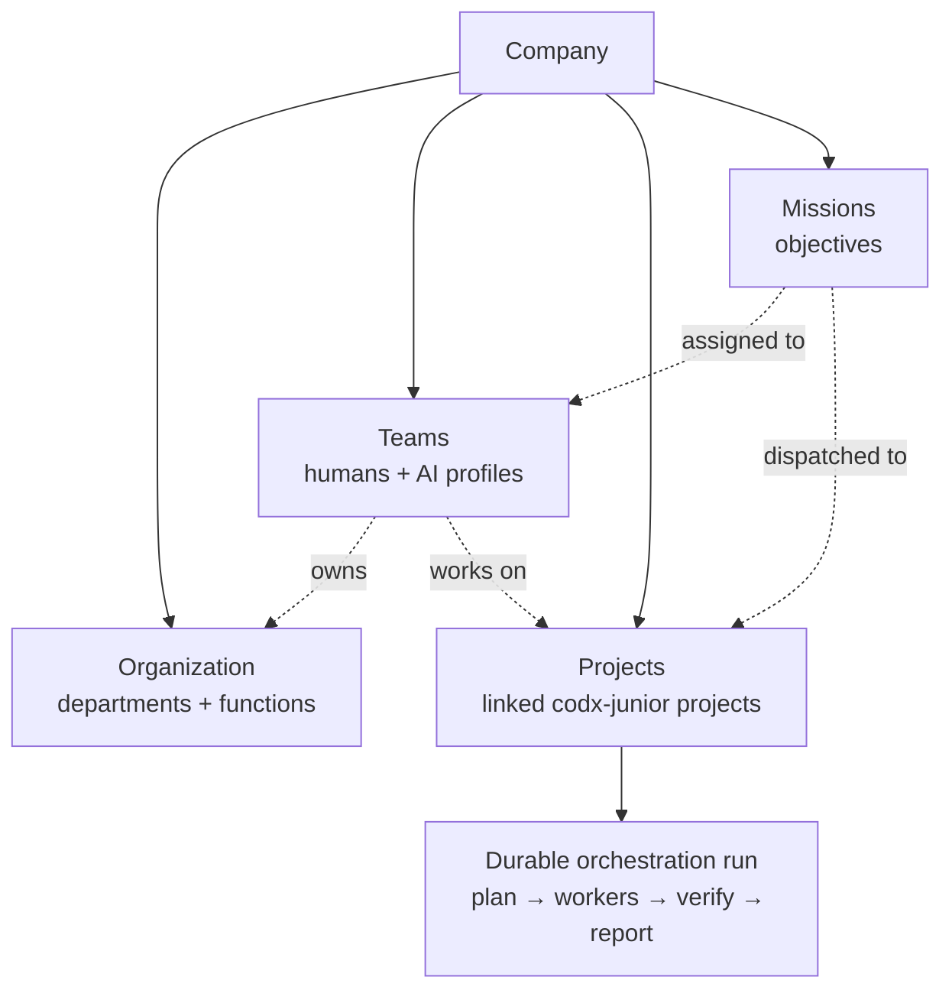
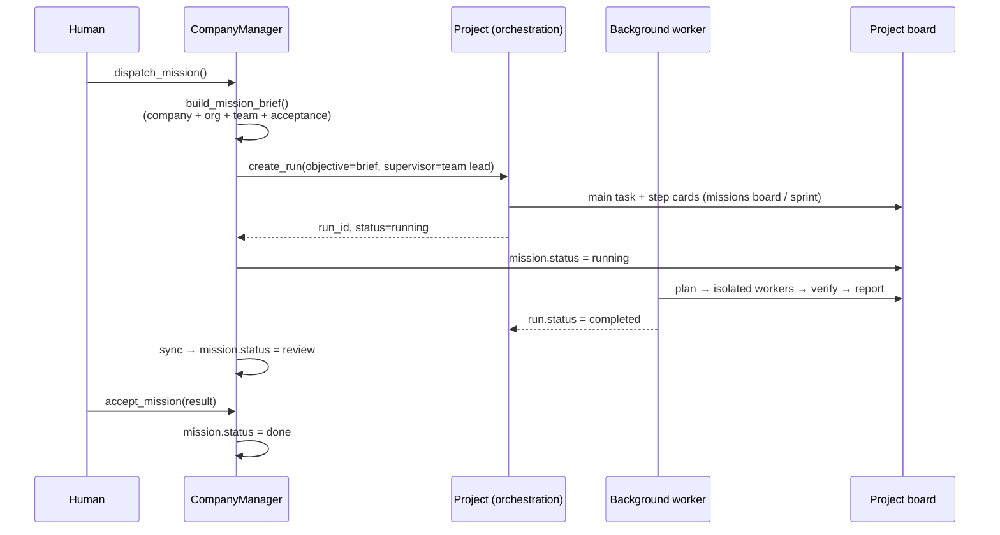
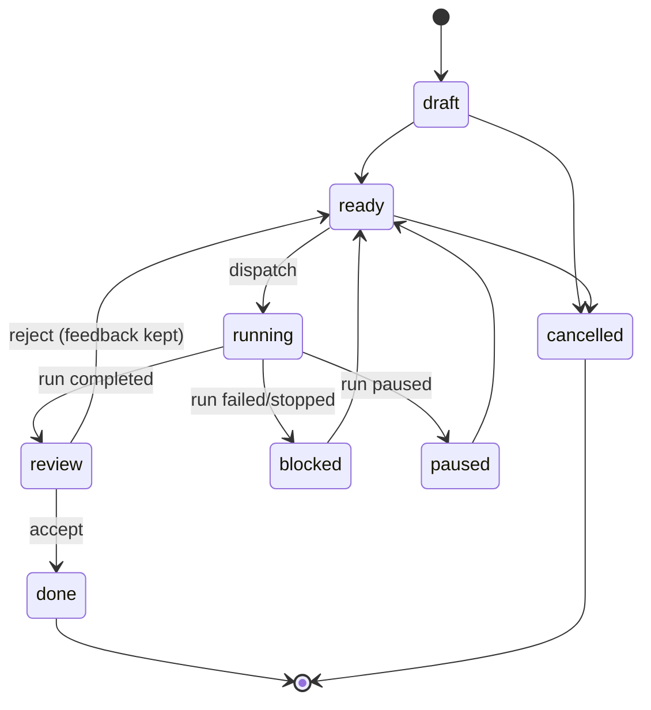

# Company — run a hybrid organization of humans and AI

A **company** is the new top-level entity of codx-junior. It sits above projects
and owns everything needed to run an organization:



A company can be run like a real organization:

* **Organization** — departments/functions with a tree, a lead and concrete
  responsibilities.
* **Teams** — hybrid rosters made of human users **and** AI profiles, each with a
  role and a responsibility. The lead is always part of the roster.
* **Projects** — linked codx-junior projects with the role they play in the
  company, the owning team and a priority.
* **Missions** — outcomes assigned to a team and a project. Dispatching a
  mission starts a real durable orchestration run in that project, so the AI
  team works on the project board and the result comes back for review.
* **Autopilot** — an opt-in, guard-railed cycle that dispatches `auto` missions
  on an interval, respecting concurrency and budget limits.

The canonical example is **codx-junior cloud**: a SaaS company that offers
codx-junior as a service (like Shopify, but for an AI development workspace).
Create it with the `saas` template and the app seeds Leadership, Product,
Engineering, Growth and Customer Success, five hybrid teams and four draft
missions — ready for a human to review before anything is dispatched.

## Where it lives

| Layer | Path |
| --- | --- |
| Domain model | `api/codx/junior/company/models.py` |
| Persistence + journal | `api/codx/junior/company/store.py` |
| Business operations | `api/codx/junior/company/manager.py` |
| Starter organizations | `api/codx/junior/company/templates.py` |
| Background autopilot | `api/codx/junior/company/autopilot.py` |
| REST API | `api/codx/junior/api/company.py` |
| AI profile tool | `api/codx/junior/tools/company_tools.py` |
| Company assistant | `api/codx/junior/company/assistant.py` + `client/src/components/company/CompanyAssistant.vue` |
| Profile/team advisor | `api/codx/junior/company/profile_advisor.py` |
| Language detection | `api/codx/junior/company/language.py` |
| User roles / memberships | `api/codx/junior/model/user.py` (`CodxUser.companies`, `workspace_mode`) |
| UI | `client/src/views/CompanyView.vue` (one screen) + `CompanySimpleHome.vue` + `CompanyAssistant.vue` |
| Tests | `tests/test_company.py`, `tests/test_company_people.py` |

## Storage

Companies are **global** (not project-scoped), so one company can orchestrate
projects anywhere in the installation.

```text
$CODX_JUNIOR_COMPANIES_PATH/          # default: /home/codx-junior/companies
└── <company_id>/
    ├── company.json                  # org chart, teams, projects, missions, autonomy
    └── journal.jsonl                 # append-only audit trail
```

* The folder is named after the **id**, never the name: renaming a company never
  moves files or breaks references.
* `company.json` is written atomically (temp file + `os.replace`), and a
  per-company file lock serializes read-modify-write between the API and the
  autopilot.
* `journal.jsonl` is append-only and line-delimited: a crash cannot corrupt the
  events already written, and a human can read it with `tail -f`.

Configure the root with:

```bash
export CODX_JUNIOR_COMPANIES_PATH=/path/to/companies
```

## Company mode vs working mode

codx-junior has two product shells:

| Shell | Who enters it | What it shows |
| --- | --- | --- |
| **Company** | `company_admin`, `manager`, an explicit `workspace_mode="company"`, or any user with a company membership | ONE friendly home screen (what is happening + four obvious actions) plus the always-present assistant. Teams, people, projects, missions and settings are managed by talking to codx-junior. |
| **Working** | `user` (today's product), or an explicit `workspace_mode="work"` | Today's full project workspace (chats, boards, files, git, infra, …) |

The mode is stored on the user document (`workspace_mode`: `auto` | `company` |
`work`) and derived from the role/memberships when it is `auto`. Global admins
keep working mode by default, so an existing installation does not change for
them. The switch lives in **Settings → Company workspace / Working workspace**.

The company entry point is project-independent: `"/company"` (optionally
`"/company/<companyId>"`). The old project-scoped `"/<project>/company"` deep
link still works.

### Roles

| Scope | Role | Can |
| --- | --- | --- |
| Global | `admin` | Everything; can switch modes |
| Global | `company_admin` | Enter company mode by default |
| Global | `manager` | Enter company mode by default |
| Global | `user` | Working mode by default |
| Company | `admin` | Add/remove company users, manage every company setting |
| Company | `manager` | Manage teams, projects and missions through the assistant |
| Company | `member` | Follow the work (read-only company views) |

Every user stores the companies they belong to (`CodxUser.companies`), so the
same account can be a manager of one company and a member of another.

### The always-present assistant

Every company screen docks the **codx-junior assistant** on the right (a bottom
sheet on phones). It is the product, not a side panel: the target user is a
manager with no technical skills, so the assistant asks **one simple question at
a time** and does the work as the answers arrive.

There is **no command syntax to memorise**. The assistant extracts the order
from normal comments (“could you add Alice to the Platform team?”, “Alice should
lead Platform”, “I need an IT team”), restates what it is about to do and waits
for confirmation. Any normal agreement works: **ok**, **okay**, **fine**,
**sure**, **yes**, **go ahead**, **do it**, **confirm**; “no”, “cancel” or
“not now” stops it.

Creation is conversational and asks only for the minimum:

* `"create a team"` → “What should we call the team?” → creates it → offers to
  add people, choose a lead or create a mission.
* `"add a person"` → asks the name → asks what the person should do (help run the
  company / follow the work / manage people and settings) → creates the account
  with a temporary password. Existing users are simply enrolled.
* `"create a mission"` → asks what it should achieve → asks the team and project
  only when they exist → creates it and offers to start it.
* `"show projects"` → lists every mapped project **and its child projects**
  (projects discovered inside a mapped project's folder).
* `"link a project"` → shows the discovered projects that are not linked yet and
  asks which one to connect.
* `"remove project X"` / `"unlink project X"` → confirms, then removes only the
  company mapping (the project itself is untouched). Open missions must be
  reassigned first.
* `"create a new project"` / `"new project called Billing"` → asks for the name,
  creates the project under the projects root, links it to the company and makes
  it available for teams/missions.
* `"I need a developer"` → inspects the linked project (languages, manifests,
  tests, Docker, CI), suggests a specialized **Developer** profile composed from
  the project/built-in `software_developer` and `analyst` profiles, and selects
  the code/git tools it needs. Existing profiles are reused instead of
  duplicated.
* `"I need an IT team"` → inspects the project and proposes the whole roster
  (IT Lead, Developer, Support Engineer, DevOps Engineer), which profiles to
  reuse and which new profiles to create. It creates the profiles and the team
  after confirmation, or can use existing profiles only.
* `"open company settings"` → asks **what** to change, then asks for the new
  value. The full settings form appears only if the manager explicitly chooses
  **“Show all settings”**.
* `"add alice to Platform"`, `"remove bob from Platform"`,
  `"make carol lead of Platform"`, `"delete team Platform"` (with confirmation),
  `"delete company"` (with confirmation) keep working as direct commands.
* `"review mission X"` → asks **accept the result** or **send it back for
  changes** (and asks for the feedback when sent back).
* `"what needs my attention?"`, `"show teams"`, `"show missions"`,
  `"who is in the company?"`, `"show the organization"` answer from the live
  company document.

The assistant is backed by `POST /api/companies/{id}/assistant`. It returns
`state` for the next question, `options` for big quick-reply buttons and
`suggestions` for what to do next. It enforces the company role server-side: a
read-only member never gets an action that could change data.

### When it does not understand

If no intent matches, the assistant switches to **AI reasoning** through the
project's `SmolAgent`/LLM. The fallback receives:

* the company context (teams, people, mapped and child projects, missions),
* the authenticated user (username, email, global/company role and preferred
  language),
* the recent conversation and the browser/request language.

The LLM is instructed to answer in the manager's language (explicit preference,
detected message language and browser language, in that order), use plain
non-technical language and personalize the reply with the manager's name. It is
also told not to claim actions it did not perform; actions remain confirmed and
executed by the deterministic assistant.

The fallback is controlled by:

```bash
CODX_JUNIOR_COMPANY_AI_FALLBACK=true          # set false to disable
CODX_JUNIOR_COMPANY_AI_TIMEOUT_SECONDS=25
```

The manager can set an explicit language in **Account → Assistant language**
(the default is *Automatic*, which follows the message/browser language).

### Profiles and teams

A company team is a roster of references: human users (`user:alice`) and AI
profiles (`profile:developer`). Profiles are **project-owned** (or built-in),
so the assistant can:

1. **Reuse** a profile that already exists in the linked project or its
   inheritance chain (`software_developer`, `analyst`, `orchestrator`, …).
2. **Create** a new project profile that composes one or more base profiles
   (`Profile.profiles`), grants only the selected tools (`Profile.tools`) and
   writes plain-language instructions for the role.
3. **Add** the profiles to a company team with the right lead and project.

The advisor (`company/profile_advisor.py`) inspects the linked project folder:
languages, manifests (`package.json`, `pyproject.toml`, `Dockerfile`, …), tests,
Docker and CI. That context decides which roles and tools are offered.

Role presets include developer, frontend/backend developer, QA, DevOps,
security, data, design, product, technical writer and support. Team presets
include IT, Engineering, Product, Data, Security, Support and Design.

### From the UI

Open **Company** in the left navigation (or `/company`, `/<project>/company`).
The company shell has **one screen**:

1. **Create the company** — only a name is required. Templates and projects are
   under “More options (optional)”.
2. **Home** shows what is happening, who is in the company, the teams, the
   mapped projects — including their **child projects** — and anything that
   needs your attention. The Projects card has **Add** (link an existing
   project) and **New** (create a project) actions that talk to the assistant.
3. **Manage everything by talking to codx-junior** — add people, create teams,
   start missions, review results and change details. The home screen includes
   ready-made prompts such as *I need a developer*, *I need an IT team* and
   *I need a QA*: the assistant inspects the project and proposes the profiles,
   base profiles and tools before creating anything.
4. The old deep links (`?tab=teams`, `?tab=people`, …) now simply ask the
   assistant the matching question instead of opening another screen.

### From an AI profile

Every profile can use the `company_management` tool. It exposes 30 actions:

```text
list, get, create, update, delete, references, snapshot,
add_org_unit, update_org_unit, delete_org_unit,
add_team, update_team, delete_team,
add_team_members, remove_team_members, set_team_lead,
link_project, unlink_project,
add_mission, update_mission, delete_mission,
dispatch_mission, accept_mission, reject_mission,
approve_mission, deny_mission, transition_mission,
sync, configure_autonomy, run_cycle
```

Example (the model can run this):

```python
company_management("create", name="codx-junior cloud", template="saas",
                   project_ids=["<project_id>"])
company_management("add_mission", company_id="<id>",
                   title="Ship the hosted provisioning flow",
                   objective="A tenant can sign up and start a project.",
                   acceptance="Provisioning works end to end.",
                   team_id="<team_id>", project_id="<project_id>",
                   dispatch_mode="manual")
company_management("dispatch_mission", company_id="<id>", mission_id="<mission_id>")
company_management("snapshot", company_id="<id>")
```

Safety in the tool:

* `delete` (company) and turning autonomy **on** require `confirm=true`.
* Missions default to `dispatch_mode="manual"`; the model must explicitly choose
  `auto` or call `dispatch_mission`.
* The tool never bypasses the company policy (concurrency, budget, human
  acceptance).

### From the REST API

All routes are under `/api/companies` (authenticated user required; writes are
limited to the company owner or an admin).

```bash
# List / create
curl /api/companies
curl -X POST /api/companies \
  -H 'content-type: application/json' \
  -d '{"name":"codx-junior cloud","template":"saas","project_ids":["proj_123"]}'

# Dashboard
curl /api/companies/<id>/snapshot
curl /api/companies/<id>/journal

# People (company admins only for writes)
curl /api/companies/<id>/members
curl -X POST /api/companies/<id>/members \
  -d '{"username":"carol","password":"secret","role":"manager","title":"Head of Product"}'
curl -X PUT /api/companies/<id>/members/carol -d '{"role":"admin"}'
curl -X DELETE /api/companies/<id>/members/carol

# Always-present company assistant (chat turn or form submission)
curl -X POST /api/companies/<id>/assistant \
  -d '{"message":"add alice to Platform","view":"teams"}'
curl -X POST /api/companies/<id>/assistant \
  -d '{"form_id":"add_user","values":{"username":"carol","password":"secret","role":"manager"}}'

# Organization and teams
curl -X POST /api/companies/<id>/org-units -d '{"name":"Engineering","kind":"department"}'
curl -X POST /api/companies/<id>/teams \
  -d '{"name":"Platform","org_unit_id":"<org>","lead_kind":"profile",
       "lead_name":"orchestrator","members":["software_developer","user:alice"],
       "project_ids":["proj_123"]}'

# Missions
curl -X POST /api/companies/<id>/missions \
  -d '{"title":"Ship provisioning","objective":"...","team_id":"<team>",
       "project_id":"proj_123","dispatch_mode":"auto","status":"ready"}'
curl -X POST /api/companies/<id>/missions/<mission>/dispatch
curl -X POST /api/companies/<id>/missions/<mission>/accept \
  -d '{"result":"Provisioning works"}'
curl -X POST /api/companies/<id>/missions/<mission>/approve \
  -d '{"note":"Looks safe"}'
curl -X POST /api/companies/<id>/missions/<mission>/deny \
  -d '{"note":"Not now"}'
curl -X POST /api/companies/<id>/missions/sync

# Autonomy
curl -X PUT /api/companies/<id>/autonomy \
  -d '{"enabled":true,"level":"supervised","interval_minutes":60,
       "max_concurrent_missions":2,"max_missions_per_cycle":1}'
curl -X POST /api/companies/<id>/cycle -d '{"force":true}'
```

## How dispatch works



The brief is important: the AI team receives the company mission/vision/values,
the project role, the org unit, the full team roster with responsibilities and
the acceptance criteria — not just a title.

Board titles are sanitized before they are used as folders under
`.codx/tasks`, so a company/mission name can never escape the project.

## Autonomy guard rails

`AutonomyPolicy` is **off by default** (`enabled=false`).

| Field | Default | Meaning |
| --- | --- | --- |
| `enabled` | `false` | The background loop may run cycles |
| `level` | `supervised` | `off` / `supervised` / `autonomous` |
| `interval_minutes` | `60` | Minimum time between automatic cycles (5–1440) |
| `max_concurrent_missions` | `2` | Running missions allowed at once |
| `max_missions_per_cycle` | `1` | Missions dispatched by one cycle |
| `daily_budget_cxjcoins` | `0` | Daily AI budget; the autopilot stops when reached (0 = no limit) |
| `require_human_acceptance` | `true` | Completed runs stop at `review` |

A cycle:

1. syncs running missions from their orchestration runs,
2. selects `ready` missions with `dispatch_mode=auto` whose team is not
   `manual` (a manual team only accepts human dispatches),
3. dispatches up to `max_missions_per_cycle` while staying under
   `max_concurrent_missions`,
4. records the cycle in the autonomy policy and the journal.

When the daily budget is exhausted the cycle returns
`status="budget_exhausted"`, records an `autopilot.budget_exhausted` journal
event and does not dispatch anything. A human can still force a manual cycle
(`force=true`) or raise the limit.

The background loop is started by `codx.junior.background` when background
services are enabled. It can be disabled independently:

```bash
export CODX_JUNIOR_COMPANY_AUTOPILOT=false
export CODX_JUNIOR_COMPANY_AUTOPILOT_TICK_SECONDS=60
```

## Budget ledger

Every orchestration run reports its cumulative cost (`RunState.spent_cxjcoins`).
`sync_missions` reads it and:

* updates `Mission.spent_cxjcoins` (the cumulative cost of that mission),
* appends **only the positive delta** to `Company.spend` (`SpendEntry` rows with
  time, mission, project, run and amount), so syncing the same run twice never
  double counts,
* updates `Company.spent_cxjcoins`, a cumulative counter that survives mission
  deletion/archival.

The company document keeps at most `SPEND_LEDGER_LIMIT` (2000) ledger rows; the
cumulative total is separate, so trimming old deltas never loses the overall
number.

The snapshot exposes a `budget` block:

```json
{
  "currency": "cxjcoins",
  "daily_limit_cxjcoins": 100,
  "spent_today_cxjcoins": 42.5,
  "remaining_today_cxjcoins": 57.5,
  "over_daily_budget": false,
  "spent_total_cxjcoins": 412.5,
  "total_project_budget_cxjcoins": 300,
  "remaining_project_budget_cxjcoins": 120,
  "projects": [
    {"project_id": "proj_123", "budget_cxjcoins": 300,
     "spent_cxjcoins": 180, "remaining_cxjcoins": 120, "over_budget": false}
  ],
  "teams": [
    {"team_id": "team-...", "budget_cxjcoins": 100,
     "spent_cxjcoins": 80, "remaining_cxjcoins": 20, "over_budget": false}
  ],
  "by_mission": {"msn-...": 42.5}
}
```

Enforcement:

| Limit | Enforced by | Behaviour when reached |
| --- | --- | --- |
| **Project budget** (`CompanyProject.budget_cxjcoins`) | `dispatch_mission` | Dispatch is refused with a clear error; `force=true` bypasses it |
| **Team budget** (`CompanyTeam.budget_cxjcoins`) | `dispatch_mission` | Dispatch is refused with a clear error; `force=true` bypasses it |
| **Mission budget** (`Mission.budget_cxjcoins`) | Orchestration run + dispatch check | The run stops with `budget_exhausted`; re-dispatch is refused |
| **Daily company budget** (`AutonomyPolicy.daily_budget_cxjcoins`) | Autopilot cycle | The cycle returns `budget_exhausted` and dispatches nothing |

The company assistant answers “How is our budget?” from the same block, and the
company home shows a budget card with today’s spend and the remaining amount.

## Approvals

A mission can be gated before it runs, either per mission
(`Mission.requires_approval`) or by a team policy
(`CompanyTeam.requires_approval`). A gated mission starts with
`approval_status="pending"` and `dispatch_mission` refuses to start it until a
human approves it:

```bash
# Approve / deny (company manager or admin)
curl -X POST /api/companies/<id>/missions/<mission>/approve -d '{"note":"Go"}'
curl -X POST /api/companies/<id>/missions/<mission>/deny -d '{"note":"Not now"}'
```

* Approval does **not** dispatch the mission: the human still chooses when to
  start it.
* `denied` missions stay blocked until they are approved.
* The autopilot skips unapproved missions, and the attention queue reports
  `approval` for pending/denied ones.
* The assistant answers “show pending approvals” and supports
  “approve <mission>” / “deny <mission>”.
* The approval is audited with `approved_by`, `approved_at` and
  `approval_note`.

## Mission lifecycle



Transitions are validated by the model (`MISSION_TRANSITIONS`), so a tool or a
UI cannot move a mission into an impossible state.

## Testing

```bash
# Pure domain tests (no AI stack, no project required)
pytest tests/test_company.py tests/test_company_people.py -q
# or
PYTHONPATH=api python -m unittest discover -s tests -p 'test_company*.py' -v
```

The tests cover persistence/journaling, the SaaS template, hybrid rosters,
profile validation, project linking, dispatch, run sync, accept/reject,
transition validation, the autonomy guard rails, the dashboard snapshot, the
budget ledger and its dispatch/autopilot enforcement, mission approval gates,
the role-driven company mode, company memberships and the company assistant
forms.

## Next steps

* **Company chat** — a channel per company/team where humans and profiles plan
  together before creating missions.
* **Multi-company** — the storage and API already support it; the UI needs a
  workspace switcher.

Made with ❤️ by codx-junior
