# Harness engines in codx-junior: boards, tasks and headless execution

> **Status.** Analysis and implementation specification. The first vertical
> slice (harness association, DSH model selection, usage logging and project
> sandbox) is implemented on `feat/harness-integration`; the rest of this
> document remains the target design.
>
> **Codebase snapshot.** `7589999a` (`v1.3-demo-site`), 2026-11-09.
>
> **Scope.** DeepSeek Harness (DSH) first; Claude Code, Codex and generic
> CLI/agent harnesses next. The document describes how to make a harness run
> become **a normal codx-junior task with an associated harness**, and what must
> be exposed by codx-junior so the harness can work **headless** (no harness UI,
> no human sitting in the harness, and no hidden state that only the harness can
> read).
>
> **Audience.** Backend and frontend contributors, reviewers, and whoever
> decides whether this work is funded. Line references are anchors into the
> snapshot above, not permanent contracts.

---

## Contents

1. [Executive summary](#1-executive-summary)
2. [What exists today](#2-what-exists-today)
3. [Gap analysis](#3-gap-analysis)
4. [Target model](#4-target-model)
5. [Data model](#5-data-model)
6. [Protocol specification](#6-protocol-specification)
7. [Backend design](#7-backend-design)
8. [Frontend design](#8-frontend-design)
9. [Harness-specific adapters](#9-harness-specific-adapters)
10. [Headless contract](#10-headless-contract)
11. [Migration and rollout](#11-migration-and-rollout)
12. [Test plan](#12-test-plan)
13. [Operations, security and risks](#13-operations-security-and-risks)
14. [Implementation checklist](#14-implementation-checklist)
15. [Decisions needed](#15-decisions-needed)
16. [Appendices](#16-appendices)

---

## 1. Executive summary

### 1.1 The current situation

codx-junior already has a working **DSH → codx-junior outbound channel**:

- the DSH Host plugin registers, heartbeats, long-polls commands and posts
  session events (`dsh-codx-junior/index.js`);
- codx-junior keeps a **mirror task** (`Chat`) on a dedicated `DSH` board, with
  the DSH session id, parent/child relationship, status and board placement
  (`api/codx/junior/integrations/dsh.py`);
- opening the task hydrates the live DSH conversation through a `get_task`
  command; messages are **not persisted** by codx-junior;
- board actions (`create_task`, `prompt`, `cancel`, `rename`) are translated
  into commands for the DSH instance (`api/codx/junior/integrations/dsh_agent.py`).

This is a good, secure first transport. It is **not yet a harness abstraction**:
it is a DSH-specific mirror with DSH-specific fields, a hard-coded board, a
process-local instance registry, no durable transcript, no approvals/questions,
and no way to assign a harness to a task created on an ordinary board.

### 1.2 The proposal in one page

Make the **task the center** and the harness an **execution backend attached to
the task**:

```
Board card / Chat (codx-junior task)
  ├── task intent, description, files, profiles, board, column, status
  ├── harness association: kind + instance + session/thread + run status
  └── durable event/transcript journal in codx-junior
              │
              ▼
      Harness adapter (DSH, Claude Code, Codex, …)
              │
              ▼
      Execution engine (long-lived host, or supervised CLI process)
```

A task can be:

- **managed** — created in codx-junior, dispatched to a harness; codx owns the
  task intent and board placement, the harness owns execution and its session
  log;
- **mirror** — discovered in the harness and mirrored into codx-junior (today's
  DSH behavior);
- **attached** — an existing codx task linked to an existing harness session.

The same task fields, protocol, journal, approval bridge and UI work for every
harness. The harness is selected when the task is created, or later from the
task panel, or by a **column default** (the same mechanism already used for
`project_id` and `profiles`).

### 1.3 The six decisions that unlock the design

| # | Decision | Recommendation |
|---|---|---|
| D1 | Is the task or the harness the system of record? | **Task in codx-junior is the work item; harness session is the execution log.** For mirror mode the harness remains canonical for the conversation; codx keeps a durable projection. |
| D2 | One board per harness, or harness as a task attribute? | **Harness is a task attribute; tasks stay on their native board/column by default.** A dedicated/inbox board is an optional policy, not the default. |
| D3 | Persist conversation? | **Yes: append-only event/transcript journal in codx-junior**, while the harness session remains the resumable source of truth. This is what makes headless/offline/audit possible. |
| D4 | Transport? | **HTTP long-poll + batched events now** (compatible with the current plugin); **WebSocket as an optional duplex transport later**, same protocol. |
| D5 | Registry and queue storage? | **Persistent SQLite control DB** (WAL) under `.codx/harness/`, not process memory. |
| D6 | Credentials? | **Per-project, per-instance agent tokens with scopes**, not one global project token shared by every DSH. Keep the current token as a compatibility bootstrap. |

### 1.4 What the first usable slice looks like

1. A user creates a task on any board and picks **Run with → DSH · instance**.
2. The card appears immediately with `harness_status = queued`; no 45-second
   blocking HTTP request.
3. A dispatcher sends `task.create` to the selected instance with a **task
   context bundle** (description, conversation, project, workspace, limits).
4. DSH creates the session, returns `task.created`, then streams turn/message/
   tool events. codx-junior journals them and updates the card.
5. Opening the card shows the live/clamped transcript, tool calls, harness
   status and controls. If DSH is stopped, the transcript is still readable.
6. Approval/question requests appear as actionable cards in codx-junior; the
   answer is routed back to DSH; a timeout fails closed.
7. The task completes; codx-junior stores the result, usage, changed files and
   artifacts, and optionally advances the card to `done`.

The same slice works with `kind=claude-code` or `kind=codex` by adding an
adapter, not by adding another mirror subsystem.

### 1.5 What is explicitly not in this document

- A new AI agent runtime inside codx-junior. Harnesses execute; codx-junior
  orchestrates, records, presents and governs.
- Replacing the existing chat engine. Native (non-harness) tasks keep using the
  current `ChatEngine`.
- A design for every future harness. The protocol and adapter seam are the
  deliverable; DSH, Claude Code and Codex are worked examples.
- A promise that DSH's current plugin can run unmodified in every headless
  profile. Section 9.1 calls out the exact `webServer`/`sessionController`
  dependency that must be resolved.

---

## 2. What exists today

### 2.1 Inventory

| Area | File | What it does today |
|---|---|---|
| DSH Host plugin | `dsh-codx-junior/index.js` | Registers, heartbeats, long-polls commands, posts session events, runs commands. `inject = ["webServer"]`. |
| Plugin helpers | `dsh-codx-junior/lib/core.js` | Message projection, task summaries, webhook signing, config normalization. |
| Plugin bundle | `dsh-codx-junior/cordis.patch.yml` | Inserts the plugin row with `codxApiUrl`, token, heartbeat/poll values. |
| DSH mirror | `api/codx/junior/integrations/dsh.py` | `DshConfig`, `DshTask`, `DshClient`, `DshSync`; board creation, upsert, hydration, legacy webhook verification. |
| DSH agent channel | `api/codx/junior/integrations/dsh_agent.py` | In-process `DshAgentRegistry`, command queue, waiters, token generation, task cache. |
| Agent API | `api/codx/junior/api/dsh_agent.py` | `/api/dsh/agent/register`, heartbeat, commands, result, events, unregister. |
| Dashboard/board API | `api/codx/junior/api/dsh.py` | Status, token, settings, sync, create task, live messages, prompt, cancel, rename, legacy `/api/dsh/events`. |
| Chat/task model | `api/codx/junior/db.py` | `Chat` is the task; `external_source`, `external_id`, `external_parent_id`, `external_instance_id`, `external_status`, `external_url`, `external_updated_at` are the current mirror fields. |
| Canonical task creation | `api/codx/junior/task_manager.py` | `TaskManager.create_task` is the single creation core for `POST /api/chats/tasks` and the `create_task`/`project_manager` tools. |
| Chat API | `api/codx/junior/api/chat.py` | Blocks writes to external chats, hydrates DSH chats on read, saves chat metadata. |
| Socket.IO | `api/codx/junior/sio/sio.py` | Blocks `codx-junior-chat` for `external_source == "dsh"`. |
| Board storage | `api/codx/junior/kanban/store.py` | Kanban v2 catalogue; columns can define `project_id` and `profiles` defaults. |
| UI settings | `client/src/components/global_settings/DshIntegrationPanel.vue` | DSH token, instances, settings, sync, trigger task. |
| UI API module | `client/src/api/modules/dsh.js` | DSH-only client calls. |
| Docs | `docs/features/dsh-sync.md` | Current user-facing DSH guide with limitations. |
| Tests | `api/tests/test_dsh_agent.py`, `api/tests/test_dsh_integration.py` | Registry round-trip, API registration, mirroring, hydration, webhook signature, config precedence. |
| DSH service | `dsh-service/` | Docker/Traefik deployment for the DSH web UI. |

### 2.2 Current topology

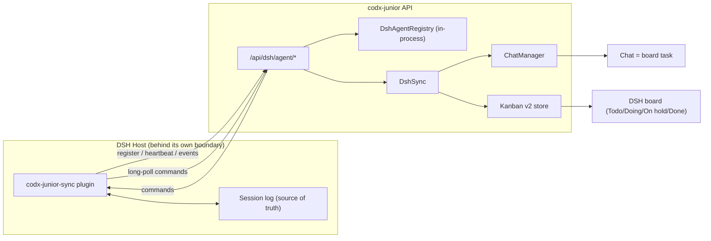

The DSH plugin always dials codx-junior; codx-junior never dials DSH. That
property is worth preserving for every adapter that can support it.

### 2.3 Current DSH protocol

**Agent endpoints** (`api/codx/junior/api/dsh_agent.py`):

| Method | Path | Purpose |
|---|---|---|
| `POST` | `/api/dsh/agent/register` | Register/refresh an instance; returns board config and intervals. |
| `POST` | `/api/dsh/agent/heartbeat` | Liveness and load; returns `reregister` when unknown. |
| `GET` | `/api/dsh/agent/commands` | Long-poll; returns 204 when idle. |
| `POST` | `/api/dsh/agent/commands/{id}/result` | Command outcome. |
| `POST` | `/api/dsh/agent/events` | Task event or snapshot. |
| `POST` | `/api/dsh/agent/unregister` | Best-effort shutdown. |

Every call uses `Authorization: Bearer <agent-token>` and `codx_path`; the
token is the Global Settings `dsh.agent_token` or
`CODX_JUNIOR_DSH_AGENT_TOKEN`, with a fallback to
`<project>/.dsh-codx-junior/token`.

**Commands** (plugin `executeCommand`): `ping`, `list_tasks`, `get_task`,
`create_task`, `prompt`, `cancel`, `rename`.

**Events** (plugin `notifySession`): `session.created`, `session.updated`,
`session.disposed`, `sync.snapshot`.

**Task summary payload** (`lib/core.js:summarizeTask`): `id`, `title`,
`parentId`, `origin`, `isSubagent`, `depth`, `cwd`, `agentPreset`, `createdAt`,
`updatedAt`, `running`, `blank`, `status` (`running`/`idle`), `webUrl`, plus
`description`/`lastMessage` when messages are read live.

**Board mapping** (`DshSync._column_for`, `_status_for`):

- idle → `Todo` / `todo`
- running → `Doing` / `doing` (only when the card is still in the first/Todo
  column)
- error → `On hold` / `onhold`
- closed → `Done` / `done`

### 2.4 Current task and board model

The important facts, from `TASKS_BOARDS_SPRINTS.md` and the code:

- **A task is a `Chat`.** There is no separate `Task` entity.
- A **kanban board** groups chats by `chat.board` + `chat.column`.
- A **sprint board** groups chats by `chat.status`; sprint membership is
  `chat.sprints`.
- `chat.status` is the workflow status (`todo`, `doing`, `onhold`, `done`,
  `rejected`); it is **not** the execution status.
- The kanban catalogue is v2: `.codx/tasks/index.json`,
  `.codx/tasks/boards/<id>/board.json`, and chat files under
  `<board-folder>/<column-folder>/`.
- Columns already carry defaults for new tasks: `project_id` and `profiles`
  (`KanbanStore.column_defaults`, `api/codx/junior/kanban/store.py:430`).
  `TaskManager.create_task` applies them (`task_manager.py:250`).
- The board UI creates tasks through `createNewChat` / `saveChat`
  (`client/src/store/chats.js:1018`, `client/src/store/kanban.js:995`), **not**
  through `TaskManager.create_task`. `POST /api/chats/tasks` and the LLM tools
  go through `TaskManager`.
- `ChatManager.save_chat` persists a whole JSON document per chat and emits a
  chat event; `update_chat_metadata` can update any field that exists on `Chat`.

### 2.5 Current mirror fields

`api/codx/junior/db.py:506-538`:

```python
external_source: Optional[str]       # "dsh"
external_id: Optional[str]           # DSH session id
external_parent_id: Optional[str]    # DSH parent session id
external_instance_id: Optional[str]  # DSH instance id
external_status: Optional[str]       # idle/running/error/closed
external_url: Optional[str]          # deep link into DSH
external_updated_at: Optional[str]   # last external update
```

There is no generic **harness kind**, no **mode** (`managed`/`mirror`/
`attached`), no **run history**, no **session sequence**, no **context version**
and no **interaction** field. Everything DSH-specific is encoded in
`external_source == "dsh"` checks scattered across the API and Socket.IO.

### 2.6 Current UI

- The only harness surface is **Global Settings → DSH Harness**
  (`DshIntegrationPanel.vue`): token, instance list, mirror board, sync,
  “Trigger a DSH task”.
- There is **no harness badge or filter on board cards**, no harness selector in
  the new-task modal, and no per-task harness panel.
- Opening a mirrored DSH task reaches `GET /api/chats?id=...`; `api/chat.py:844`
  detects `external_source == "dsh"` and hydrates the messages in memory.
- Sending a message to the task is rejected in `sio.py:161` and
  `api/chat.py:639`; the error text names DSH explicitly.
- The task's DSH session can only be continued through the DSH panel/API, not
  by typing in the task.

### 2.7 What works well

1. **Security direction.** Outbound registration is the right default for
   remote harnesses; no inbound port on the harness is required.
2. **No conversation duplication in the current model.** The session log stays
   the single copy, which avoids divergence and storage bloat (at the cost of
   offline readability, addressed later).
3. **Stable chat id.** `_chat_id_for()` uses UUIDv5 of `dsh:<session>`, so
   replayed events do not create duplicate cards.
4. **Parent/child mirroring.** `external_parent_id` and `Chat.parent_id` already
   model subagent sessions as subtasks.
5. **Idempotent upsert.** `DshSync.upsert_task` is create-or-update and uses
   `chat_only=True` for metadata updates.
6. **Clear extension points.** `DshAgentClient` mirrors the shape of
   `DshClient`, and `DshSync.create_task` already separates “create in harness”
   from “mirror locally”.
7. **Tests exist** for the hard parts: registry round-trip, command queue,
   webhook signatures, hydration without persistence, create-task endpoint.

### 2.8 Current limitations already documented

`docs/features/dsh-sync.md` lists:

- the mirror task is read-only in the codx chat UI;
- blank sessions are not mirrored until the first prompt;
- the agent registry is in-process, so a codx restart loses live instance
  state;
- long-poll uses one API thread per instance;
- archiving/deleting the codx card does not delete the DSH session.

All of these are real and remain relevant after generalization. The next
section adds the ones that are not yet documented.

---

## 3. Gap analysis

Severity: **S1** blocks the target model; **S2** causes operational or UX pain;
**S3** quality/scale debt.

| # | Gap | Evidence | Impact | Severity |
|---|---|---|---|---|
| G1 | No generic harness association on `Chat`. | `external_*` fields are DSH-shaped (`db.py:506`). | Every new harness needs new fields and new `if source == ...` branches. | S1 |
| G2 | Task creation is not harness-aware. | `TaskManager.create_task` has no harness parameters (`task_manager.py:250`); board UI bypasses `TaskManager` (`kanban.js:995`). | A task cannot be “created and run with DSH/Claude/Codex” from the board. | S1 |
| G3 | Mirror is harness-first; managed is missing. | `DshSync.create_task` creates the DSH session first, then mirrors it (`dsh.py:741`). | No local task exists until the harness succeeds; no queued/offline UX. | S1 |
| G4 | Board is hard-coded. | `DshSync.ensure_board` creates `DSH` with fixed `Todo/Doing/On hold/Done` (`dsh.py:484`). | Users cannot keep harness tasks on their real boards; columns/status mapping is fixed. | S1 |
| G5 | Status and execution state are conflated. | `upsert_task` moves `column` on running/error/closed (`dsh.py:615`). | Cards move unexpectedly; user workflow status is overwritten by engine state. | S1 |
| G6 | Registry is process-local. | `DshAgentRegistry` `_instances` / `_queues` in memory (`dsh_agent.py:220`). | codx restart loses instances and pending commands; no multi-process dispatch. | S1 |
| G7 | Command queue is not durable or idempotent. | `queue.Queue` + `threading.Event` (`dsh_agent.py:353`); `create_task` can create duplicates on retry. | Lost work on restart; duplicate DSH sessions on retry. | S1 |
| G8 | Transcript is ephemeral. | `hydrate_chat` reads `get_task` on every open (`dsh.py:816`); 30s cache (`dsh_agent.py:41`). | Headless/offline tasks have no readable history; audit impossible. | S1 |
| G9 | No approvals or user questions. | Plugin forwards only user/assistant/title/turn/error (`index.js` IMPORTANT_EVENTS); command list has no answer. | Unattended runs cannot approve tool use; interactive DSH tasks block or fail. | S1 |
| G10 | No tool calls or lifecycle events. | Plugin only counts tool call names in `meta_data` (`core.js:104`); no `tool/call`/`tool/result` events. | Headless debugging/audit cannot see what the agent did. | S2 |
| G11 | No usage/cost/artifacts. | No event/command for tokens, cost, diffs, files, logs. | Budget and review workflows cannot include harness tasks. | S2 |
| G12 | Hydration and read-only checks are DSH-only. | `api/chat.py:844`, `:639`, `:700`; `sio.py:161`. | New harnesses silently get local-chat behavior or malformed errors. | S1 |
| G13 | Token is project-wide, not instance-scoped. | `DshConfig.agent_token` from one global `DshSettings` (`model.py:214`); `_verify_agent` only compares the token (`api/dsh_agent.py:64`). | Any instance with the token can address any project path; no per-instance revoke. | S1 |
| G14 | Event/command endpoints do not verify instance ownership. | `dsh_agent_events` resolves a `DshSync` but never checks `instance.project_id` (`api/dsh_agent.py:228`); `enqueue` checks only instance id (`dsh_agent.py:353`). | Cross-project event injection / command routing if a token leaks. | S1 |
| G15 | Long-poll costs one thread per instance. | Sync `def` endpoint + `take_commands` blocking `queue.get` (`dsh_agent.py:392`). | Fleet of 100 harnesses exhausts the thread pool; 30s middleware timeout. | S2 |
| G16 | No version negotiation. | Plugin sends `version: "1"` in register/heartbeat but server ignores protocol compatibility. | Protocol changes break old plugins silently. | S2 |
| G17 | Plugin requires `webServer`. | `export const inject = ["webServer"]` (`index.js`); uses `sessionController`/`query`. | Cannot run the current plugin in a DSH profile without the Host web carrier; “headless DSH” is unproven. | S1 |
| G18 | No context bundle. | `create_task` sends only title/prompt/cwd/preset (`dsh.py:760`). | Headless harness must reconstruct project/task context; not all info is accessible. | S1 |
| G19 | No deletion/archive semantics. | `session.disposed` maps to closed (`dsh.py:696`); deleting a card does not notify the harness. | Orphan harness sessions; accidental data loss if deletion is treated as termination. | S2 |
| G20 | UI has no harness concept. | Only `DshIntegrationPanel.vue`; no badge/filter/selector/panel. | Users cannot see which engine runs a task or manage it from the board. | S1 |
| G21 | No capability model. | `capabilities: ["sessions","subagents","commands","live-context"]` is a fixed list (`index.js` register). | Dispatcher cannot know whether a harness supports approvals, artifacts, resume, etc. | S2 |
| G22 | No workspace isolation. | All tasks share the project cwd; `cwd` is passed but no worktree/lease. | Concurrent implementation tasks can clobber each other. | S2 |
| G23 | Tests are DSH-specific. | `test_dsh_agent.py`, `test_dsh_integration.py`. | No contract test prevents adapter drift. | S2 |

### 3.1 Why not just copy the DSH adapter for each harness?

Because every copy would duplicate:

- board creation and status/column mapping;
- token and instance registry;
- command queue, retries, timeouts and idempotency;
- transcript hydration and read-only rules;
- the UI badge/filter/panel;
- the “all information accessible” contract.

With three harnesses and three copies, a change to task status semantics or
security becomes a 3× change with 3× drift. The protocol + adapter seam is the
only version that stays maintainable.

---

## 4. Target model

### 4.1 Principles

1. **Task first.** A board card is a codx-junior `Chat`. The harness association
   is a property of that task, not a separate task tree.
2. **Harness owns execution; codx owns intent and presentation.** The harness
   decides how to run; codx decides what the task is, where it lives on the
   board, who may see it and what happens on completion.
3. **Durable projection.** codx-junior keeps an append-only event/transcript
   journal even though the harness session remains the resumable source of
   truth. This is required for headless, offline, audit and post-mortem.
4. **One protocol, many adapters.** Transport (HTTP long-poll, WebSocket, CLI
   process) is orthogonal to kind (DSH, Claude Code, Codex).
5. **Headless by default.** The harness must be able to run with no UI; the
   codx-junior task panel is the UI. Deep links are a convenience, not a
   requirement.
6. **Fail closed.** Approvals, token/project checks and permission policy fail
   closed, never open.
7. **At-least-once delivery with idempotent effects.** Every command and event
   has an idempotency key; every handler is safe to replay.
8. **Backward compatible.** Existing `/api/dsh/*` endpoints, fields and plugin
   rows keep working through aliases and migration.

### 4.2 Vocabulary

| Term | Meaning |
|---|---|
| **Task** | A `Chat` on a board. The unit users see and manage. |
| **Harness** | An execution engine (`dsh`, `claude-code`, `codex`, generic `cli`). |
| **Instance** | One running harness host/process registered with a project (e.g. one DSH Host). |
| **Session / thread / run id** | The harness-side identity of the conversation or run (`harness_task_id`). |
| **Harness association** | The active link on a task: kind, instance, session id, mode, status. |
| **Managed task** | codx-created task dispatched to a harness; codx owns intent. |
| **Mirror task** | Harness-discovered session projected as a codx task; harness owns the conversation. |
| **Attached task** | Existing codx task linked to an existing harness session. |
| **Run** | One dispatch attempt of a task to an instance; a task can have several runs over time. |
| **Interaction** | A pending approval or user question that needs a human decision. |
| **Journal** | codx-junior's append-only per-task event/transcript store. |
| **Context bundle** | The versioned, signed task/environment/instructions payload a harness needs to start or resume. |
| **Capability** | A feature an instance supports (`approvals`, `questions`, `artifacts`, `usage`, `resume`, `subagents`, `worktrees`, …). |

### 4.3 Component architecture

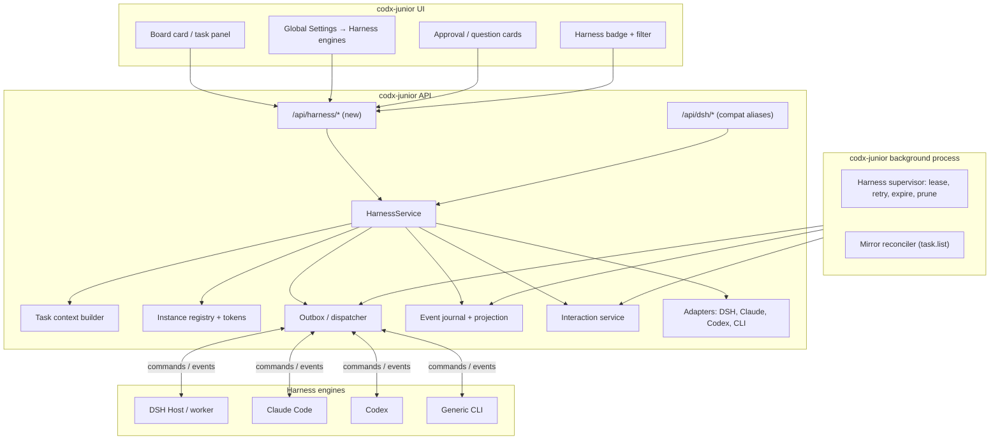

### 4.4 The four planes

| Plane | Direction | Contents | Source of truth |
|---|---|---|---|
| **Control** | codx → harness | register response, commands, context updates, cancellation, interaction answers | codx-junior |
| **Execution** | harness → codx | task created/updated, turn status, messages, tool calls, approvals, questions, usage, artifacts, completion | harness |
| **Transcript** | harness → codx → UI | durable journal, projected messages/tool events, search/export | codx-junior projection; harness remains resumable origin |
| **Presentation** | codx → user | board cards, task panel, filters, notifications, approvals | codx-junior |

### 4.5 Ownership modes

| Mode | Task origin | Who owns title? | Who owns description/prompt? | Who owns board/column? | Who owns transcript? | Typical use |
|---|---|---|---|---|---|---|
| `managed` | codx | codx (harness title is a suggestion) | codx (updates become `task.update`) | codx | harness + codx journal | “Create a task and run it with DSH.” |
| `mirror` | harness | harness (title event) | harness | codx | harness + codx journal | “A DSH session appeared; put it on the board.” |
| `attached` | either | configurable per field | codx | codx | harness + codx journal | “Link this existing task to that session.” |

Rules that apply to all modes:

- `Chat.status` is the **workflow** status; `Chat.harness_status` is the
  **execution** status. They are displayed separately.
- Board placement is **always** codx-owned. A harness status event may update
  `Chat.status` and `Chat.column` only when the task/board policy says so.
- Deleting a codx card **detaches** it; it never silently terminates a harness
  session. Termination is an explicit action.
- A task has at most one **active** harness association; previous runs are kept
  in `harness_runs`.

### 4.6 Board integration policy

Three policies, configured per project, with per-board/per-harness overrides:

| Policy | Behavior | When to use |
|---|---|---|
| `native` (default) | New tasks stay on the board/column where they were created; the card carries a harness badge. Harness-originated sessions go to the configured **inbox** board/column (default `Harness` / `Todo`) unless they match an existing task. | Teams want one board per product area, not one board per engine. |
| `inbox` | Managed tasks stay native; mirror/attached sessions land on an inbox board. This is the default for mirror mode. | Discover DSH sessions without polluting the product board. |
| `dedicated` | All tasks of a harness go to a harness-specific board (today's `DSH` board behavior). | Engine-centric teams, or a clean “what is DSH doing?” view. |

Column defaults are the second half of board integration. They already carry
`project_id` and `profiles`; add:

```json
{
  "title": "Claude implementation",
  "harness": "claude-code",
  "harness_instance_id": "",
  "harness_options": {
    "model": "sonnet",
    "permission_mode": "workspace-write",
    "approval_policy": "ask",
    "auto_run": true
  }
}
```

A task created in that column inherits the harness association and can start
immediately. This is the cleanest answer to “connect harnesses to boards and
tasks”: the board already has a defaults mechanism; extend it rather than
inventing a parallel assignment UI.

### 4.7 Status mapping

Canonical `harness_status` values:

`unassigned | queued | dispatching | running | waiting_input | paused | blocked | completed | failed | cancelled | stale | detached`

Default mapping to `Chat.status`:

| `harness_status` | `Chat.status` | Board column (if auto-advance) |
|---|---|---|
| `unassigned`, `queued`, `dispatching` | unchanged (`todo` for new) | no move |
| `running` | `doing` | `Doing` (only `on_start` policy) |
| `waiting_input` | `onhold` | `On hold` |
| `paused`, `blocked`, `stale` | `onhold` | `On hold` |
| `completed` | `done` | `Done` |
| `failed` | `onhold` | `On hold` |
| `cancelled` | `rejected` (or unchanged) | `Done`/`On hold` by policy |
| `detached` | unchanged | no move |

`auto_advance` policy: `none | on_start | on_complete | full`.

- `dedicated` boards: `full` is reasonable.
- `native` boards: `on_complete` is the recommended default; it avoids moving
  a card while a user is reading it, and preserves manual ordering.
- The current DSH behavior (`on_start` for Todo cards) remains available per
  project for compatibility.

Column resolution must use the board's real columns by title/status; never
create columns implicitly. If the mapped column does not exist, leave the card
where it is and record `harness_metadata.placement_warning`.

### 4.8 State machines

**Task / harness association**

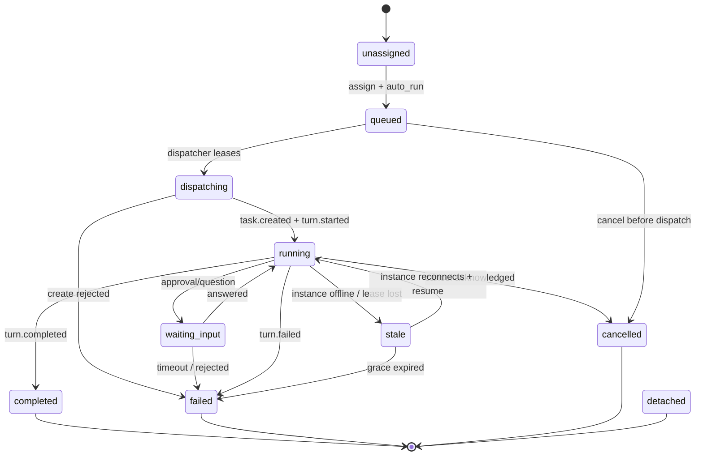

**Command**

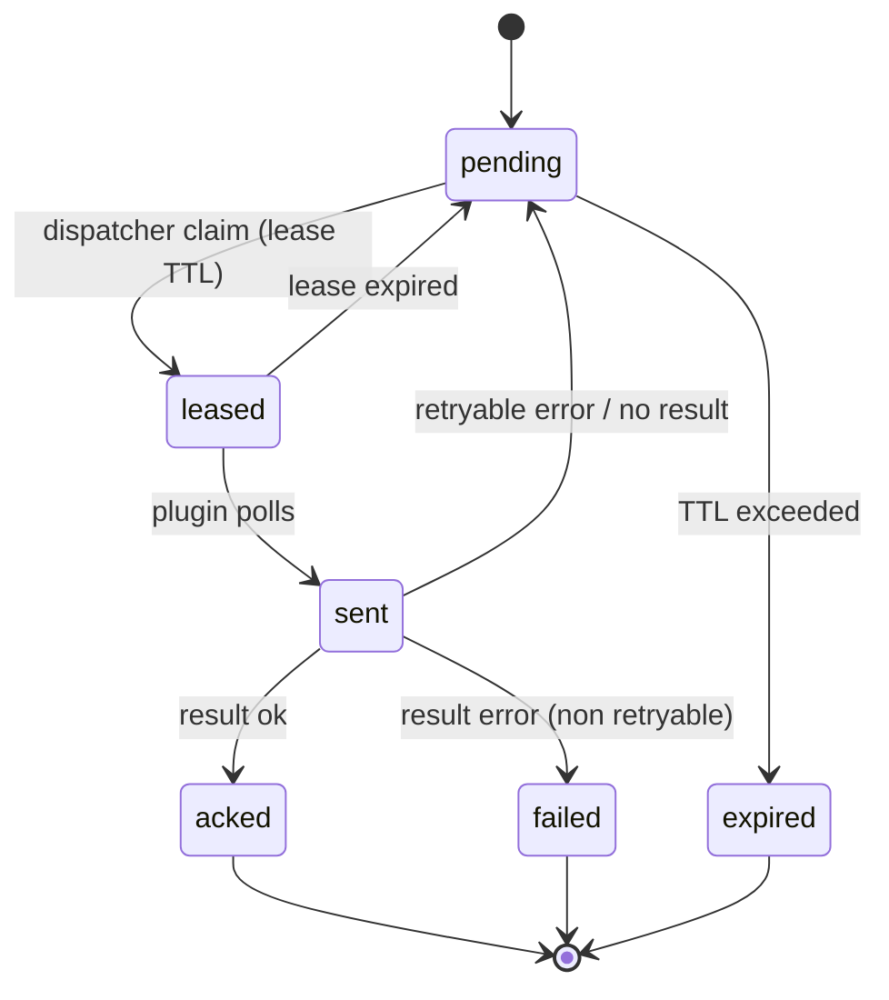

**Instance**

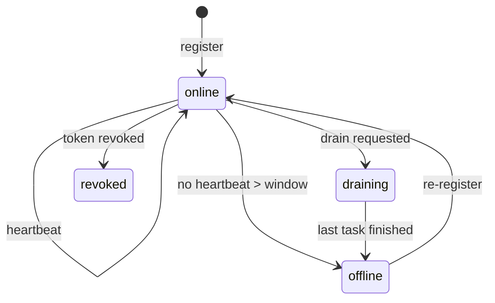

### 4.9 Sequence: managed task creation

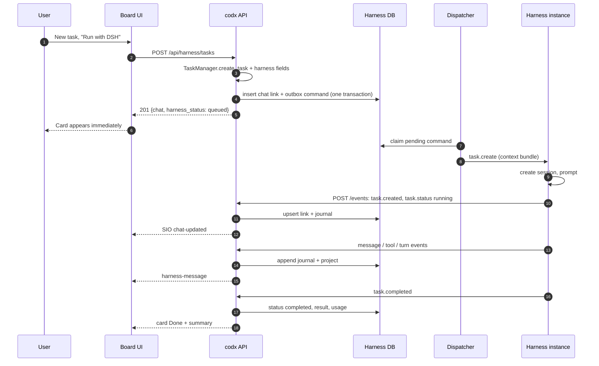

### 4.10 Sequence: mirror discovery

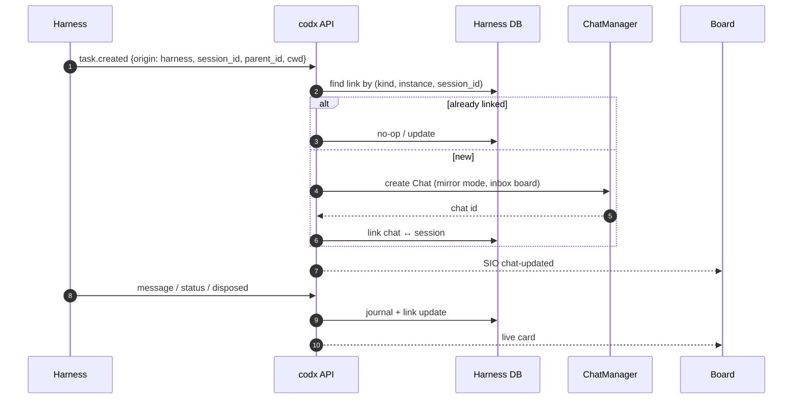

### 4.11 Sequence: prompt and turn

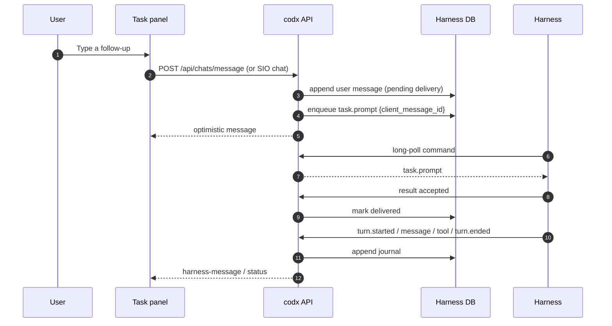

### 4.12 Sequence: approval / question

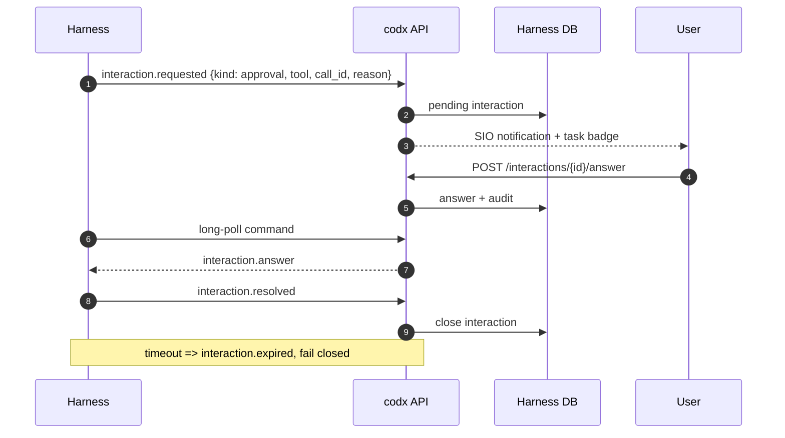

### 4.13 Sequence: reconnect and replay

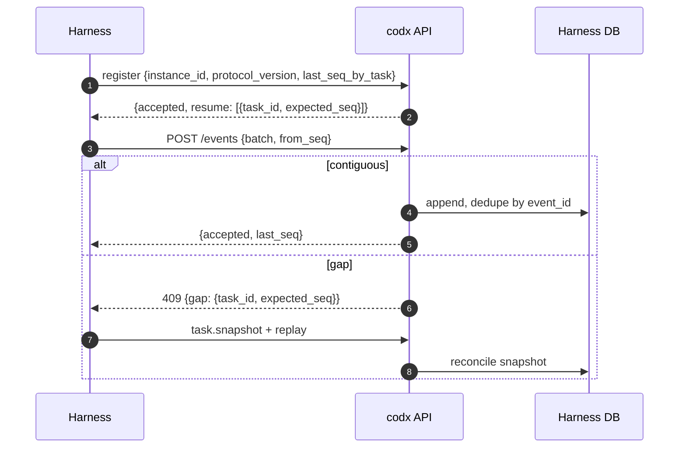

### 4.14 Multi-harness routing

`HarnessRouter.select(task, options)`:

1. explicit `harness_instance_id` on the task or request;
2. task affinity (the instance that last ran this task, if online);
3. project/board/column default instance;
4. filter by `kind`, `project_id`, `status == online`, required
   `capabilities`, model/preset support, `max_concurrent_tasks` and
   `workspace_roots`;
5. choose the least-loaded eligible instance (running / capacity), with stable
   tie-break by `last_seen`;
6. if none, create a `queued` run with `reason=no_instance` and surface an
   actionable UI message. Do not silently fall back to the local chat engine
   when the user explicitly selected a harness.

Capabilities are advertised at register and refreshed on heartbeat. A task that
requires `approvals` must not be dispatched to an instance with
`approvals: false`.

### 4.15 Workspace isolation

Implementation tasks must not share a mutable working tree. Use one of:

- **codx-created worktree** (recommended): create a git worktree per task under
  the configured worktrees path, pass `cwd` and `branch`; remove on success
  after the result is captured, retain on failure for debugging;
- **harness-created worktree**: pass `worktree_mode=harness` (DSH/Claude can
  create one); codx records the returned path;
- **read-only / no-workspace** tasks: for analysis/review, pass
  `permission_mode=read-only` and no write scope.

Add `concurrency_scope` (`worktree`, `project`, `none`) so the dispatcher can
serialize tasks that must not run concurrently.

---

## 5. Data model

### 5.1 `Chat` (task) additions

Add flat fields so existing JSON serialization, metadata updates, filters and
board code keep working. Keep them optional and defaulted; old chats are
untouched.

| Field | Type | Default | Semantics |
|---|---|---|---|
| `harness` | `Optional[str]` | `None` | Adapter kind: `dsh`, `claude-code`, `codex`, `cli`. |
| `harness_instance_id` | `Optional[str]` | `None` | Instance that currently owns the run. |
| `harness_task_id` | `Optional[str]` | `None` | Harness session/thread/run id. |
| `harness_parent_task_id` | `Optional[str]` | `None` | Parent id in the harness namespace. |
| `harness_mode` | `Optional[str]` | `None` | `managed`, `mirror`, `attached`. |
| `harness_origin` | `Optional[str]` | `None` | `codx` or `harness`. |
| `harness_status` | `Optional[str]` | `None` | Execution state (section 4.7). |
| `harness_status_reason` | `Optional[str]` | `None` | Last transition reason/code. |
| `harness_error` | `Optional[str]` | `None` | Last terminal/runtime error (human-readable). |
| `harness_url` | `Optional[str]` | `None` | Optional deep link into the harness UI. |
| `harness_updated_at` | `Optional[str]` | `None` | Last external update (ISO). |
| `harness_last_seq` | `Optional[int]` | `None` | Last journal sequence applied for the active link. |
| `harness_context_version` | `Optional[str]` | `None` | Hash/version of the context bundle sent. |
| `harness_model` | `Optional[str]` | `None` | Harness model, if selected. |
| `harness_preset` | `Optional[str]` | `None` | Harness agent/preset/profile name. |
| `harness_permission_mode` | `Optional[str]` | `None` | Canonical permission mode. |
| `harness_approval_policy` | `Optional[str]` | `None` | `ask`, `never`, `auto-review`, `allowlist`. |
| `harness_metadata` | `Dict[str, Any]` | `{}` | Free-form: title overrides, usage, capabilities snapshot, placement warnings. |
| `harness_run_id` | `Optional[str]` | `None` | Active `harness_runs.id` (history is in DB). |
| `harness_cost` | `Optional[float]` | `None` | Reported cost in the harness currency (do not silently mix with `Chat.cost`). |
| `harness_usage` | `Dict[str, Any]` | `{}` | Tokens/cache/currency snapshot from the last usage event. |

**Do not overload existing fields.** In particular:

- `Chat.status` remains workflow status; `Chat.harness_status` is execution.
- `Chat.llm_model` remains the local engine model; `harness_model` is the
  harness model.
- `Chat.cost` remains codx cxjcoins; `harness_cost` is harness-native. A
  future conversion policy may roll harness cost into analytics, but that is
  explicit and auditable, not implicit.

**Legacy aliases.** During migration, read/write both:

```
external_source       <-> harness
external_id           <-> harness_task_id
external_parent_id    <-> harness_parent_task_id
external_instance_id  <-> harness_instance_id
external_status       <-> harness_status
external_url          <-> harness_url
external_updated_at   <-> harness_updated_at
```

`external_*` remains populated for one release for old clients/tests, then is
deprecated. A `harness_migrated_at` marker in `.codx/harness/migration.json`
prevents re-running the backfill.

### 5.2 `HarnessInstance`

```python
@dataclass
class HarnessInstance:
    id: str
    project_id: str
    codx_path: str
    kind: str                      # dsh / claude-code / codex / cli
    name: str
    transport: str                 # agent_http / agent_ws / cli_process
    lifecycle: str                 # persistent / per_turn / per_task
    status: str                    # online / offline / draining / revoked
    version: str
    protocol_version: int
    capabilities: list[str]
    cwd: str | None
    workspace_roots: list[str]
    max_concurrent_tasks: int
    running: int
    queued: int
    last_seen: float
    registered_at: float
    meta: dict
```

Persist in `harness_instances`. `online` is computed from `last_seen`; do not
rely on a stored boolean except for `draining`/`revoked`.

### 5.3 `HarnessRun`

One row per dispatch attempt. This is the history the task needs when a run is
retried on another instance.

| Column | Type | Notes |
|---|---|---|
| `id` | TEXT PK | UUID. |
| `chat_id` | TEXT | FK-ish to `Chat.id`. |
| `project_id` | TEXT | |
| `kind` | TEXT | |
| `instance_id` | TEXT | |
| `harness_task_id` | TEXT NULL | Set when created. |
| `mode` | TEXT | managed/mirror/attached. |
| `status` | TEXT | queued/…/completed. |
| `reason` | TEXT NULL | Last transition reason. |
| `context_hash` | TEXT | Context bundle hash. |
| `command_id` | TEXT NULL | Create command. |
| `started_at` | TEXT | |
| `ended_at` | TEXT NULL | |
| `result` | JSON NULL | Structured completion. |
| `error` | TEXT NULL | |
| `usage` | JSON NULL | Tokens/cost. |

The active run id is mirrored on `Chat.harness_run_id`.

### 5.4 `HarnessCommand`

| Column | Type | Notes |
|---|---|---|
| `id` | TEXT PK | Server-generated UUID. |
| `instance_id` | TEXT | |
| `project_id` | TEXT | |
| `type` | TEXT | `task.create`, `task.prompt`, … |
| `payload` | JSON | |
| `idempotency_key` | TEXT UNIQUE | Server or client supplied. |
| `state` | TEXT | pending/leased/sent/acked/failed/expired. |
| `attempts` | INTEGER | |
| `available_at` | REAL | Backoff. |
| `lease_expires_at` | REAL NULL | |
| `created_at` | REAL | |
| `completed_at` | REAL NULL | |
| `result` | JSON NULL | |
| `error` | JSON NULL | |
| `last_error` | TEXT NULL | |

Claim with a single transaction:

```sql
UPDATE harness_commands
SET state = 'leased', lease_expires_at = :now + :ttl, attempts = attempts + 1
WHERE id = (
  SELECT id FROM harness_commands
  WHERE state IN ('pending','leased')
    AND available_at <= :now
    AND (state = 'pending' OR lease_expires_at < :now)
  ORDER BY available_at, created_at
  LIMIT 1
)
RETURNING *;
```

(Use `BEGIN IMMEDIATE`; SQLite WAL supports one writer at a time.)

### 5.5 `HarnessEvent` / journal

| Column | Type | Notes |
|---|---|---|
| `id` | TEXT PK | `event_id`; deterministic when possible. |
| `chat_id` | TEXT | |
| `instance_id` | TEXT | |
| `harness_task_id` | TEXT | |
| `seq` | INTEGER | Per task; unique with `chat_id`. |
| `type` | TEXT | `task.created`, `message`, `tool.call`, … |
| `visibility` | TEXT | `message`, `tool`, `status`, `interaction`, `artifact`, `usage`, `log`. |
| `occurred_at` | TEXT | |
| `payload` | JSON | Raw normalized event. |
| `created_at` | REAL | |

Indexes: `UNIQUE(chat_id, seq)`, `(chat_id, occurred_at)`, `(type)`,
`(instance_id, occurred_at)`. Dedupe by `UNIQUE(id)`.

**Why store content in the journal?** Because “all the info accessible in
codx-junior” and “headless” both require that an operator can read what
happened when the harness is stopped, the network is down or the harness UI is
not served. The harness session remains the canonical resumable log; the
journal is a codx-owned, append-only projection with its own retention policy.

**Retention.** `harness.journal_retention_days` (default 90) and
`harness.journal_max_events_per_task` (default 100k). Completed tasks can be
“pinned” beyond retention. Tool output larger than `max_inline_bytes` is stored
as an artifact reference, not inline.

### 5.6 `HarnessInteraction`

| Column | Type | Notes |
|---|---|---|
| `id` | TEXT PK | |
| `chat_id` | TEXT | |
| `instance_id` | TEXT | |
| `harness_task_id` | TEXT | |
| `kind` | TEXT | `approval` / `question`. |
| `status` | TEXT | pending/answered/expired/cancelled. |
| `tool_name` | TEXT NULL | |
| `call_id` | TEXT NULL | |
| `reason` | TEXT NULL | |
| `payload` | JSON | questions/options/risk. |
| `answer` | JSON NULL | |
| `answered_by` | TEXT NULL | codx user. |
| `created_at` | TEXT | |
| `expires_at` | TEXT | |
| `resolved_at` | TEXT NULL | |

### 5.7 `HarnessArtifact`

| Column | Type | Notes |
|---|---|---|
| `id` | TEXT PK | |
| `chat_id` | TEXT | |
| `kind` | TEXT | file/diff/log/screenshot/url. |
| `path` | TEXT NULL | Shared-FS path. |
| `url` | TEXT NULL | Remote URL. |
| `mime` | TEXT | |
| `size` | INTEGER | |
| `sha256` | TEXT | |
| `metadata` | JSON | |
| `created_at` | TEXT | |

Large artifacts are uploaded to `POST /api/harness/tasks/{id}/artifacts` or
stored in the project's artifact folder; the DB stores metadata only.

### 5.8 Settings

**Global** (`GlobalSettings.harness`; `dsh` remains as a legacy alias):

```python
class HarnessSettings(BaseModel):
    enabled: bool = True
    default_kind: str = ""
    token_ttl_days: int = 0
    journal_retention_days: int = 90
    journal_max_events_per_task: int = 100_000
    max_event_bytes: int = 1_048_576
    max_batch_events: int = 500
    heartbeat_offline_seconds: int = 35
    command_ttl_seconds: int = 120
    interaction_timeout_seconds: int = 900
    allow_remote_instances: bool = True
    kinds: dict[str, dict] = {}     # per-kind defaults/overrides
```

**Project** (`CODXJuniorSettings.harness`):

```python
class ProjectHarnessSettings(BaseModel):
    enabled: bool = True
    default_kind: str = ""
    default_instance_id: str = ""
    board_policy: str = "native"          # native / inbox / dedicated
    inbox_board: str = "Harness"
    inbox_column: str = "Todo"
    dedicated_board: str = "DSH"
    auto_advance: str = "on_complete"     # none / on_start / on_complete / full
    column_map: dict[str, str] = {
        "waiting_input": "On hold",
        "completed": "Done",
        "failed": "On hold",
        "cancelled": "Done",
    }
    only_project: bool = True
    mirror_subagents: bool = True
    context: dict = {
        "include_knowledge": True,
        "max_knowledge_docs": 5,
        "include_files": True,
        "inline_limit_bytes": 65_536,
    }
    permissions: dict = {
        "permission_mode": "workspace-write",
        "approval_policy": "ask",
        "auto_approve_tools": [],
    }
```

**Column defaults** (`KanbanStore.column_defaults`) gain `harness`,
`harness_instance_id`, `harness_options` (model/preset/permission/approval/
auto_run). `_normalize_columns` must preserve them across partial writes, like
`project_id`/`profiles`.

### 5.9 Storage layout

```
.codx/
  harness/
    harness.db                 # control + journal (SQLite, WAL)
    harness.db-wal
    artifacts/<chat_id>/...    # optional uploaded artifacts
    migration.json             # one-time migration markers
    exports/<chat_id>.jsonl    # optional debug export
```

SQLite pragmas: `journal_mode=WAL`, `synchronous=NORMAL`,
`busy_timeout=5000`, `foreign_keys=ON`. Use a small schema-version table and
run migrations at startup. The same DB is opened by the API and the background
process; WAL gives concurrent readers and one writer.

If the team prefers file-only storage, the equivalent is
`.codx/harness/instances.json` + per-task `.jsonl` journals under a project
lock. SQLite is recommended because command leasing, dedupe and pagination are
much harder to get right with ad-hoc JSON files.

### 5.10 Migration from `external_*`

1. Add new fields with `None` defaults; no chat rewrite needed for reading.
2. On first harness request for a project, run `migrate_harness_v1`:
   - for every `Chat` with `external_source` and no `harness`:
     - `harness = external_source`
     - `harness_task_id = external_id`
     - `harness_parent_task_id = external_parent_id`
     - `harness_instance_id = external_instance_id`
     - `harness_status = map_legacy_status(external_status)`
     - `harness_url = external_url`
     - `harness_updated_at = external_updated_at`
     - `harness_mode = "mirror"`
     - `harness_origin = "harness"`
   - leave `external_*` populated; mark `legacy_fields = true` in
     `harness_metadata`.
3. On write, keep both copies in sync for one release.
4. On read, prefer `harness*`, fall back to `external_*`.
5. After one release, stop writing `external_*`; after two, remove.

No data migration is needed for the board itself: existing DSH chats keep
their `board`/`column`.

---

## 6. Protocol specification

### 6.1 Versioning and transport

- Protocol version is an integer. Current plugin is effectively `1`; this
  document defines **`2`** (generic) while accepting `1` through aliases.
- `Content-Type: application/json`; UTF-8; batched events may be gzip-encoded.
- Transports:
  - `agent_http` (v1): register, heartbeat, long-poll commands, POST events.
  - `agent_ws` (optional later): one WebSocket per instance; frames carry the
    same command/event envelopes. Fall back to HTTP if the socket drops.
  - `cli_process` (supervisor): codx spawns the harness and translates
    stdout/stderr/exit into the same events; commands are process signals or
    stdin lines.
- A server may advertise `transports` in the register response. The plugin
  chooses the first mutually supported transport.

### 6.2 Authentication

Headers for every request:

```http
Authorization: Bearer <agent-token>
Content-Type: application/json
X-Codx-Path: /abs/path/to/project        # compatibility; project is also token-bound
X-Harness-Kind: dsh
X-Harness-Instance: <instance-id>
X-Harness-Protocol: 2
X-Idempotency-Key: <optional>
```

The server derives the project from the **token**, not only from `codx_path`.
`codx_path` is validated against the token's project; a mismatch is `403`.

Tokens:

| Token | Scope | Use |
|---|---|---|
| bootstrap project token | `instance:register`, project | First registration; dashboard-generated. |
| instance token | `instance:*`, `task:*` for its project | Returned once on register; stored hashed. |
| task context token | `task:context`, `task:transcript`, `task:artifacts` for one task | Short-lived (default 15 min); lets a remote harness fetch context without a long-lived project credential. |

For compatibility, the current shared `dsh.agent_token` is accepted as a
bootstrap token and can still authorize an instance. The dashboard should
migrate it to per-instance tokens on first re-register.

### 6.3 Registration

`POST /api/harness/instances/register`

```json
{
  "protocol_version": 2,
  "instance_id": "dsh-host-1",
  "kind": "dsh",
  "name": "dsh-prod-1",
  "project_id": "project-uuid",
  "codx_path": "/srv/projects/api/.codx",
  "cwd": "/srv/projects/api",
  "transport": "agent_http",
  "lifecycle": "persistent",
  "version": "0.2.2-rc.1",
  "capabilities": [
    "sessions", "streaming", "subagents", "commands", "live-context",
    "approvals", "questions", "usage", "tool-events", "artifacts", "resume"
  ],
  "limits": {
    "max_concurrent_tasks": 4,
    "max_prompt_bytes": 262144,
    "max_event_bytes": 1048576
  },
  "meta": {
    "pid": 1234,
    "platform": "linux",
    "node": "v22",
    "workspace_roots": ["/srv/projects/api"]
  }
}
```

Response `200`:

```json
{
  "ok": true,
  "protocol_version": 2,
  "instance": {
    "id": "dsh-host-1",
    "name": "dsh-prod-1",
    "status": "online",
    "project_id": "project-uuid"
  },
  "instance_token": "hx_...",          // only when a bootstrap token was used
  "conf": {
    "heartbeat_ms": 5000,
    "poll_wait_ms": 25000,
    "command_ttl_s": 120,
    "board_policy": "native",
    "default_instance_id": "dsh-host-1"
  }
}
```

Errors: `400` malformed, `401` bad token, `403` project mismatch, `409`
instance bound to another project, `426` unsupported protocol.

### 6.4 Heartbeat

`POST /api/harness/instances/{id}/heartbeat`

```json
{
  "protocol_version": 2,
  "status": "online",
  "running": 2,
  "queued": 1,
  "sessions": 7,
  "capacity": 4,
  "uptime_seconds": 3600,
  "version": "0.2.2-rc.1",
  "capabilities": ["approvals", "questions", "artifacts"],
  "metrics": {"cpu": 0.4, "memory_mb": 512}
}
```

Response: `{ "ok": true, "instance": {...}, "conf": {...} }` or
`{ "ok": false, "reregister": true }` when the instance is unknown/revoked.
Heartbeat interval is server-configured; an instance is offline after
`heartbeat_offline_seconds`.

### 6.5 Commands

`GET /api/harness/instances/{id}/commands?wait=25&limit=20`

Returns `204` after the wait if no command is available, or:

```json
{
  "ok": true,
  "commands": [
    {
      "id": "cmd-uuid",
      "type": "task.create",
      "created_at": "2026-11-09T09:00:00Z",
      "idempotency_key": "task:chat-uuid:context-sha",
      "payload": { "...": "..." }
    }
  ],
  "server_time": 1762688400.0
}
```

Command types:

| Type | Direction | Payload highlights | Result |
|---|---|---|---|
| `ping` | server → harness | `{}` | `{ok, instance_id, capabilities, version}` |
| `task.create` | server → harness | `codx_task_id`, `context`, `context_url`, `context_hash`, `options` | `{session_id, task, accepted}` |
| `task.prompt` | server → harness | `session_id`, `text`, `client_message_id`, `mode`, `context` | `{accepted, delivered_at}` |
| `task.cancel` | server → harness | `session_id`, `reason` | `{cancelled, accepted}` |
| `task.rename` | server → harness | `session_id`, `title` | `{title, accepted}` |
| `task.get` | server → harness | `session_id`, `after_seq`, `limit`, `include` | `{task, messages, events, last_seq}` |
| `task.list` | server → harness | `cwd`, `updated_after`, `cursor`, `limit`, `include_blank` | `{tasks, next_cursor}` |
| `task.context` | server → harness | `session_id`, `context_hash` | `{context}` |
| `task.update` | server → harness | `session_id`, `patch` (title/description/options) | `{accepted}` |
| `interaction.answer` | server → harness | `interaction_id`, `kind`, `answer` | `{accepted, resolved}` |
| `interaction.cancel` | server → harness | `interaction_id`, `reason` | `{accepted}` |

Result:

`POST /api/harness/instances/{id}/commands/{command_id}/result`

```json
{
  "protocol_version": 2,
  "ok": true,
  "result": {"session_id": "sess-1", "accepted": true},
  "error": null
}
```

Error object:

```json
{
  "ok": false,
  "error": {
    "code": "CAPABILITY_UNSUPPORTED",
    "message": "instance does not support approvals",
    "retryable": false,
    "details": {"capability": "approvals"}
  }
}
```

Error codes: `BAD_REQUEST`, `UNAUTHORIZED`, `FORBIDDEN`, `INSTANCE_OFFLINE`,
`TASK_NOT_FOUND`, `CAPABILITY_UNSUPPORTED`, `CONFLICT`, `TIMEOUT`,
`RATE_LIMITED`, `VERSION_UNSUPPORTED`, `INTERNAL`.

The result endpoint is idempotent: replaying the same result returns
`{ok: true, accepted: false, already_completed: true}` and does not change state.

### 6.6 Events

`POST /api/harness/instances/{id}/events`

```json
{
  "protocol_version": 2,
  "batch_id": "batch-uuid",
  "events": [
    {
      "event_id": "dsh:sess-1:41",
      "seq": 41,
      "type": "task.updated",
      "occurred_at": "2026-11-09T09:00:01Z",
      "task_id": "sess-1",
      "payload": { "title": "Fix login", "status": "running" }
    }
  ]
}
```

Response:

```json
{
  "ok": true,
  "accepted": 1,
  "duplicates": 0,
  "last_seq": {"sess-1": 41},
  "gap": null
}
```

If a batch contains a gap for a task, accept the contiguous prefix and return
`409` with:

```json
{"ok": false, "code": "EVENT_GAP", "gap": {"task_id": "sess-1", "expected_seq": 42}}
```

The plugin must resend from `expected_seq`. A `task.snapshot` can reconcile a
task after a gap or a long offline period.

Event types:

| Type | Visibility | Purpose |
|---|---|---|
| `task.created` | status | New harness session; includes origin, parent, cwd, title, status, capabilities. |
| `task.updated` | status | Title/status/cwd/metadata change (compact). |
| `task.snapshot` | status | Full task summary + `last_seq`; used on reconnect. |
| `task.disposed` | status | Session closed/destroyed. |
| `turn.started` | status | Turn/step began. |
| `turn.ended` | status | Turn ended with `reason` (`completed`, `aborted`, `blocked`, `error`). |
| `message` | message | User/assistant message; append-only, includes `message_id`, role, content, think, model, usage. |
| `tool.call` | tool | Tool invocation. |
| `tool.result` | tool | Tool result/error. |
| `interaction.requested` | interaction | Approval or question. |
| `interaction.resolved` | interaction | Answer/timeout/cancel. |
| `usage` | usage | Tokens/cost for a turn or task. |
| `artifact` | artifact | File/diff/log/screenshot/url. |
| `log` | log | Bounded terminal/diagnostic line. |
| `error` | status | Non-terminal or terminal error. |

**Message event example**

```json
{
  "event_id": "dsh:sess-1:42",
  "seq": 42,
  "type": "message",
  "occurred_at": "2026-11-09T09:00:02Z",
  "task_id": "sess-1",
  "payload": {
    "message_id": "dsh-sess-1-42",
    "role": "assistant",
    "content": "I found the timeout in auth.py.",
    "think": "The token refresh runs after the request.",
    "model": "deepseek-flash",
    "provider": "deepseek",
    "turn": 3,
    "step": 2,
    "usage": {"input_tokens": 1200, "output_tokens": 80}
  }
}
```

**Tool events** should be mapped to the existing `Message.tool_events`
(`ToolEvent` in `api/codx/junior/db.py:95`) so the current chat UI can render
them collapsed without a new component. Keep the raw `tool.call`/`tool.result`
in the journal for audit.

**Turn events** map to `Message.lifecycle_events` (`LifeCycleEvent`,
`db.py:126`) on the current assistant message.

**Completion**

```json
{
  "type": "task.completed",
  "task_id": "sess-1",
  "payload": {
    "status": "completed",
    "summary": "Fixed the login timeout and added a regression test.",
    "files": ["api/auth/login.py", "api/tests/test_login.py"],
    "verification": "pytest api/tests/test_login.py -q (12 passed)",
    "followups": [],
    "diff_stat": "2 files changed, 18 insertions(+), 4 deletions(-)",
    "commit": "abc1234",
    "pr_url": null,
    "usage": {"input_tokens": 5200, "output_tokens": 640, "cost_usd": 0.04},
    "duration_seconds": 312
  }
}
```

### 6.7 Interactions

`interaction.requested`:

```json
{
  "type": "interaction.requested",
  "task_id": "sess-1",
  "payload": {
    "interaction_id": "int-uuid",
    "kind": "approval",
    "tool_name": "bash",
    "call_id": "call-7",
    "reason": "Run the integration test suite",
    "options": ["allowed-once", "rejected"],
    "expires_at": "2026-11-09T09:15:00Z",
    "risk": "medium"
  }
}
```

Question variant:

```json
{
  "kind": "question",
  "payload": {
    "interaction_id": "int-uuid",
    "questions": [
      {
        "id": "q1",
        "question": "Which database should the migration target?",
        "header": "Database",
        "options": [{"label": "Postgres"}, {"label": "SQLite"}],
        "multi_select": false
      }
    ]
  }
}
```

Answer command:

```json
{
  "type": "interaction.answer",
  "payload": {
    "interaction_id": "int-uuid",
    "kind": "approval",
    "answer": {"outcome": "allowed-once"}
  }
}
```

Question answer:

```json
{"answer": {"answers": [{"id": "q1", "selected": ["Postgres"], "custom": ""}]}}
```

Timeout policy: `fail_closed` (default), `reject`, or `cancel_turn`. The
interaction remains visible as `expired` with the reason.

### 6.8 Task context endpoint

`GET /api/harness/tasks/{chat_id}/context`

Auth: agent instance token bound to the task's project, or a task context
token. Response is the **context bundle** described in section 10.3. It is
signed/hashed; the harness should treat it as read-only input.

`GET /api/harness/tasks/{chat_id}/transcript?after_seq=0&limit=200&include=tools`

Returns projected messages compatible with codx `Message`, plus raw events for
tools/lifecycle. This is the endpoint a remote/headless harness can use to
rebuild context or a UI can use to read history without the harness.

`GET /api/harness/tasks/{chat_id}/events?after_seq=0&limit=500`

Raw journal events for audit/debug.

`GET /api/harness/tasks/{chat_id}/artifacts`

Metadata list; `GET .../artifacts/{id}` downloads if stored by codx.

### 6.9 Limits and backpressure

| Limit | Default | Behavior |
|---|---|---|
| `max_event_bytes` | 1 MiB | `413`; split batch or send artifact ref. |
| `max_batch_events` | 500 | `413`/`400`. |
| `max_message_bytes` | 256 KiB inline | Truncate with `truncated: true`; full content as artifact. |
| `max_commands_per_poll` | 20 | Server limit. |
| `max_poll_wait` | 25 s | Server clamps. |
| `max_concurrent_tasks` | per instance | Dispatcher queues. |
| `max_running_seconds` | per task | Supervisor marks `stale`/`failed`; sends cancel. |
| `max_events_per_task` | 100k | Journal refuses/rolls over to summary + artifact. |

If the plugin is slow, the server returns `429` with `Retry-After`; the plugin
backs off exponentially with jitter.

### 6.10 Compatibility mapping (DSH v1 → v2)

| v1 | v2 |
|---|---|
| `session.created` | `task.created` |
| `session.updated` | `task.updated` |
| `session.disposed` | `task.disposed` |
| `sync.snapshot` | `task.snapshot` per task (or batch snapshot) |
| `create_task` | `task.create` |
| `prompt` | `task.prompt` |
| `cancel` | `task.cancel` |
| `rename` | `task.rename` |
| `get_task` | `task.get` |
| `list_tasks` | `task.list` |
| `task` object fields | same names where possible; `harness`/`mode` added |
| `x-dsh-agent-token` | `Authorization: Bearer` (both accepted) |
| `x-dsh-instance` | `X-Harness-Instance` (both accepted) |

The server must accept both shapes for at least one release. The current
plugin can be upgraded independently of the codx server; version negotiation
decides which command names are sent.

---

## 7. Backend design

### 7.1 Package layout

```
api/codx/junior/harness/
  __init__.py
  constants.py          # states, capabilities, defaults
  models.py             # Pydantic/dataclass models
  protocol.py           # envelopes, validation, version negotiation, errors
  registry.py           # instances + tokens (SQLite)
  store.py              # commands, events, interactions, runs (SQLite)
  service.py            # HarnessService facade
  router.py             # instance selection, dispatch, status mapping
  context.py            # TaskContextBuilder
  journal.py            # append, dedupe, project to Chat/messages
  interactions.py       # approval/question lifecycle
  dispatcher.py         # outbox worker, leases, retries, reconciliation
  adapters/
    __init__.py
    base.py             # HarnessAdapter protocol
    dsh.py              # DSH normalization + payloads
    cli.py              # generic CLI process transport
    claude_code.py      # Claude Code adapter (phase 3)
    codex.py            # Codex adapter (phase 3)
```

Keep the existing `integrations/dsh.py` and `dsh_agent.py` as the initial
implementation, then refactor their reusable pieces behind the adapter. Do not
delete them until the new path passes the current tests.

### 7.2 Adapter contract

```python
class HarnessAdapter(Protocol):
    kind: ClassVar[str]
    protocol_version: ClassVar[int]
    default_capabilities: ClassVar[frozenset[str]]

    def normalize_registration(self, payload: Mapping[str, Any]) -> Registration: ...
    def normalize_event(self, raw: Mapping[str, Any]) -> list[NormalizedEvent]: ...
    def build_create_payload(
        self, context: TaskContext, options: DispatchOptions
    ) -> dict[str, Any]: ...
    def build_prompt_payload(
        self, task: Chat, message: Message, options: DispatchOptions
    ) -> dict[str, Any]: ...
    def build_cancel_payload(self, task: Chat, reason: str) -> dict[str, Any]: ...
    def build_answer_payload(
        self, interaction: HarnessInteraction, answer: Mapping[str, Any]
    ) -> dict[str, Any]: ...
    def status_from_event(self, event: NormalizedEvent) -> str | None: ...
    def title_from_event(self, event: NormalizedEvent) -> str | None: ...
    def message_from_event(self, event: NormalizedEvent) -> Message | None: ...
    def usage_from_event(self, event: NormalizedEvent) -> dict | None: ...
```

Supporting types (keep them small and JSON-serializable):

```python
@dataclass
class Registration:
    instance_id: str
    kind: str
    name: str
    project_id: str
    codx_path: str
    cwd: str | None
    version: str
    protocol_version: int
    capabilities: list[str]
    limits: dict[str, Any]
    meta: dict[str, Any]

@dataclass
class DispatchOptions:
    harness: str
    instance_id: str | None
    mode: str                       # managed / mirror / attached
    model: str | None
    preset: str | None
    permission_mode: str
    approval_policy: str
    budget: dict[str, Any]
    timeout_seconds: int
    max_turns: int | None
    concurrency_scope: str          # worktree / project / none
    metadata: dict[str, Any]

@dataclass
class TaskContext:
    task: Chat
    messages: list[Message]
    workspace: dict[str, Any]
    context: dict[str, Any]
    options: DispatchOptions
    context_hash: str
    issued_at: str
    expires_at: str

@dataclass
class NormalizedEvent:
    event_id: str
    seq: int
    type: str
    task_id: str
    occurred_at: str
    visibility: str                 # message / tool / status / interaction / artifact / usage / log
    payload: dict[str, Any]
```

`NormalizedEvent` is the server's canonical event, independent of DSH/Claude/
Codex. Adapters translate **into** it; the rest of codx-junior never sees raw
harness payloads.

### 7.3 `HarnessService`

Responsibilities:

- `register(payload)` / `heartbeat(id, payload)` / `unregister(id)`;
- `enqueue_command(instance_id, type, payload, idempotency_key)`;
- `poll_commands(instance_id, wait, limit)`;
- `complete_command(command_id, result)`;
- `ingest_events(instance_id, batch)`;
- `assign(chat, kind, instance_id, mode, options)` — create a run + outbox;
- `prompt(chat, text, user)` — append user message + enqueue `task.prompt`;
- `cancel(chat, user)`;
- `answer(interaction_id, answer, user)`;
- `detach(chat)` / `terminate(chat)`;
- `transcript(chat, after_seq, limit)`;
- `context(chat)`.

It must be callable from both API and background processes. Do not keep mutable
state on the service object; state lives in the store.

### 7.4 Registry and token service

- `harness_instances`, `harness_tokens` tables.
- Token generation: `secrets.token_urlsafe(32)` with a `hx_` prefix; store
  `sha256(token)` only. Return the plaintext once.
- Token scopes: `instance:register`, `instance:read`, `task:read`,
  `task:write`, `interaction:answer`, `admin`.
- Verification returns a `Principal(project_id, instance_id, scopes)`.
- Every request checks `principal.project_id == path/query project`.
- Instance ownership check on every command/event/interaction operation:
  `instance.project_id == project_id`.
- Revocation sets `revoked_at`; the instance is offline immediately; running
  tasks become `stale` after grace.
- Keep the legacy `dsh.agent_token` as a bootstrap token; log a warning and
  offer migration in the UI.

### 7.5 Dispatcher and outbox

`HarnessDispatcher` runs in the background process (or a lightweight thread in
the API if the background process is disabled):

- `claim_due_commands(limit)` — leases commands with TTL;
- `dispatch_create(run)` — builds `TaskContext`, calls `task.create`, records
  `harness_run_id`, `context_hash`;
- `retry_or_fail(command, error)` — retry on `retryable`, backoff with jitter,
  max attempts;
- `expire_commands()` — commands whose TTL passed become `expired`, task
  `failed`/`queued` according to policy;
- `expire_interactions()` — fail closed at `expires_at`;
- `reap_stale_tasks()` — instance offline / lease lost beyond grace;
- `reconcile_mirrors()` — for instances with `mirror_sync`, call `task.list`
  every N minutes and upsert;
- `prune_journal()` — retention;
- `reap_orphan_runs()` — runs stuck in `dispatching`.

**Important:** the API should not block on `task.create`. `POST
/api/harness/tasks` returns `201` with `queued`; the dispatcher and events move
it forward. This fixes the current 45-second blocking path for a cold/offline
instance.

### 7.6 Event ingestion pipeline

```
HTTP POST /events
  -> auth + project/instance check
  -> validate envelope/size
  -> adapter.normalize_event (raw -> NormalizedEvent)
  -> for each event, in order:
       - dedupe by event_id
       - check seq (contiguous per task; buffer/gap)
       - append journal row (transaction)
       - update link/run/task projection (same transaction if possible)
       - collect side effects (SIO, notifications)
  -> commit
  -> emit SIO events after commit
```

Do not emit SIO or notifications before the DB commit. On failure, the plugin
retries the batch; dedupe makes it safe.

Projection rules:

| Event | Chat update | Journal | SIO |
|---|---|---|---|
| `task.created` | create/link chat if mirror; set title/status | yes | `chat-updated` |
| `task.updated` | title/status/metadata | yes | `chat-updated` |
| `message` | update `Chat.meta_data.harness.last_message_at/preview` (throttled); do **not** rewrite full messages | yes | `harness-message` |
| `tool.call/result` | attach to current assistant message projection | yes | `harness-message` (throttled) |
| `turn.started/ended` | `harness_status`; optional `Chat.status`/column | yes | `chat-updated` |
| `interaction.*` | `harness_metadata.pending_interactions` count | yes | `harness-interaction` |
| `usage` | `Chat.harness_usage`, `Chat.harness_cost` | yes | `chat-updated` (throttled) |
| `artifact` | `harness_metadata.artifacts_count` | yes | `chat-updated` |
| `task.completed` | `harness_status`, `Chat.status` per policy, result | yes | `chat-updated` + notification |
| `task.disposed` | `harness_status = detached/completed` | yes | `chat-updated` |

Throttle board/SIO updates to at most one per 500–1000 ms per task; the journal
is the source of truth for the full stream.

### 7.7 Journal and projection

- `journal.append(chat_id, seq, type, payload)` is append-only and idempotent.
- `journal.transcript(chat_id, after_seq, limit)` projects `message` events
  into `Message` objects, attaches `tool_events`/`lifecycle_events` to the
  nearest assistant message, and returns `has_more`.
- `journal.hydrate(chat)` fills `chat.messages` in memory for API reads. For
  mirror tasks, never persist those messages into the chat JSON; for managed
  tasks, the journal is still the canonical message store, so hydration is
  also in-memory. `Chat.messages` remains a projection/cache.
- `journal.backfill_from_harness(chat)` when a task is first read and has no
  journal: call `task.get` (or legacy `get_task`), map messages, append to
  journal with synthetic sequences. This preserves existing DSH tasks.
- `journal.export(chat_id)` writes JSONL for debugging/retention; optional.

### 7.8 Interaction service

- `request(instance, event)` creates a pending interaction, validates the task
  and user visibility, emits SIO, starts an expiry timer (stored in DB, not a
  thread per interaction).
- `answer(interaction_id, answer, user)` validates user permission, stores the
  answer, enqueues `interaction.answer`, returns immediately.
- The plugin's command result confirms delivery; a later
  `interaction.resolved` event closes it.
- On expiry: mark `expired`, enqueue `interaction.cancel` (best effort), and
  apply `fail_closed`. The task's `harness_status` becomes `failed` or
  `waiting_input` depending on policy.
- Audit: `answered_by`, timestamp, answer JSON, and the original request are
  never deleted with the task.

### 7.9 DSH refactor path

Keep the current code working while extracting:

1. `DshAdapter.normalize_event` maps:
   - `session.created` → `task.created`
   - `session.updated` → `task.updated` (plus message if description/last
     message present)
   - `session.disposed` → `task.disposed` + `harness_status=completed`
   - `sync.snapshot` → `task.snapshot` per task
   - new DSH granular events (`turn/*`, `tool/*`, `approval/*`,
     `user-questions/*`) → normalized events.
2. `DshAdapter.build_create_payload` maps `TaskContext` to the plugin's
   `create_task` payload; keep `codx_task_id` and add `context`,
   `context_hash`, `parent_session_id` (when supported), `options`.
3. `DshSync` becomes a thin compatibility facade that calls `HarnessService`
   for board/status/link operations. Delete only after tests pass.
4. `DshAgentClient` becomes an `agent_http` transport used by the DSH adapter.
5. `DshConfig` remains the DSH-specific settings resolver; generic settings
   live in `ProjectHarnessSettings`.
6. `api/dsh.py` and `api/dsh_agent.py` become aliases/wrappers around
   `/api/harness/*`. Keep response shapes for existing clients.

### 7.10 API endpoints

**Agent/instance API (new canonical):**

| Method | Path | Purpose |
|---|---|---|
| `POST` | `/api/harness/instances/register` | Register/refresh. |
| `POST` | `/api/harness/instances/{id}/heartbeat` | Liveness/load. |
| `GET` | `/api/harness/instances/{id}/commands` | Long-poll. |
| `POST` | `/api/harness/instances/{id}/commands/{cmd}/result` | Command result. |
| `POST` | `/api/harness/instances/{id}/events` | Event batch. |
| `POST` | `/api/harness/instances/{id}/unregister` | Shutdown. |
| `GET` | `/api/harness/instances/{id}/ws` | Optional WebSocket transport. |

**User/dashboard API:**

| Method | Path | Purpose |
|---|---|---|
| `GET` | `/api/harness/status` | Global status, counts, errors. |
| `GET` | `/api/harness/instances` | Instances for this project. |
| `POST` | `/api/harness/instances/{id}/drain` | Stop new tasks. |
| `POST` | `/api/harness/instances/{id}/revoke` | Revoke token. |
| `POST` | `/api/harness/tokens` | Generate bootstrap/instance token. |
| `GET` | `/api/harness/tokens` | List tokens (prefix/last4, no secret). |
| `POST` | `/api/harness/settings` | Save project harness settings. |
| `POST` | `/api/harness/tasks` | Create a task with harness association. |
| `POST` | `/api/harness/tasks/{chat_id}/assign` | Attach/change harness. |
| `POST` | `/api/harness/tasks/{chat_id}/run` | Dispatch/retry. |
| `POST` | `/api/harness/tasks/{chat_id}/prompt` | Send a follow-up. |
| `POST` | `/api/harness/tasks/{chat_id}/cancel` | Cancel the active turn. |
| `POST` | `/api/harness/tasks/{chat_id}/detach` | Unlink without terminating. |
| `POST` | `/api/harness/tasks/{chat_id}/terminate` | Explicitly close the harness session. |
| `GET` | `/api/harness/tasks/{chat_id}/context` | Context bundle. |
| `GET` | `/api/harness/tasks/{chat_id}/transcript` | Journal projection. |
| `GET` | `/api/harness/tasks/{chat_id}/events` | Raw events. |
| `GET` | `/api/harness/tasks/{chat_id}/artifacts` | Artifacts. |
| `POST` | `/api/harness/tasks/{chat_id}/interactions/{id}/answer` | Answer approval/question. |
| `POST` | `/api/harness/tasks/{chat_id}/sync` | Pull/refresh from harness. |

**Compatibility aliases:**

```
/api/dsh/status              -> /api/harness/status?kind=dsh
/api/dsh/token               -> /api/harness/tokens?kind=dsh
/api/dsh/settings            -> /api/harness/settings?kind=dsh
/api/dsh/sync                -> /api/harness/tasks/{...}/sync or instance sync
/api/dsh/tasks               -> /api/harness/tasks
/api/dsh/tasks/{id}/messages -> /api/harness/tasks/{chat_id}/transcript (session-id lookup)
/api/dsh/tasks/{id}/prompt   -> /api/harness/tasks/{chat_id}/prompt (session-id lookup)
/api/dsh/tasks/{id}/cancel   -> /api/harness/tasks/{chat_id}/cancel
/api/dsh/tasks/{id}/rename   -> /api/harness/tasks/{chat_id}/rename
/api/dsh/events              -> legacy webhook, unchanged
```

Alias handlers must resolve a session id to a chat id through
`harness_task_id` and the project, never by scanning all projects.

### 7.11 `TaskManager` integration

Add optional arguments to `TaskManager.create_task`:

```python
harness: Optional[str] = None,
harness_instance_id: Optional[str] = None,
harness_mode: str = "managed",
harness_options: Optional[dict] = None,   # model, preset, permission, approval, auto_run
auto_run: bool = False,
```

Behavior:

1. Build the `Chat` exactly as today.
2. If `harness` is set, set the association fields and
   `harness_status="queued"`.
3. Persist the task and, in the same logical operation, create a
   `harness_run` + outbox `task.create` command with
   `idempotency_key=f"task:{chat.id}:{context_hash}"`.
4. If `auto_run` is false, the task is `unassigned`/`queued` but no command is
   enqueued until the user clicks Run.
5. Return the task immediately; never wait for the harness.

`POST /api/chats/tasks` accepts the same fields and returns the task with
`harness_status`. Existing callers are unaffected.

**Board UI path:** today `KanbanBoardView.onTaskCreated` creates the chat
through the store and then optionally calls `chatWihProject`. For phase 1,
after the chat is created, call `POST /api/harness/tasks/{id}/assign` and then
`/run` when the user selected a harness. In phase 3, converge on
`POST /api/chats/tasks` so there is one creation path. Do not duplicate task
creation rules in the frontend.

### 7.12 Chat engine integration

`CODXJuniorSession.chat_with_project` and
`ChatEngineActions.chat_with_project` are the choke points for “run this
chat.” Add an early branch:

```python
if getattr(chat, "harness", None):
    return await self.harness_service.prompt_task(chat, user=self.session.user), []
```

`HarnessService.prompt_task`:

1. Take the latest user message(s) not yet delivered (journal delivery status).
2. Append them to the journal as `message` events with
   `delivery_status="pending"` and a `client_message_id`.
3. Enqueue `task.prompt` (idempotency key `prompt:<chat>:<client_message_id>`).
4. Return the chat immediately; do not run the local engine.

This means:

- typing in a harness task works from the task panel, the board quick chat or
  Socket.IO;
- the local `ChatEngine` never sees a harness task;
- a harness task cannot silently fall back to the local model when the harness
  is offline; the task stays queued and the UI says why.

`api/chat.py` changes:

- `GET /api/chats?id=` hydrates from the journal for any `chat.harness` or
  legacy `external_source`; remove the `== "dsh"` check.
- `POST /api/chats/message` allows **user** messages on harness tasks (they are
  queued as prompts); rejects assistant/system edits.
- `PUT /api/chats` preserves the harness fields and never persists a duplicate
  transcript; metadata edits are allowed.
- `DELETE /api/chats` detaches by default; `?terminate=1` explicitly asks the
  harness to close.

`sio.py` changes:

- replace `if external_source == "dsh"` with `if chat.harness or
  chat.external_source` and route to `HarnessService.prompt_task`;
- if the service is unavailable/offline, emit a clear event instead of
  silently returning;
- keep a compatibility branch for legacy DSH chats.

### 7.13 Concurrency and transactions

- All harness DB writes use a short transaction; never hold a transaction while
  doing HTTP/command I/O.
- Event ingestion for one task is serialized by `(chat_id, seq)`; different
  tasks can proceed in parallel.
- Command claim uses `BEGIN IMMEDIATE` + `RETURNING`.
- Chat JSON writes and harness DB writes are not one transaction. Order:
  1. write the chat (JSON) with `harness_status`;
  2. write the run/outbox row;
  3. if step 2 fails, mark the chat `harness_error` and retry idempotently.
  A periodic reconciler must find chats with a harness but no run and repair.
  Do not attempt distributed transactions across JSON and SQLite.
- Use a per-chat in-process lock to avoid two event batches racing the same
  chat projection; cross-process safety comes from the DB unique constraints
  and `BEGIN IMMEDIATE`.

### 7.14 Security controls (backend)

- Project binding on token and instance (section 6.2).
- Task-scoped context token for remote context fetch.
- Body/event limits; reject unknown event types unless
  `harness.accept_unknown_events` (default false, store as `log`).
- Redact secrets from metadata before persisting/displaying:
  `Authorization`, `*_TOKEN`, `*_KEY`, `*_SECRET`, cookies, `.env` values.
- Do not include raw environment values in the context bundle; include names
  and refs only.
- Approval answers require a logged-in user with write access to the task's
  project; never accept an answer with the agent token.
- Rate limit registration attempts and command polling per IP/token.
- HMAC-sign commands/results optionally for deployments that cannot rely on
  TLS termination; verify with constant-time compare.
- Audit every command, event, answer and token change.

### 7.15 Observability

Metrics/log fields:

- `harness.kind`, `harness.instance_id`, `harness.task_id`, `harness.command_id`,
  `harness.event_seq`, `harness.protocol_version`.
- Counters: registered/online/offline instances, commands pending/leased/
  failed, events accepted/duplicated/gap, interactions pending/expired,
  journal bytes, projection errors.
- Histograms: command latency (enqueue→result), event lag (occurred_at→ingest),
  approval wait, dispatch latency.
- Health endpoint: DB writable, registry reachable, dispatcher heartbeat,
  oldest pending command age.
- Alerts: instance offline with running tasks, pending command age > TTL,
  event gap unresolved > 5 min, journal disk > 80%, approval pending > timeout.

### 7.16 Configuration

Environment variables (compatibility and deployment):

```
CODX_JUNIOR_HARNESS_ENABLED=1
CODX_JUNIOR_HARNESS_DB=.codx/harness/harness.db
CODX_JUNIOR_HARNESS_HEARTBEAT_OFFLINE_S=35
CODX_JUNIOR_HARNESS_COMMAND_TTL_S=120
CODX_JUNIOR_HARNESS_INTERACTION_TIMEOUT_S=900
CODX_JUNIOR_HARNESS_JOURNAL_RETENTION_DAYS=90
CODX_JUNIOR_HARNESS_MAX_EVENT_BYTES=1048576
CODX_JUNIOR_HARNESS_ALLOW_REMOTE_INSTANCES=1
```

Global/project settings override code defaults; env is for container
deployments, as with `DshConfig` today.

---

## 8. Frontend design

### 8.1 Global Settings → Harness engines

Replace the DSH-only panel with a generic panel that renders one card per
configured kind and a shared instance/token section.

```
Global Settings
└── Harness engines
    ├── Status: 2/3 instances online, 4 running, 1 approval pending
    ├── Tabs/cards: DSH · Claude Code · Codex · Generic CLI
    ├── Instance list (kind, name, status, version, cwd, running/capacity)
    ├── Tokens (bootstrap/instance, prefix+last4, rotate/revoke, scopes)
    ├── Project defaults (board policy, auto_advance, column map, context)
    └── Quick start per kind (copy config/token)
```

Keep the DSH quick-start content, but render it as the DSH adapter card. Add a
“Copy harness config” snippet per kind. Never show a full token after creation;
show it once with a copy button and a warning.

### 8.2 Board card

Add a compact harness badge:

```
[icon] DSH · running      [status dot]   (click → task harness panel)
```

- Icon/color per kind: DSH, Claude, Codex, generic.
- Status dot: queued (gray), running (blue/pulse), waiting input (amber),
  completed (green), failed (red), stale (orange), detached (gray).
- Tooltip: instance name, session id short, last update, error.
- Card should **not** reflow or grow; truncate labels.
- A board-level filter: “Harness: all / DSH / Claude Code / Codex / none”.
- A “Harness” chip in the board filter bar, persisted per user/board.

### 8.3 New task modal

Add a **Run with** control to the shared `SprintBoardModals` task composer:

```
Run with:  [ codx-junior AI ▼ ]
           [ DSH · dsh-prod-1 ]
           [ Claude Code · claude-1 ]
           [ Codex · codex-1 ]
Advanced:  model [ ... ]  preset [ ... ]  permission [ workspace-write ▼ ]
           approval [ ask ▼ ]  budget [ ... ]  worktree [ on ▼ ]
```

Behavior:

- Options come from `/api/harness/instances` filtered by project/online/
  capability; show offline instances disabled with a reason.
- Default from the destination column defaults; show “inherited from column”.
- If “Run with” is a harness, the primary button becomes **Create & run** and
  the task is created with `auto_run=true`.
- If no harness is selected, behavior is unchanged.
- The modal must work for both kanban (column) and sprint (status) boards.
- Add a link “Manage harnesses” that opens Global Settings.

### 8.4 Task detail: Harness panel

A collapsible panel/tab in the task view:

```
Harness: DSH · dsh-prod-1 · session 8f3a…    [Open in DSH] [Refresh]
Status:  running · turn 3/… · 00:04:12      [Cancel] [Detach]
Model:   deepseek-flash · preset default
Context: v4 (updated 2m ago)                [View context]
Transcript: [messages] [tools] [events] [artifacts] [usage]
```

- **Messages** tab: normal chat rendering; user can type a follow-up (managed/
  attached) or see read-only banner (mirror) with a Continue action.
- **Tools** tab: tool calls/results, collapsed by default, with error badges.
- **Events** tab: raw journal timeline for debugging (admin only?).
- **Artifacts** tab: files/diffs/logs with download/open.
- **Usage** tab: tokens/cost/duration, clearly labeled with the harness
  currency/model.
- **Approvals** appear inline at the top of the panel and as a task badge; they
  are not buried in a global queue.
- **Offline/stale** state: show last known status, last event time, retry/
  reassign actions; do not pretend the task is running.

### 8.5 Task creation/assignment from the task view

For an existing task:

- “Assign harness” opens a picker (kind + instance + mode). If mode is
  `managed` and no session exists, offer “Create session” or “Attach existing”.
- “Run” dispatches; “Retry” creates a new run on the same or another instance.
- “Detach” unlinks without terminating; “Terminate” explicitly closes the
  harness session with confirmation.
- Changing harness while a run is active is blocked unless the user confirms
  cancel/detach.

### 8.6 Approvals and questions

- Approval card: tool name, reason, risk, requested action, options
  (`Approve once`, `Reject`, optionally `Always allow`), countdown, “why am I
  seeing this?” link.
- Question card: header, question, options, multi-select, free-text “Other”.
- Optimistic answer with pending state; disable double submit.
- On timeout: card becomes expired with “No answer; the harness was told to
  fail closed.”
- Notifications: toast + task badge + optional global inbox.
- Mobile: same cards in a bottom sheet.

### 8.7 Client API/state

- New `client/src/api/modules/harness.js`:
  `status`, `instances`, `tokens`, `settings`, `createTask`, `assign`, `run`,
  `prompt`, `cancel`, `detach`, `terminate`, `transcript`, `events`,
  `artifacts`, `answerInteraction`.
- Keep `client/src/api/modules/dsh.js` as a compatibility wrapper for one
  release.
- Store:
  - `harness.instances`, `harness.status`, `harness.byTask` (status/last seq),
  - `harness.interactions` (pending by task),
  - `harness.transcripts` (paged, per task).
- SIO listeners: `harness-updated`, `harness-message`, `harness-interaction`,
  `harness-instance`. Reuse the existing `chat-updated` path for board cards if
  that is less invasive.
- Cache: transcript pages by `(chat_id, after_seq)`; invalidate on completion
  or explicit refresh.

### 8.8 UX states

| State | UI |
|---|---|
| No harness configured | Board modal shows “Connect a harness” link; no broken select. |
| Harness selected, offline | Option disabled; if already assigned, card shows queued + warning + Retry. |
| Dispatching | Card “Starting DSH…” with spinner; cancel available. |
| Waiting input | Amber badge + inline approval/question; notification. |
| Stale | Orange badge; last event time; “Reconnect” / “Retry on another instance”. |
| Failed | Red badge + error summary; “Retry”, “Detach”, “Open logs”. |
| Mirror | Read-only banner; prompt box disabled but “Continue in DSH” available if URL exists. |
| Detached | Gray badge; task remains readable/editable locally; no harness actions. |

### 8.9 Accessibility/i18n

- Badge labels must have text, not color only.
- Approval cards keyboard-focusable; `aria-live` for status changes.
- All harness names/kind labels through i18n files (`locale/*.json`), not
  hard-coded English.
- Long ids truncated with a copy button and full value in the title.

---

## 9. Harness-specific adapters

### 9.1 DSH

**Current shape.** Host plugin, outbound HTTP, session controller/query
services, `webServer` inject, long-poll commands, compact session events.

**Target shape.**

1. **Plugin v2** (`dsh-codx-junior`):
   - optional `webServer` inject; register the legacy bridge only if present;
   - `protocol_version: 2`, `kind: "dsh"`, capabilities;
   - forward granular events: `turn/start`, `turn/end`, `user/message`,
     `assistant/message`, `tool/call`, `tool/result`, `approval/asked`,
     `approval/decided`, `user-questions/*`, `session/title`,
     `session/disposed`;
   - map DSH `usage` from assistant messages to `usage` events;
   - add `task.prompt` idempotency via `client_message_id`;
   - implement `interaction.answer` and `interaction.cancel`;
   - support `task.get` pagination (`after_seq`, `limit`);
   - batch events with a bounded queue and retry/backoff;
   - persist `last_ack_seq` per session (or replay from the DSH log).
2. **Approval bridge.** Register an `approval/request` waterfall listener
   (`@deepseek-ai/dsh-user-approval`): if the session is managed by codx,
   create an interaction and await the answer; return `allowed-once`/`rejected`/
   `cancelled`; otherwise call `next()`. Fail closed on timeout/offline.
3. **Question bridge.** Register a `user-questions/request` listener
   (`@deepseek-ai/dsh-user-questions`): create a question interaction, await the
   structured answer, return it; on timeout, throw the appropriate
   `UserQuestionError`/abort so DSH continues safely.
4. **Headless profile.** The current plugin cannot run under `dsh --profile
   headless` because it injects `webServer` and uses `sessionController`, which
   are Host/web services. Two viable paths:
   - **worker profile**: a DSH profile/bundle that composes the same
     session/agent services plus a small keep-alive/worker plugin and the
     outbound channel, without the browser/web carrier. This is the preferred
     long-lived “DSH engine” for codx-junior.
   - **CLI adapter**: codx-junior supervises `dsh --profile headless --json`
     per task, parses NDJSON and resumes with `--session-id`. This is the
     simplest path to a true headless process and also validates the CLI
     adapter seam used for Claude/Codex.
   The exact service availability in DSH `0.2.2-rc.1` must be verified before
   committing to the worker profile; do not assume `sessionController` exists
   outside the web app.
5. **Event mapping.** Use DSH's durable event sequence as `seq`; generate
   `event_id = dsh:<session>:<seq>`. Skip synthetic `user/message` context
   (`source.kind != "user"`) from the message projection but keep it in the
   journal as `log`/`context` if needed for audit.
6. **Title ownership.** Mirror: DSH title event wins. Managed: codx title wins;
   DSH rename is a suggestion stored in `harness_metadata`.
7. **Subagents.** Forward subagent sessions with `parentId`; codx mirrors them
   as child tasks when `mirror_subagents=true`. Do not create a child task for
   a subagent that is only an internal tool call (no session).

**DSH-specific risks.**

- The plugin's `webServer` dependency is a real blocker for headless; treat
  “make plugin profile-independent” as a phase-2 prerequisite.
- DSH's approval service is a same-process waterfall; a plugin answerer must
  not steal approvals from the DSH web UI when both are present. Only bridge
  when `codx.junior` is the configured owner (e.g. session created by codx or
  `bridgeApprovals=true`).
- DSH session events can be large (`tool/result`); enforce the artifact/truncate
  policy before sending.

### 9.2 Claude Code

**Documented surface.** `claude -p` (print/headless) with
`--output-format stream-json --verbose --include-partial-messages`;
`--resume <session>` or `--session-id <uuid>`; `--permission-mode`;
`--permission-prompts none` for unattended runs; `--permission-prompt-tool`
for routing permission prompts to an MCP tool; `--allowedTools`/`--tools`;
`--max-turns`; `--max-budget-usd`; `--mcp-config`; `--add-dir`; `--worktree`;
`--bg`/`claude agents --json` for background sessions. See
[Claude Code CLI reference](https://code.claude.com/docs/en/cli-reference) and
[headless guide](https://code.claude.com/docs/en/headless).

**Adapter sketch.**

- `transport: cli_process`, `lifecycle: per_turn` (spawn per prompt and
  `--resume`), or `persistent` if wrapping the Agent SDK/background sessions.
- Spawn: `claude -p <prompt> --output-format stream-json --verbose
  --include-partial-messages --session-id <uuid>` in the task worktree.
- Map stream-json events:
  - `system/init` → instance/session capabilities;
  - `assistant`/`user` message blocks → `message`;
  - `tool_use`/`tool_result` → `tool.call`/`tool.result`;
  - `result` → `task.completed` (includes `session_id`, `total_cost_usd`,
    usage, `permission_denials`);
  - `system/api_retry`, `permission_denied` → `log`/`error`.
- Resume a follow-up: `claude -p <text> --resume <session_id>` (same cwd;
  worktree must still exist).
- Approvals: in `-p` mode there is no interactive human; use
  `--permission-prompt-tool` with a codx-owned MCP server, or
  `--permission-prompts none` and pre-authorize via `--allowedTools`. Declare
  `approvals: false` unless the MCP bridge is configured.
- Cost: `result.total_cost_usd`; map to `harness_cost`/`usage` (do not write
  into `Chat.cost` without an explicit conversion policy).
- Subagents: `parent_tool_use_id` + `--forward-subagent-text` to reconstruct
  nesting; optional child tasks.
- Background sessions: `claude --bg` returns a session id; `claude agents
  --json` allows reconciliation. This is a viable long-lived lifecycle if
  codx-junior supervises the daemon.

### 9.3 Codex

**Documented surface.** `codex exec` non-interactive mode;
`--json` emits JSONL with `thread.started`, `turn.started`, `item.*`,
`turn.completed`, `turn.failed`, `error`; `--sandbox workspace-write` /
`danger-full-access`; `--ignore-user-config`; `--output-schema`; `-o` last
message; `codex exec resume <SESSION_ID>`; `--skip-git-repo-check`. See
[Codex non-interactive mode](https://learn.chatgpt.com/docs/non-interactive-mode).

**Adapter sketch.**

- `transport: cli_process`, `lifecycle: per_turn` with resume.
- Spawn: `codex exec --json --sandbox workspace-write "<prompt>"` in the task
  worktree; capture stdout JSONL and stderr logs.
- Map:
  - `thread.started` → session id + `task.created`;
  - `turn.started` → running;
  - `item.completed` (`agent_message`) → `message`;
  - `item.started/completed` (`command_execution`, `file_change`,
    `mcp_tool_call`, `web_search`, `plan_update`) → `tool.call/result`;
  - `turn.completed` → usage + completed;
  - `turn.failed`/`error` → failed with error.
- Resume: `codex exec resume <SESSION_ID> "<prompt>"`; keep cwd/worktree.
- Approvals: `codex exec` is sandboxed; use `--sandbox` policy and
  `--approve-for-me`/auto-review where the installed version supports it.
  Declare `approvals: false` unless a JSON-RPC/app-server bridge is
  implemented.
- Cost/usage: `turn.completed.usage` tokens; cost may require a model price
  table; store raw usage and label it as estimated if so.

### 9.4 Generic CLI

A `CliHarnessAdapter` configured by a project setting:

```json
{
  "kind": "cli",
  "name": "My agent",
  "command": ["my-agent", "--headless", "--json"],
  "resume_command": ["my-agent", "--resume", "{session_id}"],
  "cwd": "{workspace}",
  "event_parser": "jsonl",
  "session_id_path": "session_id",
  "message_path": "message",
  "completion_path": "done",
  "env_allowlist": ["MY_AGENT_API_KEY"],
  "capabilities": ["streaming", "resume", "usage"]
}
```

This covers internal agents and future CLIs without a new Python adapter,
provided they emit a JSONL event stream. The parser is a small declarative
mapping; if it is not enough, add a real adapter.

### 9.5 Adapter capability matrix

| Capability | DSH | Claude Code | Codex | Generic CLI |
|---|---|---|---|---|
| Persistent host | Yes (Host/worker) | Background sessions / SDK | `exec` per turn + resume | Depends |
| One-shot headless | `dsh --profile headless` | `claude -p` | `codex exec` | Configurable |
| Resume | Session id | `--resume`/`--session-id` | `codex exec resume` | Configurable |
| Streaming messages | Session events | `stream-json` | `--json` | JSONL |
| Tool events | `tool/call`, `tool/result` | `tool_use`/`tool_result` | `item.*` | Parser |
| Approvals | `approval/request` | `--permission-prompt-tool` (MCP) | Sandbox/auto-review | Configurable |
| Questions | `user-questions/request` | AskUserQuestion (not in `-p`) | Item/plan | Configurable |
| Usage/cost | Assistant usage | `result.total_cost_usd` | `turn.completed.usage` | Optional |
| Subagents | Session parent | `parent_tool_use_id` | Subagents/threads | Optional |
| Worktree | Shared cwd / worktree | `--worktree` | Git repo/worktree | Configurable |

The matrix is a **capability advertisement**, not a hard-coded feature test.
Instances declare what they support; the dispatcher and UI use that.

---

## 10. Headless contract

This section answers the requirement: **“We need all the info accessible in
codx-junior so harness will work headless.”**

### 10.1 What “headless” means here

There are two independent meanings; both must be supported:

1. **No harness UI.** The harness exposes no browser/UI (DSH headless, Claude
   `-p`, Codex `exec`, a CLI worker). The only UI is codx-junior.
2. **No human in the harness loop.** The harness may run unattended and cannot
   wait for a person at its own prompt. Approvals/questions must be routed to
   codx-junior or resolved by an explicit policy.

A harness is “headless-ready” only when codx-junior can provide:

- the task and its full context;
- the environment/workspace and limits;
- a control channel (start, prompt, cancel, answer);
- a durable, readable event/transcript stream;
- a completion contract (status, result, files, verification, usage);
- security boundaries (no user credentials, scoped token, audit).

### 10.2 The task capsule

Every dispatch includes a **task capsule** either inline (small) or by URL:

```json
{
  "protocol_version": 2,
  "context_id": "ctx-uuid",
  "context_hash": "sha256:...",
  "issued_at": "2026-11-09T09:00:00Z",
  "expires_at": "2026-11-09T09:15:00Z",
  "task": {
    "id": "chat-uuid",
    "name": "Fix login timeout",
    "description": "## Context\n...\n## Done\n...",
    "mode": "task",
    "status": "todo",
    "board": "Backend",
    "column": "Doing",
    "priority": "high",
    "due_date": "2026-11-15",
    "progress": 0,
    "profiles": ["backend"],
    "tags": ["auth", "bug"],
    "files": ["api/auth/login.py"],
    "sprints": ["Sprint 12"],
    "parent_id": null,
    "root_id": "chat-uuid",
    "project_id": "project-uuid",
    "owner_project_id": "project-uuid"
  },
  "workspace": {
    "root": "/srv/projects/api",
    "cwd": "/srv/projects/api/.worktrees/task-chat-uuid",
    "branch": "codx-junior/task-chat-uuid",
    "base_branch": "main",
    "repo_url": "git@github.com:org/api.git",
    "worktree_mode": "codx",
    "git_status": "clean"
  },
  "conversation": {
    "summary": "Short summary of earlier turns, if any",
    "messages": [
      {"role": "user", "content": "Fix the timeout...", "created_at": "..."}
    ],
    "transcript_url": "/api/harness/tasks/chat-uuid/transcript",
    "last_seq": 12
  },
  "context": {
    "instructions": "Project-wide instructions / profile prompt",
    "knowledge": [
      {"id": "doc-1", "title": "Auth flow", "snippet": "...", "url": "/wiki/auth"}
    ],
    "mentions": ["@codx-ok, please-wait...: ..."],
    "linked_tasks": [
      {"id": "chat-2", "name": "Add regression test", "status": "todo"}
    ],
    "parent": null
  },
  "execution": {
    "harness": "dsh",
    "instance_id": "dsh-prod-1",
    "mode": "managed",
    "model": "deepseek-flash",
    "preset": "default",
    "permission_mode": "workspace-write",
    "approval_policy": "ask",
    "budget": {"cxjcoins": 10, "usd": null},
    "timeout_seconds": 3600,
    "max_turns": 50,
    "concurrency_scope": "worktree"
  },
  "secrets": {
    "mode": "env",
    "refs": ["DEEPSEEK_API_KEY"],
    "note": "The harness resolves these from its own environment/vault; no secret value is in this bundle."
  },
  "links": {
    "self": "/api/harness/tasks/chat-uuid",
    "events": "/api/harness/tasks/chat-uuid/events",
    "transcript": "/api/harness/tasks/chat-uuid/transcript",
    "artifacts": "/api/harness/tasks/chat-uuid/artifacts",
    "answer": "/api/harness/tasks/chat-uuid/interactions/{id}/answer"
  }
}
```

### 10.3 Context rules

- **No raw secrets.** Only env names/refs. If a secret must be delivered, use a
  separate short-lived secret lease with audit, never the task capsule.
- **Bounded size.** Inline context is capped (`inline_limit_bytes`, default
  64 KiB). Larger content is referenced by URL and fetched with the task
  context token.
- **No whole repository.** Pass file paths, a description, a diff or a
  knowledge snippet; do not serialize the repo.
- **Versioned.** `context_hash` changes when the task, messages, workspace or
  options change. A harness can report `context_version` in events; codx can
  send `task.update` when it changes.
- **Project-aware.** `project_id` is the *target* project; `owner_project_id`
  is where the task file lives. Both are included. The workspace is resolved
  from the target project, not blindly from the owner.
- **Profile/instructions.** codx `profiles` are translated into harness
  instructions/preset by the adapter; the raw Python prompt is not sent.

### 10.4 Transcript contract

The harness must be able to answer “what happened?” without its UI, and
codx-junior must be able to answer it without the harness. The journal provides:

- every user/assistant message (with model/usage metadata);
- every tool call/result (collapsed in UI, raw in events);
- turn/step lifecycle and errors;
- approvals/questions and answers;
- artifacts and completion result.

`GET /api/harness/tasks/{id}/transcript` returns codx `Message` objects so the
existing chat renderer works. `GET .../events` returns raw events for debugging.
`GET .../context` returns the capsule. All three are available with an instance
token or a task context token.

### 10.5 Headless lifecycle

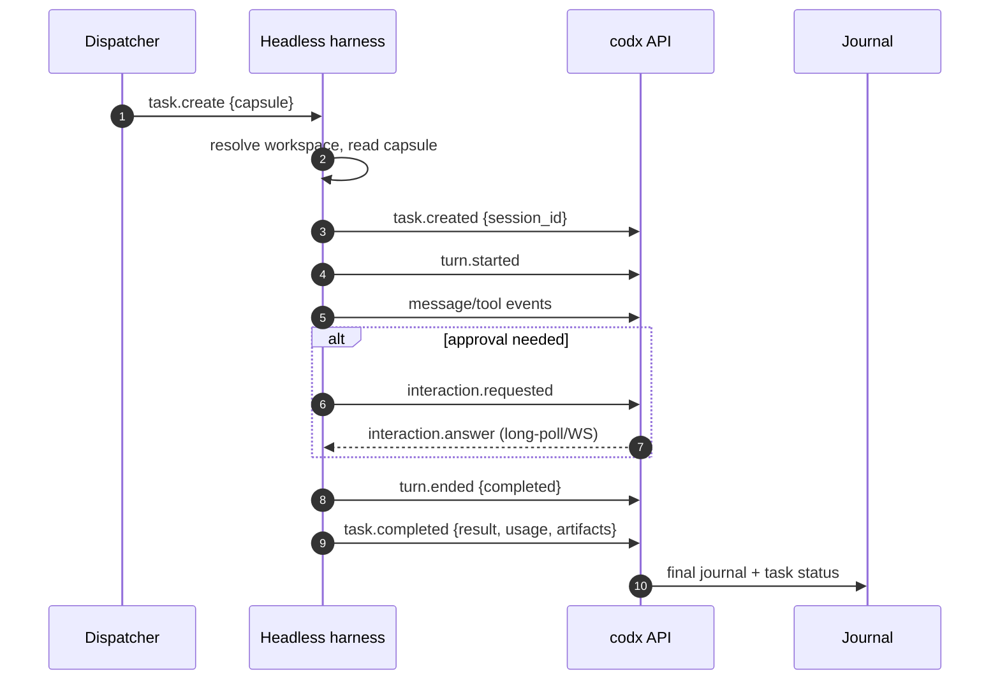

If the process dies:

- codx marks the run `stale` after the lease/heartbeat grace;
- the journal keeps everything received;
- retry policy can resume (`--resume`/`--session-id`) or start a new run;
- a non-resumable harness gets a new session, and the old run remains in
  history.

### 10.6 What the harness must never need from its own UI

- Task description and first prompt: in the capsule.
- Follow-up prompts: `task.prompt` command.
- File context: workspace + file paths + knowledge snippets.
- Approval: `interaction.requested`/`answer` command.
- Cancellation: `task.cancel`.
- Status: `task.status` events.
- Result: `task.completed`.
- History: `task.get`/transcript endpoint (or its own session log for resume).

If any of these is missing, the harness will invent its own state or require a
human at its UI; that is the failure mode this contract exists to prevent.

---

## 11. Migration and rollout

### 11.1 Compatibility matrix

| Component | Before | After phase 1 | After phase 2 | After phase 3 |
|---|---|---|---|---|
| DSH plugin | v1 `/codx-junior/*`, `session.*` events | v1 still accepted; v2 events optional | v2 preferred; v1 accepted | v1 removed after deprecation window |
| codx `/api/dsh/*` | Primary | Aliases to `/api/harness/*` | Deprecated headers | Removed or kept as thin aliases |
| `Chat.external_*` | Writes/reads | Read/write both; new fields added | Prefer `harness*`; legacy mirrored | Legacy fields removed |
| DSH board | Dedicated `DSH` | Existing chats stay; new tasks native | Policy configurable | Dedicated optional |
| Registry | In-process | Persistent SQLite; in-process fallback | Persistent only | Persistent + WS |
| Transcript | On-demand only | Journal + backfill on read | Journal always | Journal + artifacts/export |
| Approvals | None | Pass-through event only | Full bridge | Full bridge + policy |

### 11.2 Phases

#### Phase 0 — Contract and fixtures (no behavior change)

- Add this document and protocol JSON schemas.
- Add a `FakeHarness` fixture that can register, poll, emit scripted events and
  answer commands.
- Capture redacted DSH v1 payload fixtures for compatibility tests.
- Add CI check that the schemas/examples validate.

**Exit:** protocol reviewed; fixtures pass; no production behavior changed.

#### Phase 1 — Generic model + compatibility layer

- Add `Chat.harness*` fields and `HarnessInstance`/`HarnessRun` models.
- Implement `HarnessService` read paths, `TaskContextBuilder`, journal
  projection and generic hydration.
- Backfill `external_*` → `harness*`.
- Replace `external_source == "dsh"` checks in `api/chat.py`, `sio.py` with a
  generic `HarnessRouter`.
- Add `/api/harness/*` aliases; keep `/api/dsh/*` response shapes.
- Add board badge/filter and task panel (read-only) using existing DSH data.

**Exit:** existing DSH tasks hydrate and behave as before; no DSH-specific
branch remains in chat/sio; all current DSH tests pass.

#### Phase 2 — Durable control plane + managed tasks + DSH v2

- SQLite store (instances, commands, events, interactions, runs).
- Outbox dispatcher and supervisor.
- `TaskManager.create_task` harness args; `POST /api/harness/tasks`.
- Managed create flow: task queued → command → session → events.
- DSH plugin v2: granular events, context capsule, idempotency, approvals/
  questions.
- Headless DSH worker profile or CLI adapter (depending on the service
  availability spike).
- UI: harness selector in task modal, card statuses, approvals, retry/detach.

**Exit:** create a DSH task from a normal board; card appears immediately;
transcript survives DSH restart; approval round-trip works; worker profile
registers without a browser.

#### Phase 3 — Multi-harness adapters + isolation

- Claude Code adapter (CLI/stream-json, resume, worktree).
- Codex adapter (`codex exec --json`, resume, sandbox).
- Generic CLI adapter.
- Worktree/concurrency policy, artifact upload, usage/cost.
- WebSocket transport (optional; HTTP remains).
- Multi-instance routing and capacity.

**Exit:** same task lifecycle works for DSH, Claude Code and Codex; one
implementation task per worktree; cost/usage visible; 50+ instances stable.

#### Phase 4 — Orchestration and governance

- Integration with `orchestration` (harness as a step executor).
- Quotas, budgets, approval policies, audit exports.
- Analytics: harness throughput, failure rate, cost, cycle time.
- Search/export of journal content.

### 11.3 Rollback

- Keep `/api/dsh/*` and the v1 plugin working through phase 2.
- Feature flag `harness.enabled`; if off, all paths use the legacy DSH mirror.
- SQLite is additive; deleting `.codx/harness/` returns to on-demand hydration.
- The journal is additive; chat JSON remains compatible.
- If a phase fails, the old DSH board and APIs remain usable.

---

## 12. Test plan

### 12.1 Unit

- Protocol: version negotiation, envelope validation, error mapping, limits.
- Registry: register/heartbeat/offline/revoke/duplicate/project mismatch.
- Token: hash, scope, project binding, revocation, timing-safe compare.
- Command store: claim/lease/retry/expire/idempotent result.
- Event store: seq/dedupe/gap/out-of-order/batch split/unknown type.
- Journal projection: message ordering, tool attachment, lifecycle, pagination.
- State machine: every allowed/disallowed transition.
- Router: explicit/affinity/project/default/capacity/capability selection.
- Context builder: no secrets, bounded size, project target vs owner, hash
  stability.
- Status mapping: auto_advance policies, missing columns.
- Adapters: DSH v1/v2, Claude stream-json fixtures, Codex JSONL fixtures.

### 12.2 Contract

- JSON schemas for register, heartbeat, command, result, event batch,
  interaction, context capsule.
- Golden fixtures from the real DSH plugin (redacted) and from Claude/Codex
  sample streams.
- Backward compatibility: a v1 plugin fixture drives a v2 server; a v2 server
  reports capabilities to an old plugin.

### 12.3 Integration (fake harness)

Scenarios:

1. Managed create: task queued → command → `task.created` → running →
   completed; card on native board; status/column per policy.
2. Mirror discovery: `task.created` from harness → inbox card; parent/child.
3. Duplicate/replayed events: no duplicate messages; `duplicates` count.
4. Gap: server returns 409; plugin snapshot/replay; final state converges.
5. Offline: instance stops heartbeating; running task becomes stale; journal
   remains readable; reconnect resumes.
6. Command retry: result lost; plugin re-polls; no duplicate session
   (`codx_task_id` dedupe).
7. Prompt: user message queued; `task.prompt` result marks delivered; assistant
   message appended once.
8. Cancel: `task.cancel` → `turn.ended aborted` → `cancelled`.
9. Approval: request → UI answer → command → resolved; timeout fails closed.
10. Question: structured answer round-trip; skip/custom handling.
11. Usage/artifacts: stored and displayed; large tool output truncated.
12. Delete/detach/terminate semantics.
13. Cross-project: token/project mismatch is 403; instance cannot read another
    project task.
14. Legacy DSH: v1 events/commands still work; existing tests pass.

### 12.4 End-to-end

- DSH web/host profile: current flow still works.
- DSH worker/headless: no browser; register, create task, approve, complete;
  transcript readable after process stop.
- Claude Code: temp git repo, create task, stream, resume, diff/artifacts.
- Codex: temp git repo, `codex exec --json`, resume, usage.
- Board: new task modal → harness selector → card → task panel → approval.

### 12.5 Security

- Cross-project token/instance, forged `codx_path`, spoofed instance id.
- Replay a command result/event batch; ensure idempotent.
- Oversized JSON, deeply nested payload, invalid UTF-8, huge tool output.
- Approval answer from a user without project access; from agent token.
- Token in logs/metadata/context is redacted.
- SSRF on artifact URLs; path traversal on artifact paths; zip bombs.
- Rate limit / brute force registration.
- HMAC mismatch (if enabled).

### 12.6 Performance/scale

- 100 instances long-polling: thread/connection count, p95 command latency.
- 1k events/s burst: ingest throughput, DB WAL growth, SIO throttling.
- 10k pending commands: claim fairness, retry storm.
- 1M journal events: transcript page p95, retention job duration.
- Large message/tool output: truncation and artifact path.

### 12.7 Test matrix

| Area | Unit | Contract | Integration | E2E | Security | Load |
|---|---|---|---|---|---|---|
| Protocol | ✓ | ✓ | ✓ |  | ✓ |  |
| Registry/tokens | ✓ |  | ✓ |  | ✓ | ✓ |
| Commands/outbox | ✓ |  | ✓ |  |  | ✓ |
| Events/journal | ✓ | ✓ | ✓ |  |  | ✓ |
| Board/status | ✓ |  | ✓ | ✓ |  |  |
| Chat/prompt | ✓ |  | ✓ | ✓ |  |  |
| Approvals | ✓ | ✓ | ✓ | ✓ | ✓ |  |
| Adapters | ✓ | ✓ | ✓ | ✓ |  |  |
| UI |  |  | ✓ | ✓ |  |  |

### 12.8 Fixtures

- `tests/fixtures/harness/dsh_v1_*.json`
- `tests/fixtures/harness/dsh_v2_*.json`
- `tests/fixtures/harness/claude_stream_*.jsonl`
- `tests/fixtures/harness/codex_exec_*.jsonl`
- `tests/fixtures/harness/context_capsule.json`
- Fake harness server with scripted scenarios (`tests/harness/fake_harness.py`).

---

## 13. Operations, security and risks

### 13.1 Deployment topologies

| Topology | Shared FS | Context | Artifacts | Notes |
|---|---|---|---|---|
| Same host, same user | Yes | Paths + capsule | Paths | Simplest; DSH plugin reads token file. |
| Same host, different container | Volume | Paths + capsule | Volume/upload | Ensure UID/GID and worktree paths. |
| Remote host | No | Capsule + context URL | Upload/download | TLS + instance token; no path assumptions. |
| Multiple projects per harness | Depends | Project-bound token | Per project | Prefer one instance per project for isolation. |

### 13.2 Runbook

- **Instance offline with running tasks:** check heartbeat, network, token;
  tasks become `stale` after grace; reconnect or retry on another instance.
- **Command stuck:** inspect `harness_commands` state/lease; requeue or expire;
  the plugin may have processed it—check `idempotency_key` before resending.
- **Event gap:** ask the plugin for `task.snapshot`; do not guess sequence
  numbers.
- **Approval stuck:** check task panel; answer or wait for timeout; verify the
  plugin received `interaction.answer`.
- **Journal disk full:** prune oldest unpinned events, export/archive, raise
  retention/volume.
- **Duplicate tasks:** check `_chat_id_for`/link unique constraints; run the
  reconciler; never delete blindly.
- **Cross-project 403:** verify token project and `codx_path`; do not “fix” by
  disabling the check.

### 13.3 Retention and backup

- Back up `.codx/harness/harness.db` with the project; it contains control and
  transcript metadata.
- Artifacts folder is separate; include it if artifacts are stored locally.
- Retention default 90 days; pin completed/audited tasks.
- Export JSONL before deleting; the harness session may outlive the codx
  journal.

### 13.4 Quotas and cost

- Per-instance max concurrent tasks; per-project max queued/running.
- Per-task `timeout_seconds`, `max_turns`, budget; the adapter maps to native
  limits where possible.
- Harness-native cost/usage stored separately; analytics can convert with a
  configured rate, never silently.
- Approval auto-approve allowlists are explicit, per tool/pattern, audited.

### 13.5 Privacy

- Transcripts may contain source code, secrets, PII. Treat the journal as
  sensitive project data.
- Redact known secret patterns; do not log message bodies at INFO.
- Remote harnesses: document data residency; the capsule and events cross the
  boundary.
- Provide project-level disable/retention controls.

### 13.6 Risk register

| Risk | Likelihood | Impact | Mitigation |
|---|---|---|---|
| Protocol drift between codx and harness | High | Broken tasks | Version negotiation + contract tests + adapter isolation. |
| Transcript duplication/storage growth | Medium | Cost | Retention, artifact refs, truncation, pinning. |
| Approval deadlock in headless | Medium | Stuck tasks | Explicit timeout, fail closed, policy `never`/auto-review. |
| Cross-project token abuse | Low/Medium | Data leak | Per-instance tokens, project binding, tests. |
| Workspace clobbering | Medium | Lost work | Worktree per task, concurrency scope. |
| Long-poll thread exhaustion | Medium | API latency | Async endpoints, DB queue, WS later. |
| Duplicate sessions on retry | Medium | Duplicate work | `codx_task_id` dedupe, idempotency keys. |
| Harness session deleted while codx task lives | Medium | Orphan card | `task.disposed` → detached; explicit terminate. |
| DSH plugin cannot run headless | High | Blocks phase 2 | Worker profile spike; CLI adapter fallback. |
| UI complexity | Medium | Adoption | Progressive disclosure; badge + panel, not a new app. |
| Cost model mismatch | Medium | Bad budgets | Separate native usage; explicit conversion. |

---

## 14. Implementation checklist

PR-sized work items, ordered. Each item lists the main files and the
acceptance check. Sizes are indicative (S ≤ 2 days, M ≤ 1 week, L > 1 week for
one experienced contributor).

### Phase 0 — Contract

- [ ] **P0.1 Protocol schemas + fixtures** (S)
  - `api/codx/junior/harness/protocol.py` (or `schemas/`), tests/fixtures.
  - Acceptance: schemas validate all examples in this document; CI runs them.
- [ ] **P0.2 Fake harness** (S)
  - `tests/harness/fake_harness.py`: register, poll, scripted events, answer.
  - Acceptance: managed/mirror/approval scenarios run offline.

### Phase 1 — Generic model + compatibility

- [ ] **P1.1 `Chat` harness fields + migration** (M)
  - `api/codx/junior/db.py`, `migrations/harness_v1.py`.
  - Acceptance: old chats read unchanged; backfill idempotent; tests.
- [ ] **P1.2 `HarnessService` read path + journal** (M)
  - `harness/service.py`, `journal.py`, `store.py`.
  - Acceptance: `transcript`/`events`/`context` endpoints return data for a
    DSH chat; no DSH-specific branch in `api/chat.py`.
- [ ] **P1.3 Generic hydration in chat API/SIO** (S)
  - `api/chat.py`, `sio/sio.py`.
  - Acceptance: any `chat.harness` hydrates; user prompt is routed, not
    rejected with a DSH-only message.
- [ ] **P1.4 `/api/harness/*` aliases** (M)
  - `api/harness/*`, `api/dsh.py`, `api/dsh_agent.py`.
  - Acceptance: existing DSH tests pass through aliases; response shapes stable.
- [ ] **P1.5 Board badge/filter + read-only task panel** (M)
  - `client/src/components/kanban/*`, `client/src/api/modules/harness.js`.
  - Acceptance: DSH cards show a badge; filter works; panel shows status and
    transcript.

### Phase 2 — Durable control plane + managed DSH

- [ ] **P2.1 SQLite store + migrations** (M)
  - `harness/store.py`, schema, WAL pragmas.
  - Acceptance: concurrent read/write test; restart preserves instances/commands.
- [ ] **P2.2 Registry/tokens** (M)
  - `harness/registry.py`, settings/API/UI.
  - Acceptance: per-instance token; project mismatch 403; revoke works.
- [ ] **P2.3 Outbox dispatcher + supervisor** (L)
  - `harness/dispatcher.py`, `background.py`.
  - Acceptance: lease/retry/expire; task creation non-blocking; no duplicate
    command effects.
- [ ] **P2.4 `TaskManager` harness args + managed flow** (M)
  - `task_manager.py`, `api/chat.py`, `/api/harness/tasks`.
  - Acceptance: task appears queued immediately; command → session → running.
- [ ] **P2.5 DSH plugin v2** (L)
  - `dsh-codx-junior/index.js`, `lib/core.js`, `cordis.patch.yml`.
  - Acceptance: granular events, context capsule, idempotent prompt, v1 compat.
- [ ] **P2.6 DSH headless worker/CLI spike** (M/L)
  - DSH profile/bundle or `DshCliAdapter`.
  - Acceptance: registers and completes a task with no browser; documented
    decision.
- [ ] **P2.7 Approval/question bridge** (L)
  - DSH listeners + `interactions.py` + UI cards.
  - Acceptance: approve/reject/timeout round-trip; audit rows.

### Phase 3 — Multi-harness

- [ ] **P3.1 CLI process transport** (M)
  - `adapters/cli.py`, process supervisor, stdout/stderr parsing, cancellation.
  - Acceptance: a fake CLI harness completes a task; exit code mapping.
- [ ] **P3.2 Claude Code adapter** (L)
  - `adapters/claude_code.py`.
  - Acceptance: create/resume/cancel/stream/tool events/cost; fixtures.
- [ ] **P3.3 Codex adapter** (L)
  - `adapters/codex.py`.
  - Acceptance: `codex exec --json` create/resume/stream/usage; fixtures.
- [ ] **P3.4 Worktree/concurrency policy** (M)
  - `harness/workspace.py`, task options.
  - Acceptance: two implementation tasks do not share a mutable tree.
- [ ] **P3.5 Artifacts + usage UI** (M)
  - artifact storage/API, usage panel.
  - Acceptance: diff/log/artifact visible; cost labeled.
- [ ] **P3.6 WebSocket transport** (M)
  - `/api/harness/instances/{id}/ws`, same protocol.
  - Acceptance: command/event duplex; fallback to HTTP.

### Phase 4 — Orchestration/governance

- [ ] **P4.1 Orchestration step executor** (L)
  - `orchestration/executor.py` harness backend.
- [ ] **P4.2 Quotas/analytics/export** (M)
  - metrics, retention, audit export.

---

## 15. Decisions needed

These are the choices that should be confirmed before implementation. Each has a
recommendation.

| # | Question | Recommendation | Why |
|---|---|---|---|
| Q1 | Default board policy? | `native` + inbox for mirror sessions | Keeps boards organized by product area; avoids a board per engine. |
| Q2 | Persist transcripts? | Yes, journal with retention | Required for headless/offline/audit; bounded by retention/artifacts. |
| Q3 | Is `Chat.status` updated by harness? | Only per `auto_advance`; default `on_complete` | Avoid surprising card moves; keep workflow status user-owned. |
| Q4 | One active harness per task? | Yes; runs are history | Simple UI and state; retries create new runs. |
| Q5 | Registry storage? | SQLite WAL under `.codx/harness/` | Durable, concurrent, transactional; avoids bespoke JSON locking. |
| Q6 | Transport first? | HTTP long-poll + batched events | Works with current plugin; WS later without protocol change. |
| Q7 | Per-instance tokens? | Yes; legacy shared token as bootstrap | Revocation/isolation; compatibility. |
| Q8 | DSH headless path? | Worker profile preferred; CLI adapter fallback | Worker keeps long-lived sessions; CLI validates the generic adapter. |
| Q9 | Approvals in headless? | Bridge when supported, else `never`/auto-review, fail closed | No silent approvals; deterministic unattended runs. |
| Q10 | Cost currency? | Store native usage/cost separately; no implicit conversion | Avoid corrupting cxjcoins budgets. |
| Q11 | Delete semantics? | Detach by default; explicit terminate | Prevents accidental loss of harness work. |
| Q12 | Where do new tasks get harness from? | Column defaults + explicit selector | Uses the existing board defaults mechanism. |

Open questions that need product input, not just engineering:

- Should mirror sessions auto-create tasks for every DSH session, or only ones
  on a watched board/cwd? (Recommend: only `cwd` under the project and not
  blank, as today, plus an inbox.)
- Should a task be allowed to move between harnesses mid-run? (Recommend: no;
  detach + new run.)
- Is transcript retention a per-project or global policy? (Recommend:
  project override, global default.)
- Do we need cross-project harness tasks (task in project A runs in project
  B)? (Recommend: yes, but explicitly via `project_id`, with a warning and
  separate token scope.)
- Should the harness be able to update the task description? (Recommend:
  managed: suggestion only; mirror: yes if it owns the conversation.)

---

## 15.1 First implementation (this branch)

The first vertical slice is implemented in
`.worktrees/harness-integration` on branch `feat/harness-integration`:

- `Chat` now carries generic harness fields (`harness`,
  `harness_instance_id`, `harness_task_id`, `harness_status`,
  `harness_model`, `harness_usage`, `harness_cost`, `harness_metadata`); DSH
  mirror rows populate them alongside the legacy `external_*` aliases.
- DSH task creation can select a model from codx-junior's `ai_models`
  catalogue (`GET /api/dsh/models`). The model is translated through
  `AIModel.metadata.dsh` and applied with DSH's `selectModel`; failures are
  recorded as `model_selection` metadata and shown in the panel.
- Task summaries carry usage/model counters. The server mirrors them on the
  task and appends `.codx/harness/usage.jsonl`; `GET /api/dsh/status` returns an
  aggregate.
- Project sandbox checks use `realpath` on the server and in the DSH plugin.
  A cwd outside the project (including a symlink escape) is rejected before a
  session is created. `sandbox_enabled` is configurable.
- The DSH plugin accepts `workspaceRoot`, reports `sandbox`/`model-selection`/
  `usage` capabilities, and sends usage/model summaries.
- `/api/dsh/agent/*` now rejects an instance/token from another project.
- The DSH panel exposes the model selector, the sandbox toggle and usage cost.

Still required for the full design in this document: durable SQLite
registry/outbox/journal, managed task creation from any board, generic adapter
package, approvals/questions, artifacts, worktrees and the Claude/Codex
adapters. The current slice intentionally keeps the existing DSH mirror and
in-process registry so it can be merged independently.

Tests used for this slice:

```sh
# plugin (Node)
TMPDIR="$PWD/.tmp-test" node --test dsh-codx-junior/test/*.test.mjs

# Python DSH tests (run with the project's Python environment)
python -m pytest api/tests/test_dsh_integration.py api/tests/test_dsh_agent.py
```

The sandbox test also covers a symlink escape. The model test uses a fake
selection payload; a real DSH Host must still be checked for its
`selectModel`/provider mapping.

## 16. Appendices

### Appendix A — Current DSH payload examples

**Register (plugin):**

```json
{
  "instance_id": "8f3a...",
  "name": "dsh-prod-1",
  "cwd": "/srv/projects/api",
  "version": "1",
  "capabilities": ["sessions", "subagents", "commands", "live-context"],
  "meta": {"pid": 1234, "platform": "linux", "node": "v22"}
}
```

**Event (plugin):**

```json
{
  "version": 1,
  "event": "session.updated",
  "sentAt": "2026-11-09T09:00:00Z",
  "task": {
    "id": "sess-1",
    "title": "Fix login",
    "parentId": null,
    "origin": "session",
    "isSubagent": false,
    "depth": 0,
    "cwd": "/srv/projects/api",
    "agentPreset": null,
    "createdAt": 1762688000000,
    "updatedAt": 1762688400000,
    "running": true,
    "blank": false,
    "status": "running",
    "webUrl": "http://127.0.0.1:3080/?session=sess-1",
    "description": "Fix the login timeout",
    "lastMessage": "I found the timeout..."
  }
}
```

**Command result:**

```json
{
  "instance_id": "8f3a...",
  "ok": true,
  "result": {"sessionId": "sess-1", "promptAccepted": true},
  "error": null
}
```

### Appendix B — Proposed event examples

**`task.created`**

```json
{
  "event_id": "dsh:sess-1:1",
  "seq": 1,
  "type": "task.created",
  "occurred_at": "2026-11-09T09:00:00Z",
  "task_id": "sess-1",
  "payload": {
    "task": {
      "id": "sess-1",
      "codx_task_id": "chat-uuid",
      "title": "Fix login",
      "parent_id": null,
      "origin": "session",
      "cwd": "/srv/projects/api",
      "created_at": "2026-11-09T09:00:00Z",
      "status": "running",
      "web_url": "http://127.0.0.1:3080/?session=sess-1"
    },
    "codx_task_id": "chat-uuid"
  }
}
```

**`turn.ended`**

```json
{
  "event_id": "dsh:sess-1:7",
  "seq": 7,
  "type": "turn.ended",
  "task_id": "sess-1",
  "payload": {
    "turn": 2,
    "reason": {"kind": "completed"},
    "duration_ms": 42000,
    "usage": {"input_tokens": 1200, "output_tokens": 80}
  }
}
```

**`interaction.resolved`**

```json
{
  "event_id": "dsh:sess-1:8",
  "seq": 8,
  "type": "interaction.resolved",
  "task_id": "sess-1",
  "payload": {
    "interaction_id": "int-uuid",
    "outcome": "allowed-once",
    "answered_by": "user@example.com",
    "resolved_at": "2026-11-09T09:01:00Z"
  }
}
```

### Appendix C — DSH service mapping

| DSH concept | Protocol/event | codx projection |
|---|---|---|
| `session/created` | `task.created` | Chat + link + board card |
| `session/event` `user/message` | `message` (role user) | `Message` |
| `session/event` `assistant/message` | `message` (role assistant) | `Message` + usage |
| `session/event` `turn/start` | `turn.started` | `harness_status=running` |
| `session/event` `turn/end` | `turn.ended` | `harness_status` completed/failed/cancelled |
| `session/event` `tool/call` | `tool.call` | `ToolEvent(status=running)` |
| `session/event` `tool/result` | `tool.result` | `ToolEvent(status=done/error)` |
| `session/event` `approval/asked` | `interaction.requested` (approval) | Interaction card |
| `session/event` `approval/decided` | `interaction.resolved` | Close interaction |
| `user-questions/request` | `interaction.requested` (question) | Question card |
| `session/title` | `task.updated` (title) | `Chat.name` |
| `session/disposed` | `task.disposed` | `harness_status=completed/detached` |
| `sessionQuery`/`sessionController` | `task.get/list` | transcript/sync |

### Appendix D — Glossary

- **Adapter** — code that translates one harness's raw protocol into codx's
  normalized events/commands.
- **Agent token** — credential a harness instance uses to call codx.
- **Bootstrap token** — project token used only to register and obtain an
  instance token.
- **Capability** — a declared feature an instance supports.
- **Context capsule** — the signed/versioned task + environment bundle.
- **Detach** — unlink a codx task from a harness without terminating it.
- **Harness** — an execution engine (DSH, Claude Code, Codex, CLI).
- **Instance** — one running harness host/process.
- **Journal** — codx's append-only event/transcript projection.
- **Managed task** — codx-created task run by a harness.
- **Mirror task** — harness session projected as a codx task.
- **Run** — one dispatch attempt of a task to an instance.
- **Task capsule** — see context capsule.
- **Terminate** — explicitly ask a harness to close a session.

---

*End of document. The analysis above remains the implementation contract; the
first vertical slice is implemented on `feat/harness-integration` as described
in §15.1.*
