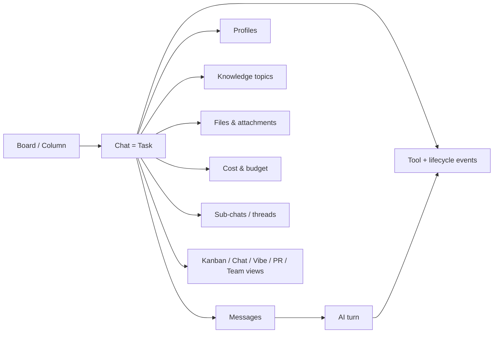
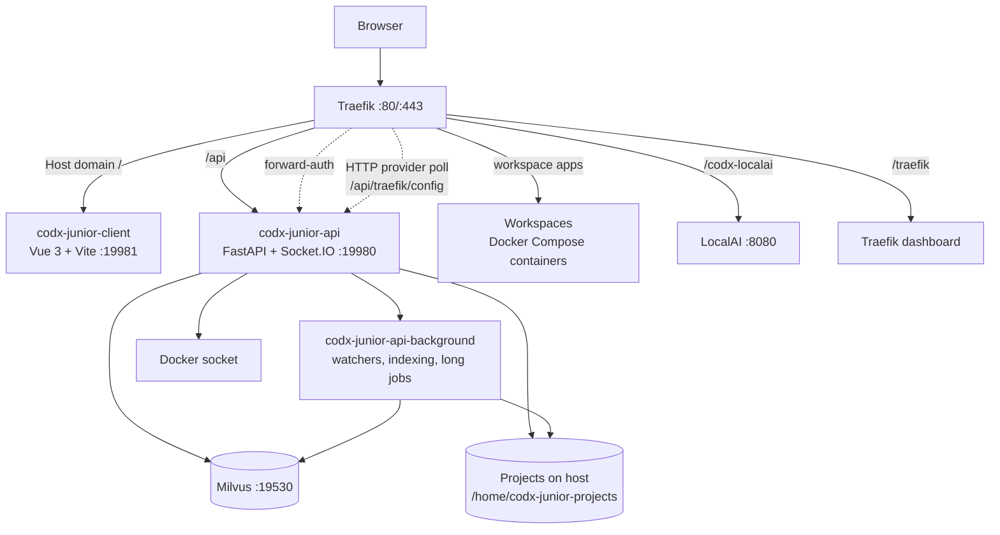
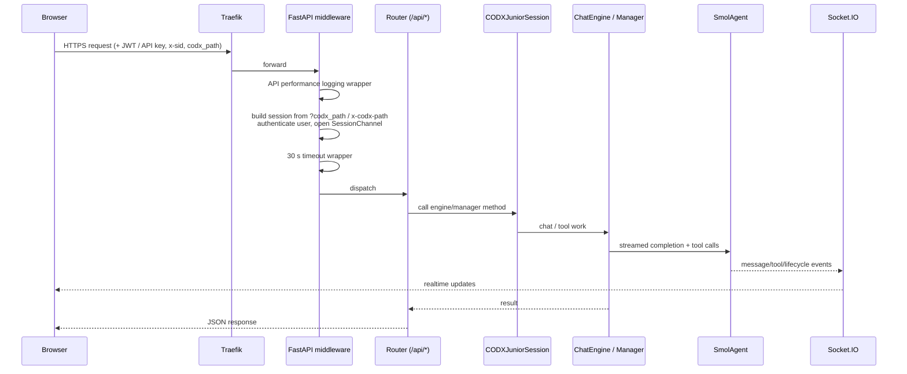
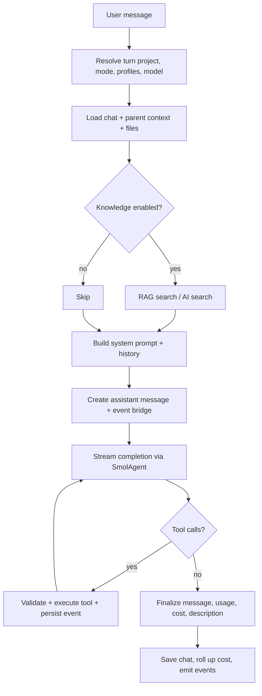
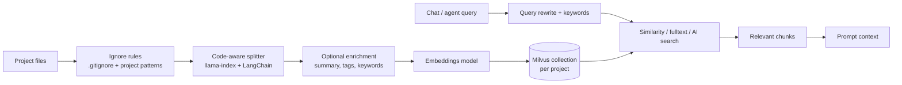

# codx-junior — Detailed Project Analysis

> **What this document is.** A product and engineering walkthrough of the `codx-junior` repository: what the platform does, how it is built, how a request flows through it, how data is stored, how it is deployed, and where the code is heading.
>
> **What it is based on.** Static analysis of the working tree at commit `9654d953` (*"add kanban v2 storage and LRT-0 fixes"*) on branch `v1.3-demo-site`, plus the project's own `README.md` and VitePress documentation. Line counts, route counts and module lists are approximate snapshots of that revision, not contractual facts.
>
> **Audience.** New contributors, architects evaluating the platform, and operators who need to run or extend it.

---

## Table of contents

1. [Executive summary](#1-executive-summary)
2. [What the project actually is](#2-what-the-project-actually-is)
3. [Who it is for](#3-who-it-is-for)
4. [The core product model: everything is a chat](#4-the-core-product-model-everything-is-a-chat)
5. [Feature catalogue](#5-feature-catalogue)
6. [Architecture](#6-architecture)
7. [Backend deep dive](#7-backend-deep-dive)
8. [Frontend deep dive](#8-frontend-deep-dive)
9. [Data model and persistence](#9-data-model-and-persistence)
10. [Security and multi-tenancy](#10-security-and-multi-tenancy)
11. [AI, cost and governance](#11-ai-cost-and-governance)
12. [Deployment and operations](#12-deployment-and-operations)
13. [Extensibility](#13-extensibility)
14. [Technology stack](#14-technology-stack)
15. [Repository map](#15-repository-map)
16. [Current state, strengths and risks](#16-current-state-strengths-and-risks)
17. [Onboarding: where to start reading](#17-onboarding-where-to-start-reading)
18. [Glossary](#18-glossary)
19. [Sources](#19-sources)

---

## 1. Executive summary

**codx-junior is a self-hosted, AI-native software delivery workspace.** It puts planning, AI coding agents, dev containers, team communication, code review, documentation, and AI cost control behind a single browser tab, on top of a user's own Git repositories and infrastructure.

In one sentence:

> *codx-junior is an open-source "virtual software company" workspace where Kanban tasks, chats, AI agent profiles, RAG over your codebase, Docker dev containers, and per-user AI budgets are all first-class, interconnected objects.*

The platform's thesis is that unsupervised AI agents are unreliable, while fully manual teams are slow. It therefore pairs **AI agents that do the volume of work** with **humans who keep direction and review every change**, and it makes the cost of that AI work explicit and enforceable.

Technically it is:

- a **Python 3.11 / FastAPI** backend (`api/`) containing a chat engine, a tool-calling agent runtime, a RAG pipeline over Milvus, Docker workspace orchestration, Git/PR tooling, analytics, and a JWT-based user/permission system;
- a **Vue 3 + TypeScript + Vite** single-page application (`client/`) with a windowed "desktop" mode (Dockview) and a mobile/router mode, sharing one app registry;
- a **Docker Compose stack** (`codx-junior-installer/`) with Traefik as the single entry point, a second API process dedicated to background work, Milvus as the vector store, and optional LocalAI/LiteLLM model serving.

Size at this revision: roughly **97k lines of Python across 235 files** in `api/codx`, and roughly **147k lines across 490 `.vue` files plus TypeScript/JavaScript** in `client/src`. It is a large, fast-moving beta, not a small prototype.

---

## 2. What the project actually is

### 2.1 The short version

| Question | Answer |
| --- | --- |
| Category | AI software-delivery workspace / AI development platform |
| Deployment | Self-hosted via Docker Compose; also offered as a managed service by the maintainers |
| Users | Developers, tech leads, small product teams, agencies |
| Core unit | The **chat**, which doubles as a **task** on a Kanban board |
| AI support | Any OpenAI-compatible provider (OpenAI, Ollama, LocalAI, LiteLLM, vLLM, …), per-purpose models |
| Context | Project-scoped: files, RAG index, profiles, wiki, Git state, settings |
| Isolation | Per-project configuration; Docker Compose "workspaces" for running code |
| Governance | Users, roles, project permissions, per-app access, wallets, token limits, settings history |
| License | AGPL-3.0 (`LICENSE.md`) |
| Status | Active beta, open source |

### 2.2 What it is *not*

Being precise about boundaries matters when evaluating the project:

- **It is not an IDE.** It *embeds* VS Code (Coder) and a virtual desktop inside a dev container, and it has Monaco-based file/diff views, but the editor is not the product center.
- **It is not a model provider.** It is a multi-provider client and router; local models are optional via LocalAI/vLLM/Ollama.
- **It is not a traditional project-management SaaS.** Boards and chats are local, project-scoped objects stored as files next to the code.
- **It is not a PaaS.** It orchestrates Docker Compose workspaces through the host Docker socket; it does not provision cloud infrastructure.

### 2.3 The problem it addresses

A team adopting AI coding tools usually ends up with a fragmented stack: one tool for chat, one for code completion, one for containers, one for issue tracking, one for documentation, and no shared context or cost control. codx-junior's answer is consolidation around the project:

1. **Context lives with the code.** Knowledge index, profiles, wiki and Git state belong to the project, not to a global chat account.
2. **Work is tracked as conversations.** A Kanban card *is* a chat, so planning, discussion, execution and review are the same artifact.
3. **Agents are supervised.** Tool loops have iteration caps, loop detection, cancellation, budgets, and human-reviewed diffs.
4. **Cost is observable and enforceable.** Every AI call is metered in tokens and internal "cxjcoins", checked against wallet limits before it is sent.
5. **Everything runs where the code runs.** Workspaces mount the projects and publish apps through the same authenticated domain.

### 2.4 The "hybrid model" positioning

The README and docs frame the product around a hybrid delivery model:

- **AI** searches the codebase, writes and patches files, runs containers, generates docs/images, and reviews changes.
- **Humans** define work on the board, choose profiles and models, review diffs/PRs, and talk to each other and the agents in shared channels.
- **Budget** is visible per user and model, alongside planned human hours.

The commercial framing (seed round, managed team, "4x faster") is marketing copy; the engineering substance is the workspace and the agent/tooling platform described below.

---

## 3. Who it is for

| Persona | What they get |
| --- | --- |
| **Solo developer / indie builder** | A single workspace to plan, code with agents, run the app, and keep AI spend bounded. |
| **Tech lead** | Cross-project visibility (management dashboard), reviewable AI changes, profiles that encode team standards. |
| **Small product team** | Shared boards, channels/DMs, per-project permissions, shared workspaces and previews. |
| **Agency / consultancy** | Multiple isolated projects, per-user budgets, client-facing previews, predictable AI cost. |
| **Self-hosting operator** | A Docker Compose stack behind Traefik with Milvus, optional local models, and a forward-auth gate for every routed app. |

The documentation also targets teams that would rather **hand the roadmap to the maintainers' managed team**, but that is a service offering, not a code feature.

---

## 4. The core product model: everything is a chat

This is the single most important design decision in the codebase. The `Chat` object is simultaneously:

- a **conversation** (messages, attachments, threads, sub-chats),
- a **task** (board, column, status, priority, due date, assignees, progress, sprints, checklists, tags),
- a **budget envelope** (`estimation_cost`, accumulated `cost`, with cost rolled up to the root chat),
- a **context carrier** (profiles, model, file list, knowledge topics, parent/child links),
- an **execution record** (tool events, lifecycle events, status history, cost breakdown).

That is why the Kanban, messenger, PR review, and quick-chat surfaces all reuse the same engine: they are different *views* and *modes* over the same object.



Two consequences worth internalizing:

1. **The file tree is the database.** Chats are JSON documents under the project's `.codx` folder, organized by board and column.
2. **A chat can be a tree.** `parent_id`, `root_id`, `linked_chat_ids` and sub-chats enable task decomposition and long-running work, with knowledge/files optionally inherited from the parent.

---

## 5. Feature catalogue

The table below separates what the public docs advertise from what the code at this revision actually contains. "Documented" means described in `docs/`; "implemented" means backend and/or UI code exists.

### 5.1 Planning and work management

| Feature | What it does | Status |
| --- | --- | --- |
| **Quick chat** | Project-aware launcher: start a chat, pick profile/model, reopen recent chats. | Implemented |
| **Chats & sub-chats** | Modes, threads, nested sub-tasks, attachments, links, checklists, tags, pinning, templates, search, export. | Implemented |
| **Kanban boards** | Multiple boards per project, columns, cards-as-chats, board/grid/tree views, drag & drop, bookmarks. | Implemented (v2 storage) |
| **Task metadata** | Status (`todo`/`doing`/`onhold`/`done`/`rejected`), priority, due date, progress, assignees, sprints. | Implemented |
| **Sprints / planning** | Cross-board task queries, grouping, metrics, burndown, activity feed, Gantt-style sprint views. | Implemented (`planning_manager.py`) |
| **Management dashboard** | Cross-project "command center": pulse, attention/blockers, delivery forecast, team load, AI cost. | Implemented, lightly documented |
| **Templates** | Mark a chat as a template to reuse when creating tasks. | Implemented |

### 5.2 Building with AI

| Feature | What it does | Status |
| --- | --- | --- |
| **Chat modes** | `chat`, `task` (refine a document), `agent` (tool loop), `vibe` (code + diff + preview), `topic` (team channel), `prview` (review), `browser`, `slides`, `tutorial`, `preview`, `channel`. | Implemented; client registry is the source of truth |
| **Agent tools** | ~60 tools: project search/read/write, patching, structure, web fetch/search, images, Docker/Compose, Git/PR, tasks, profiles, teams, tutorials, recipes, browser sessions. | Implemented |
| **Profiles** | Reusable Markdown instructions with model, tools, mode, linked profiles, file matching, knowledge toggle, and OpenAI-API exposure. | Implemented |
| **Vibe coding** | Split view: conversation + changed files/diffs + live app preview, optional Kanban panel. | Implemented |
| **`@codx` mentions** | In-file commands (`// @codx: ...`, `<codx>...</codx>`) processed by the background watcher, with flags like `--knowledge`, `--model=`, `--vibe`. | Implemented |
| **RAG / knowledge** | Code-aware chunking, embeddings, Milvus, similarity/AI search, keywords, knowledge graph, tag extraction, chat indexing. | Implemented |
| **Wiki** | AI-maintained documentation folder with build/rebuild/index endpoints and a wiki model. | Implemented (background rebuild disabled by default) |
| **Guardrails** | Scope detection and static rules around agent behavior. | Implemented (`guardrails/`) |
| **Organizer** | AI-assisted classification of new chats into boards/columns with validation and fallback. | Implemented (`organizer/`) |
| **Meetings** | Meet sessions/records with manager and UI (`MeetView`). | Implemented, not in docs |
| **Browser sessions** | Playwright-driven browser sessions with screenshots/source tools and a session manager UI. | Implemented |

### 5.3 Running and collaborating

| Feature | What it does | Status |
| --- | --- | --- |
| **Workspaces** | Docker Compose dev containers from templates (`dev-stack`, `static-site`, `custom`), projects mounted, apps published via Traefik. | Implemented |
| **Default apps** | Coder (VS Code in browser), virtual desktop (noVNC/Kasm), LiteLLM, Traefik dashboard. | Implemented |
| **Desktop shell** | Window manager in the browser (Dockview panels), tabs, saved/shared views. | Implemented |
| **Teams & messenger** | Teams, categories, channels backed by `topic` chats, DMs, media library. | Implemented |
| **File browser** | Browse/search/preview/upload/download/create/rename/copy/archive/delete; two implementations (`files` and `file-finder`). | Implemented (duplicated APIs) |
| **Project scripts** | Named bash scripts, background mode, auto-restart, PID files. | Implemented |
| **Console** | Per-project terminal manager and console UI. | Implemented |
| **Infra view** | Docker host/container/stack management (containers, images, networks, volumes, monitoring, SSH keys, cloud server modal). | Implemented, not in docs |
| **API monitoring** | Per-request latency/throughput/error logs + dashboard. | Implemented, not in docs |
| **Activity wall / shared views** | Activity feed and shareable view links. | Implemented |

### 5.4 Shipping and controlling

| Feature | What it does | Status |
| --- | --- | --- |
| **Git engine** | Branches, commits, diffs, staged/worktree state, remotes, worktrees, commit graphs, AI commit messages. | Implemented |
| **PR review** | Compare branches/commits, per-file review, AI report, `prview` chat mode, diff comments. | Implemented |
| **GitHub issues** | Paste an issue URL; a dedicated agent summarizes and proposes sub-tasks. | Implemented |
| **Analytics** | Token/cxjcoin usage by day, model, user, project; tool metrics; decision logs; raw AI logs; chat logs. | Implemented |
| **Wallets & limits** | Balance, transactions, daily/weekly/monthly spending limits, preflight blocking. | Implemented |
| **Token-limit rules** | Per user/provider/model daily caps, one-day admin extensions, user extension requests. | Implemented |
| **Users & roles** | Admin/user, project permissions (`admin`, `knowledge_admin`), per-app access, disable users, env vars. | Implemented |
| **Auth** | Username/password (bcrypt), JWT, API keys, GitHub OAuth, GitHub-admin allowlist, GitHub-only login. | Implemented |
| **Forward auth** | `/api/forward-auth` protects every Traefik-routed app (workspaces, LocalAI, dashboards). | Implemented |
| **Settings history** | Global settings versioned by section with rollback. | Implemented |
| **Plugins** | Python plugins with method/args/roles/extends/async; examples for Azure DevOps, image editor, guide model, Claude container. | Implemented |
| **OpenAI-compatible API** | Expose profiles as models: `GET /api/v1/models`, `POST /api/v1/completions`. | Implemented |
| **MCP servers** | Per-project MCP server configuration (name, URL, key, active) stored in settings. | **Configuration only** — no MCP client/runtime found in the backend at this revision |

### 5.5 Modes of work not obvious from the README

A few surfaces exist in code and UI but are only lightly covered by the docs:

- **Solopreneur mode** — a project-independent, top-level screen (`/solopreneur/:module?`) re-framing the workspace around a solo operator, with modules and an AI co-founder.
- **Management dashboard** — cross-project aggregation of work, blockers, delivery forecast, team capacity and AI cost (`management_manager.py`, `views/management/`).
- **Infra** — Docker host management from the browser.
- **API monitoring** — performance telemetry captured by middleware and rendered as charts.
- **Meets** — meeting sessions.
- **Browser sessions** — managed Playwright browsers.
- **Desktop** — Dockview-based multi-panel desktop with saved views.

---

## 6. Architecture

### 6.1 High-level topology



### 6.2 Services

| Service | Image | Port | Role |
| --- | --- | --- | --- |
| `codx-junior-client` | `codxjunior/codx-junior:client` | 19981 | Static SPA served by the client container. |
| `codx-junior-api` | `codxjunior/codx-junior:api` | 19980 | REST API under `/api`, Socket.IO, OpenAPI docs, forward-auth. |
| `codx-junior-api-background` | same API image | — | Same code started with `CODX_JUNIOR_API_BACKGROUND=1`: project watchers, knowledge indexing, mentions, long-running jobs. |
| `milvus` | `milvusdb/milvus:v2.5.11` | 19530, 9091 | Vector database for knowledge. |
| `localai` | `codx-junior-localai:latest` | 8080 | Optional local model serving. |
| `traefik` | `traefik:latest` | 80/443 | Reverse proxy, TLS, dynamic routes for workspace apps. |
| `codx-junior-init` | `codxjunior/codx-junior:debian` | — | One-shot initial setup script. |
| Workspaces | per-template Compose | dynamic | Dev containers created on demand. |

Ports for workspaces are allocated from a configurable range (default `16000`–`17000`), and apps are published as paths on the main domain.

### 6.3 Why two API processes

The API process is stateless per request; the background process owns long-running and CPU-heavy work:

- project file watching and change processing (`watchfiles` / `watchdog`),
- knowledge indexing and re-indexing,
- `@codx` mention processing,
- wiki updates,
- periodic model reloading,
- long-running agent/runner ticks.

The split keeps request latency predictable and lets background work crash/restart without taking the API down. Both share the same image, settings volume, projects volume and Milvus.

### 6.4 Request lifecycle (HTTP)



Key mechanics in `api/codx/junior/app.py`:

1. **Dynamic router discovery.** Every module in `api/codx/junior/api/` that exports a `router` is imported and mounted with the `/api` prefix (`discover_routers()`), so adding a file adds endpoints.
2. **Per-request project session.** `add_codx_junior_settings` reads `codx_path` from the query string or `x-codx-path` header, authenticates the user, opens a `SessionChannel(sid, sio)`, and stores a `CODXJuniorSession` on `request.state`. Every endpoint uses that session to reach chats, knowledge, Git, workspaces, profiles, etc.
3. **Cross-cutting middleware.** API call recording (duration, status, size, user, project), `X-Process-Time` header, a global 30-second timeout returning HTTP 504, and a global exception handler returning the traceback.
4. **Socket.IO** is mounted at `/api/socket.io` with the same FastAPI app as fallback.
5. **Static files** are served from `CODX_JUNIOR_STATIC_FOLDER` under `/api/static` (uploads, images, generated assets).

### 6.5 Realtime layer

`codx.junior.sio` wraps `python-socketio`'s async server. Clients authenticate with a token (`codx-junior-login`) and then use events such as:

- `codx-junior-chat` — run a chat turn,
- `codx-junior-chat-search` — search chats,
- `codx-junior-improve`, `codx-junior-improve-patch` — code improvement,
- `codx-junior-generate-code`, `codx-junior-generate-tasks` — generation,
- `codx-junior-ai-load-model` — model loading,
- `codx-junior-file-read`, `codx-junior-file-diff` — long file operations offloaded to a thread pool, answered with correlated `*-response` events,
- `background-event` — background notifications,
- chat streaming events emitted through `SessionChannel`.

The important architectural detail is that **tool calls and lifecycle events are persisted on the assistant message as typed lists** (`tool_events`, `lifecycle_events`) while streaming, so a crashed or killed run still leaves an inspectable record.

### 6.6 Chat turn sequence (simplified)



### 6.7 The agent tool loop

The runtime is `api/codx/junior/ai/smol/smol_agent.py` (`SmolAgent`), with `loop_guard.py`, `tool_cache.py`, `tool_context.py`, `messages.py` and `constants.py`. Its responsibilities:

- build the system message from profiles and team composition,
- stream completions from the resolved provider,
- parse and validate tool arguments,
- execute tools (project, web, Docker, images, tasks, profiles, teams, browser, tutorials, recipes),
- cache repeated tool results and detect loops,
- enforce per-provider/per-model limits on tool calls and iterations,
- enforce chat/run budgets before and during the call,
- record token usage and cxjcoin cost into analytics,
- emit tool/lifecycle events and partial content for crash safety,
- honor cancellation tokens.

Provider-level and model-level limits override a global default: `max_tool_calls` and `max_iterations` are resolved model → provider → fallback. A global `agent_settings.max_agent_iteractions` sets the general cap.

---

## 7. Backend deep dive

### 7.1 Package layout

The runnable backend is `api/codx/junior`. `api/codx/junior/engine.py` is an empty leftover; the real `engine` is the **package** `api/codx/junior/engine/`, which Python resolves first.

| Module | Responsibility |
| --- | --- |
| `app.py` | FastAPI app, middleware, router discovery, Socket.IO mount, a set of legacy core endpoints. |
| `main.py` | Uvicorn entry point. |
| `background.py` | Background service startup, project check loop, quarantine/backoff, model reload. |
| `chat_manager.py` | Chat CRUD, storage layout, list/search, message persistence, metadata, status history, cost roll-up. |
| `chat/chat_engine.py` | The turn pipeline: mode/profile/model resolution, context building, RAG, AI execution, persistence, cancellation. |
| `chat/chat_prompt_builder.py` | System prompt composition: profiles, knowledge, team, files, guardrails. |
| `chat/chat_event_bridge.py` | Event-to-message persistence, stream throttling, crash safety. |
| `chat/chat_knowledge.py` | Indexing chats as knowledge. |
| `chat/chat_export.py` | Export formats (PDF/DOCX/… via pandoc). |
| `ai/ai.py` | Provider client wrapper; sync/async chat; streaming. |
| `ai/__init__.py` (`AIManager`) | Provider/model registry, reload, pricing-page extraction. |
| `ai/smol/*` | Agent loop, loop guard, tool cache, messages, run context. |
| `ai/wallet_check.py` | Preflight wallet/spending-limit enforcement. |
| `ai/cancellation.py` | Cancellation tokens and registry. |
| `ai/raw_logger.py` | Raw AI request/response logs. |
| `tools/` | Tool implementations + JSON schemas + `TOOLS` registry. |
| `custom_tools/` | Project-defined tools. |
| `knowledge/` | Splitting, embeddings, Milvus, AI search, keywords, graph, PDF loading, wiki knowledge, tag extraction. |
| `workspaces/` | Workspace model, manager, templates, Compose engine, file generation. |
| `engine/` | Session object plus focused engines: chat actions, code, file, Git, Git graph/workspace, image, knowledge, wiki, progress callbacks. |
| `project/` | Project discovery, creation, watcher, context. |
| `profiles/` | Profile manager, built-in profiles, profile knowledge. |
| `mentions/` | `@codx` parsing, flags, replacement, notification states. |
| `organizer/` | AI classification of chats into boards/columns. |
| `guardrails/` | Scope detection and static rules. |
| `analytics/` | Token/tool/session/decision recording and aggregation. |
| `security/` | Users, login, JWT, bcrypt, permissions, GitHub OAuth. |
| `plugins/` | Plugin loading/execution. |
| `teams/` | Teams, categories, channels, DMs. |
| `meets/` | Meeting sessions. |
| `browser/` | Playwright/Firefox session management. |
| `infra/` | Docker host/container/stack management. |
| `kanban/` | Kanban v2 models and locked per-board store. |
| `search/` | Project search manager. |
| `reviews/` | Review models. |
| `sio/` | Socket.IO server, session channel, background events, message models. |
| `settings.py` / `global_settings.py` | Per-project and global settings models, persistence, versioning. |
| `db.py` | **Not a database layer** — Pydantic models for chats/messages/kanban/events. |
| `model/` | Domain models: user, wallet, AI provider/model, agent results, logs, management, image. |
| `planning_manager.py`, `management_manager.py`, `task_manager.py`, `tutorial_manager.py`, `console_manager.py`, `chat_searcher.py` | Cross-cutting managers. |
| `api/*.py` | ~25 router modules mounted under `/api` (roughly 190 route decorators). |

### 7.2 API surface (by router)

| Router | Area |
| --- | --- |
| `chat.py` | Chats, messages, search, sub-tasks, tasks, metadata, cancel, export, from-URL. |
| `profiles.py` | Profiles, tools, profile knowledge, API exposure. |
| `knowledge.py` | Search, indexing, status, reload, delete, keywords, AI search, graph. |
| `files.py`, `file_finder.py` | Read/write/list/search/preview/diff/archive/copy/upload/download; two overlapping implementations. |
| `git.py` | Repo info, branches, commits, changes, diffs, history, graph, worktrees, locks, staged state. |
| `workspaces.py`, `workspace_models.py` | Workspace CRUD, files, lifecycle, accessible list. |
| `teams.py` | Teams, channels, DMs, media. |
| `users.py` | Login, users, API keys, OAuth URLs, forward-auth. |
| `global_settings.py` | Read/write settings, section history, plugins. |
| `analytics.py`, `analytics_model.py` | Usage, daily/model/user/project breakdowns, price editor data. |
| `logs.py`, `api_logs.py` | System logs, AI raw logs, chat logs, API performance logs. |
| `management.py` | Cross-project dashboard, blockers, delivery, team, cost, assistant. |
| `meets.py` | Meeting sessions. |
| `browser.py` | Browser sessions and actions. |
| `infra.py` | Docker host/containers/images/networks/volumes/stacks, monitoring, maintenance. |
| `console.py` | Terminal sessions. |
| `views.py` | Saved/shared desktop views. |
| `wiki.py` | Wiki content, build/rebuild/index/config. |
| `traefik.py` | Dynamic HTTP provider config for workspace routes. |
| `images.py`, `image.py` | Generated/attached image serving and analysis/generation. |
| `projects.py`, `project_search.py` | Project discovery/search. |
| `chatGPTLikeApi.py` | OpenAI-compatible `/api/v1/models` and `/api/v1/completions`. |
| `db_router.py` | Internal DB-ish helpers. |

Notable app-level endpoints in `app.py` (not in a router module): `/api/health`, `/api/settings` (GET/PUT), `/api/projects` (GET/POST/DELETE), `/api/profiles`, `/api/files/*`, `/api/apps`, `/api/system/logs`, `/api/screen`, `/api/restart`, `/api/shutdown`, `/api/run/improve`, `/api/socket.io`.

### 7.3 The chat engine in detail

`ChatEngine` (`api/codx/junior/chat/chat_engine.py`, ~3.2k lines) is the heart of the backend. Its job is to turn one user message into one persisted assistant response while managing all context and side effects.

Inputs it resolves per turn:

1. **Project scope.** `Chat.project_id` is the project the chat works on; `owner_project_id` is where it was created. A user message may declare its own `project_id`, which becomes the main project for that turn.
2. **Mode.** `chat`, `task`, `agent`, `vibe`, `tutorial` are special-cased in the backend; the client registry additionally defines `topic`, `preview`, `browser`, `slides`, `channel`, `prview`.
3. **Profiles.** Explicit chat profiles, profiles mentioned in the message, file-matching profiles, linked profiles, and team profiles. Profile-managed tools (`profile_learning`, `profile_knowledge*`) are granted per run based on the user's permissions, never inherited blindly from the profile.
4. **Model.** Chat → profile → project → global defaults, resolved through `AIManager`.
5. **Context.** Parent messages (unless `ignore_parent_knowledge`), file list (unless `ignore_parent_files`), attachments, linked chats, RAG results, team context, global chat instructions.
6. **Guardrails.** Scope detection and static rules are applied before/around the model call.

Execution properties:

- **Crash-safe persistence.** The assistant message is created *before* the AI call and passed to `ChatEventBridge`; tools/lifecycle events and partial streamed content are persisted as they arrive; error and cancellation paths persist immediately.
- **Cost accounting.** The result is an `AgentRunResult`; `cost.iteration_cost_cxjcoins` is stored on the message, accumulated into `Chat.cost`, and rolled up to the root chat.
- **Cancellation.** Tokens are registered in a global registry; `cancel_chat` / `cancel_chat_by_token_id` stop the run.
- **Post-processing.** Chat description/name generation, metadata auto-initialization (`auto_initialize`), organizer classification, status history, knowledge indexing of the chat.

### 7.4 Tools

Tools are registered in `api/codx/junior/tools/__init__.py` as `TOOLS` entries: a JSON schema (`tool_json`), settings (`scope` = `global`/`chat`, `dual_response`, `project_settings`), tags, and the callable.

| Group | Tools |
| --- | --- |
| Project | `project_search`, `project_read_file`, `project_write_file`, `apply_file_changes`, `project_structure`, `read_folder`, `code_writer`, `get_file_last_version` |
| Repository | `repository_overview`, `repository_status`, `repository_branches`, `repository_log`, `repository_compare`, `repository_commit_message` |
| Web | `fetch_webpage`, `duckduckgo_search` |
| Browser | `start_session`, `browse_action`, `get_screenshot`, `get_source_code`, `finish_session` |
| Images | `explain_image`, `generate_image` |
| Tasks | `create_task`, `process_task` |
| Docker | `docker_ps`, `docker_logs`, `docker_stats`, `docker_inspect`, `docker_images`, `docker_run`, `docker_start`, `docker_stop`, `docker_restart`, Compose equivalents, `docker_container`, `docker_compose_service` |
| Git/PR | `create_pr_branch`, `close_pr`, `abandon_pr`, `restore_changes` |
| Profiles | `profile_management`, `list_profiles`, `list_profiles_summary`, `get_profile`, `create_profile`, `update_profile`, `delete_profile`, `profile_learning`, `profile_knowledge_search` |
| Teams | `team_management`, `team_context` |
| Projects | `project_manager` |
| Tutorials/recipes | create/modify/delete chapters; list/start/complete recipe steps |
| Documents | `doc_converter`, `markdown_to_pdf`, `markdown_to_docx`, `html_to_markdown`, `html_to_pdf`, `html_slides_to_pdf` |
| Items | item-ref tools for task/board references |
| Misc | `test_tool` |

Design details:

- Some tools return a **dual response**: user-facing content (`ToolResponse.user_response`) and LLM-facing text. The user-facing part is stored in `ToolEvent.output`, deliberately outside `Message.content`, so tool output doesn't pollute chat history.
- Search-style tools accept **bulk queries** and glob patterns; read/write tools use literal paths.
- Tool results can carry a cost (e.g. image generation), accounted in the same budget.

### 7.5 Profiles

A profile is a Markdown instruction set plus configuration:

- name, avatar, description, category (`global`, `file`, `coding`, …),
- file-match pattern for automatic application,
- content (instructions),
- linked profiles,
- LLM model,
- allowed tools,
- use-knowledge flag,
- chat mode override,
- API settings (expose as a model).

Built-ins ship as `.profile` files and `coding_profiles.json` under `api/codx/junior/profiles/`: `analyst`, `software_developer`, `teacher`, `wiki`, `project`, `browser`, `arts`, plus coding-task prompts. Projects and users can create their own.

Profiles are also the mechanism behind the **OpenAI-compatible API**: an exposed profile becomes `<project>/<profile>` (or its configured model name) and can be called from external IDE extensions or tools.

### 7.6 Knowledge / RAG pipeline



Key implementation files: `knowledge/knowledge_code_splitter.py`, `knowledge/knowledge_milvus.py`, `knowledge/knowledge_ai_search.py`, `knowledge/knowledge_graph.py`, `knowledge/knowledge_keywords.py`, `knowledge/knowledge_db.py`, `engine/knowledge_engine.py`.

Configuration (per project): search type (similarity by default), document count (10), relevance cutoff (0.9), RAG distance (0.4), HNSW `M` (1024), ignore patterns (`.codx` by default), external folders, sub-project inclusion, tag extraction, document enrichment, training dataset generation. Chats can be indexed as knowledge with topics.

Storage: Milvus collections plus local per-project artifacts under `.codx/db/<sanitized-project-key>/` (Milvus Lite/file DB and caches), so projects remain portable.

### 7.7 Workspaces

A `Workspace` is a declarative object:

- template (`dev-stack`, `static-site`, `custom`),
- mounted `project_ids` (`["*"]` = all),
- allowed `user_ids` (empty = everyone),
- apps (name, icon, path, port, scheme, roles),
- env vars and resources (CPU, memory, shm),
- Sysbox flag,
- generated files (Compose, Dockerfile, env).

`WorkspaceManager` generates the files with Jinja templates, starts/stops/restarts the stack through `DockerComposeEngine`, tracks status (`stopped`, `starting`, `running`, `error`), exposes logs, and edits files. Traefik discovers routes by polling `/api/traefik/config`; each app is protected by the `codx-junior-auth` forward-auth middleware.

Templates:

| Template | Contents |
| --- | --- |
| `dev-stack` | Sysbox container with systemd and an inner Docker daemon; full-stack development without privileged mode or host socket. |
| `static-site` | Single `app` container (`node:22-slim` by default) running `npm install && npm run dev`; image/command configurable. |
| `custom` | Admin-provided files. |

### 7.8 Git and code review

`engine/git_engine.py`, `engine/git_graph.py`, `engine/git_workspace.py`, `engine/git_commit_message.py`, `api/git.py` provide:

- repository info, branches, commits, commit details, changes (staged/unstaged), diffs, file history, remotes, worktrees, graph,
- AI-generated commit messages,
- PR branch creation/close/abandon, restore changes,
- PR view (`prview` mode) with per-file navigation and an AI report,
- diff comments answered by AI,
- GitHub issue ingestion through a dedicated agent,
- worktree-based parallelism (configurable path and branch prefix).

### 7.9 Wiki and mentions

**Wiki:** an AI-maintained documentation tree (`project_wiki`, `project_wiki_path`) with a wiki engine that builds/rebuilds pages from project knowledge and a dedicated wiki model. A background wiki loop exists but is intentionally disabled in `background.py` ("until analyzing high AI consumption").

**Mentions:** `MentionManager` scans watched files for `@codx:` lines and `<codx>` blocks, parses flags/attributes (`--knowledge`, `--model=`, `--chat-id=`, `--code`, `--image`, `--vibe`), replaces them with a wait marker (`codx-ok, please-wait...`) or error marker, routes the request to the engine, and restores the result in place.

### 7.10 Analytics and metering

`analytics/analytics.py` records:

- token usage per call (provider, model, user, project, input/output tokens, cxjcoins),
- tool usage,
- chat sessions (start/end, latency, status),
- archived messages,
- tool-call messages,
- decision events (model selection/routing).

It supports aggregation by user, project, model, day, endpoint, status, and produces totals and daily series; `analytics/storage.py` persists JSON data under `CODX_JUNIOR_API_ANALYTICS_DATA_PATH`; `token_counter.py` handles token estimation; `decision_model.py` supports routing decisions.

`api_logs/` separately records HTTP request performance: path, method, status, duration, endpoint, user, project, session, client IP, query string, response size and error. This powers the API-monitoring dashboard.

### 7.11 Background services

`background.py` starts a daemon thread that:

- reloads models,
- cycles through all projects every ~3 seconds,
- checks for file changes and processes mentions/indexing,
- quarantines failing projects with exponential delays (0, 1, 10, 30, 120 minutes),
- (optionally) rebuilds wikis every 10 minutes.

It only runs when `CODX_JUNIOR_API_BACKGROUND` is set, which is exactly how the second Compose service is configured.

---

## 8. Frontend deep dive

### 8.1 Stack and shape

- **Vue 3.5** with Composition API and a global mixin exposing store shortcuts (`$storex`, `$ui`, `$projects`, `$chats`, `$user`, …).
- **TypeScript** with `vue-tsc`, **Vite 7**, **Tailwind CSS 4** and **daisyUI 5**.
- **Vuex 4 + typed-vuex** (not Pinia) for state.
- **Dockview** for the desktop panel layout, **Monaco** for editing, **markdown-it** + **highlight.js** + **Mermaid** for rendering, **Chart.js** for analytics, **noVNC** for the virtual desktop, **VueFinder** for the file browser.
- `client/src` has ~490 `.vue` files and ~147k lines of Vue/TS/JS.

### 8.2 Two navigation modes, one app registry

The client supports:

1. **Desktop mode** — a Dockview layout where each screen is a panel that can be tiled, tabbed, grouped, saved as a view and shared.
2. **Router/mobile mode** — one screen at a time via `vue-router` with a responsive sidebar.

Both are driven by `client/src/config/apps.js` (the "single source of truth for how to open an app") and `config/appComponentsMap.js`. `openApp(appKey, payload)` picks the strategy, so feature code never branches on mobile vs desktop.

Multi-instance apps opt in (`multiInstance: true`) and define `desktopKey` / `desktopTabId` / `desktopParams`; for example, several Task Manager panels can show different boards.

### 8.3 Routing is project-scoped

Every route (except `/` and `/solopreneur`) lives under `/:projectName`, so the URL always states which project you are working in:

- `/:projectName/chats/:chatId/:chatName`
- `/:projectName/kanban/:board?/:boardName?`
- `/:projectName/workspaces/:workspaceId/:workspaceName`
- `/:projectName/messenger`, `/:projectName/team/:teamId?`
- `/:projectName/vibe-coding`, `/wiki`, `/knowledge`, `/docs`, `/settings`
- `/:projectName/management-dashboard`, `/infra`, `/api-monitoring`, `/analytics`
- `/:projectName/desktop/:pathMatch(.*)*` for the Dockview desktop

The router wrapper injects the active project into any named navigation, so call sites cannot forget the prefix. Route components are lazy-loaded.

### 8.4 State modules

`client/src/store/index.js` composes namespaced modules:

| Module | Responsibility |
| --- | --- |
| `session` | Connection/session state, transient socket events, login state. |
| `project` | Project list, active project, settings, chat modes. |
| `chats` | Chat entities, reload coordination, message/search state, status config, recent chats. |
| `kanban` | Boards, columns, cards, drag/drop state. |
| `planning` | Sprint/planning queries and dashboards. |
| `profiles` | Profile catalogue and editing. |
| `teams` | Teams, channels, DMs. |
| `users` | Directory and permissions. |
| `ui` | Theme, layout, open apps, desktop/panels, modals. |
| `views` | Saved desktop views. |
| `media`, `logs`, `toast`, `browsers`, `meets` | Media library, log tailing, notifications, browser sessions, meetings. |

### 8.5 API client layer

`client/src/api/` is more sophisticated than a thin `fetch` wrapper:

- `api.js` — modules for files, global settings, analytics, logs, views, chats, teams, workspaces, browsers, meets, infra, repo, console; inflight request **deduplication**, a short-lived **response cache**, and per-category **request queues** (e.g. file diffs run one at a time with a quiet period).
- `connection.js` — per-project/per-user connection object.
- `socket.js` — singleton Socket.IO manager.
- `requestCache.js`, `requestQueue.js`, `telemetry.js` — caching, queueing, client telemetry.
- `service/` — higher-level domain services (`chat`, `project`, `wiki`, `prAnalysis`).

The dedupe/cache/queue design is a direct response to a real problem: diff panels re-rendering dozens of file diffs can saturate the backend.

### 8.6 Key screens and components

| Screen | Component / view |
| --- | --- |
| Home / command center | `views/management/ManagementDashboardView.vue` (also the `/` welcome screen). |
| Quick chat | `views/QuickChatView.vue`, `components/chat/*`, `components/quick-chat/*`. |
| Kanban | `components/kanban/board/KanbanBoardView.vue`. |
| Vibe coding | `views/VibeCodingView.vue`, `components/vibe/*`. |
| Workspaces | `views/WorkspaceView.vue`, `components/workspaces/*`. |
| Messenger | `views/MessengerView.vue`, `components/messenger/*`. |
| Teams | `views/TeamView.vue`, `components/teams/*`. |
| Knowledge | `views/KnowledgeView.vue`, `views/KnowledgeSettings.vue`. |
| Wiki | `views/WikiView.vue`. |
| Git / PR | `components/repo/*`, `components/git/*`, `components/DiffViewer.vue`. |
| Analytics | `components/analytics/MetricsDashboard.vue`. |
| Desktop | `components/desktop/Desktop.vue`, `components/windowManager/*`. |
| Infra | `views/infra/*`. |
| API monitoring | `views/api-monitoring/*`. |
| Settings | `views/GlobalSettings.vue`, `views/ProjectSettings.vue`, `views/ProjectProfile.vue`. |
| Solopreneur | `views/SolopreneurView.vue`. |
| Login | `components/user/Login.vue`. |

The chat surface alone is a subsystem: message rendering (Markdown, Mermaid, code, diffs), tool event cards, lifecycle rows, attachment cards, a navigator drawer, a mini-map, search, export, and per-chat status/tags/checklists.

---

## 9. Data model and persistence

### 9.1 There is no relational database

This is a deliberate and unusual choice: **project state is file-based**. `db.py` contains Pydantic models, not database access. Persistence is JSON/YAML on disk plus Milvus for vectors and JSON files for analytics.

### 9.2 Project storage (`.codx`)

Each project gets a `.codx` folder next to its code:

```
<project>/.codx/
├── project.json              # CODXJuniorSettings (models, knowledge, git, MCP, scripts…)
├── tasks/                    # chats (kanban v2)
│   ├── index.json            # catalogue
│   ├── boards/<id>/board.json
│   └── <board>/<column>/<slug>.<uuid>.json
├── profiles/                 # project profiles
├── views/                    # saved desktop views
├── db/<project-key>/         # Milvus Lite / cache files
├── images/                   # generated and message images
├── wiki/                     # generated wiki
└── dependency_graph.json, project_summary.md, domain_map.json, …
```

Chat files are named `{slugified_name}.{uuid}.json`; the UUID is the chat id. Kanban v2 keeps one file per board behind an `fcntl` lock and migrates the legacy single `kanban.json`. This makes chats inspectable, diffable, and backup-friendly without a database server.

### 9.3 Global settings and users

Global settings live in `CODX_JUNIOR_CONFIG_FOLDER` as a JSON document (`codx-junior-global-settings.json` by default). It contains:

- AI providers and models, per-purpose defaults,
- users (with wallets, token rules, permissions, env), user logins,
- agent settings, chat global instructions,
- workspaces and port range,
- OAuth providers,
- plugins,
- bookmarks, projects root path, shared env,
- a `secret` used for encryption/signing.

Global settings are versioned by section, and the API exposes history and rollback.

### 9.4 Core domain objects

| Object | File | Key fields |
| --- | --- | --- |
| `Chat` | `db.py` | `id`, `project_id`, `owner_project_id`, `parent_id`, `root_id`, `mode`, `status`, `board`/`column`, `priority`, `due_date`, `progress`, `assignees`, `sprints`, `profiles`, `users`, `file_list`, `messages`, tool/lifecycle events, `cost`, `estimation_cost`, `knowledge_topics`, `pr_view`, `visibility`, `attachments`. |
| `Message` | `db.py` | role, content, hidden/reasoning, tool events, lifecycle events, cost, tokens, timestamps, attachments, metadata. |
| `ToolEvent` | `db.py` | tool, tool_call_id, status (`running`/`done`/`error`), request, preview, user-facing output. |
| `LifeCycleEvent` | `db.py` | run lifecycle transitions. |
| `Kanban` / `KanbanColumn` | `db.py`, `kanban/model.py` | board/column identity, ordering, chats. |
| `Workspace` | `workspaces/model.py` | template, projects, users, apps, env, resources, sysbox, status. |
| `CodxUser` | `model/user.py` | role, projects/permissions, apps, api_key, wallet, token rules/requests, GitHub flags. |
| `Wallet` | `model/wallet.py` | balance, transactions, daily/weekly/monthly limits. |
| `AIProvider` / `AIModel` | `model/ai_model.py` | URL/key, prices per 1K, pricing URL, tool/iteration limits; model type, settings, overrides. |
| `GlobalSettings` | `model/model.py` | all installation-level settings. |
| `CODXJuniorSettings` | `settings.py` | all project-level settings. |
| `AgentRunResult` / `CostInfo` | `model/agent.py` | cost breakdown, round costs, tool summaries, usage. |

### 9.5 Storage map

| Data | Location | Format |
| --- | --- | --- |
| Project settings | `<project>/.codx/project.json` | JSON |
| Chats / tasks | `<project>/.codx/tasks/...` | JSON per chat + catalogue |
| Profiles | `<project>/.codx/profiles/`, built-ins in `api/codx/junior/profiles/` | `.profile`, `.md`, `.json` |
| Global settings / users | `CODX_JUNIOR_CONFIG_FOLDER` | JSON |
| Workspaces | `<CODX_JUNIOR_WORKSPACES_FOLDER>/<workspace-id>/` | JSON + Compose files |
| Knowledge | Milvus (+ local `.codx/db` artifacts) | Vector collections |
| Analytics | `CODX_JUNIOR_API_ANALYTICS_DATA_PATH` | JSON (daily) |
| Raw AI logs | `CODX_JUNIOR_AI_RAW_LOG_PATH` | JSON/JSONL |
| API logs | `API_LOGS_DATA_PATH` | JSON |
| Images/uploads | `CODX_JUNIOR_STATIC_FOLDER` | Files served under `/api/static` |
| Wiki | project wiki folder (`wiki/`) | Markdown |

Operational consequence: **backups are file copies**, but concurrent writers rely on file locks and careful merge logic (chat messages are merged rather than overwritten). Multi-node deployments are not supported by this design.

---

## 10. Security and multi-tenancy

### 10.1 Authentication

- **Username/password**: bcrypt hashes; the first password entered for `admin` becomes the admin password.
- **JWT**: `pyjwt`; tokens returned by login and validated per request.
- **API keys**: per-user `api_key` for programmatic access.
- **GitHub OAuth**: configurable providers; `GITHUB_ADMINS` environment variable grants admin to listed accounts; users can be restricted to GitHub-only login.
- **Socket.IO**: login event with a token, user stored per socket id.

### 10.2 Authorization

- **Global role**: `admin` or `user`.
- **Project permissions**: `admin` (full project administration) and `knowledge_admin` (custody of profile knowledge), with optional inheritance to children and per-app lists.
- **App access**: workspace apps can declare allowed roles; Traefik-routed apps go through `/api/forward-auth`.
- **Admin-only guards**: `require_admin` dependency, plus admin checks in settings, users, infra, logs, plugin, and monitoring routers.

### 10.3 Trust boundaries and risks

Security-sensitive facts an operator must understand:

1. **The API mounts the host Docker socket** to manage workspaces and the infra view. Anyone who can reach privileged endpoints effectively controls the host. Restrict admin access and network exposure.
2. **Global settings contain secrets** (provider keys, OAuth secrets, git tokens, a `secret` defaulting to `codx-junior-rules`). The default must be changed; the settings file must be protected.
3. **Session selection is path-based** (`codx_path`/`x-codx-path`). Authorization ultimately depends on project visibility and user permissions; treat the API as trusted-network software unless hardened.
4. **Forward-auth protects routed apps** (Coder, desktops, LocalAI, Traefik dashboard), which is essential because those apps have their own weak/no auth.
5. **Settings history** gives rollback but also retains deleted secrets in older versions.

The design is typical of a self-hosted developer platform: powerful, single-tenant-friendly, and dependent on proper network isolation.

---

## 11. AI, cost and governance

### 11.1 Provider abstraction

`AIProvider` describes an OpenAI-compatible endpoint: name, protocol (`llmfactory` by default), API URL/key, optional admin/pricing URLs, cost per 1K input/output tokens, and optional tool-call/iteration caps. `AIModel` adds type (`llm`, `embeddings`, `image`), settings (temperature, context length, vector size, chunk size), price overrides, tags, system prompt and prompt template.

`AIManager` resolves models, reloads metadata, prunes models, and can extract pricing from a provider's pricing page using an LLM (converting per-1M or per-token prices to per-1K).

Purpose routing (global defaults, overridable per project/chat/profile):

| Purpose | Used for |
| --- | --- |
| `llm_model` | Chats, tasks, agents |
| `rag_model` | Knowledge search/summaries |
| `embeddings_model` | Indexing |
| `wiki_model` | Wiki generation |
| `guardrail_model` | Guardrail checks |
| `image_generation_model` | Text-to-image |
| `image_vision_model` | Image understanding |

Supported in practice: any OpenAI-compatible API; Ollama and vLLM-CPU adapters exist; Anthropic and Mistral adapters are present but disabled (`.py.disabled`). Local serving is via LocalAI/vLLM/Ollama.

### 11.2 Cost model: cxjcoins

- Every call records input/output tokens and converts them to **cxjcoins** using provider/model per-1K prices.
- Cost is stored on the message (`Message.cost`, `cost_info`), accumulated on the chat, and rolled up to the chat's root so a task tree has one budget.
- `estimation_cost` on a chat acts as a hard-ish budget: `SmolAgent` stops before exceeding it.
- `wallet_check.check_user_wallet` runs as a preflight: wallet disabled → block; no limits → allow; limits → compare today's analytics spend and block when exhausted.

### 11.3 Token limits and approvals

Per-user `TokenLimitRule`s can target all requests, a provider, or a provider+model, with a daily cap. An optional one-day `TokenLimitExtension` (absolute extra tokens, percentage, or unlimited) auto-expires. Users can file a `TokenLimitRequest` with a reason; admins approve/deny with a note.

### 11.4 Observability

- **Analytics dashboard**: daily totals, by model/user/project, price editor.
- **Raw AI logs**: full request/response payloads (for debugging and forensics).
- **Chat logs**: archived messages, tool calls, token stats per chat.
- **API monitoring**: latency/throughput/errors per endpoint.
- **Decision model logs**: routing/decision records.

---

## 12. Deployment and operations

### 12.1 Self-hosting with Compose

Requirements: Linux with Docker + Compose, ideally 4 CPU / 16 GB RAM (more for local models), a domain for HTTPS, and an OpenAI-compatible API key or local model server.

```bash
git clone https://github.com/gbrian/codx-junior.git
cd codx-junior/codx-junior-installer/codx-junior
cp .env.example .env      # CODX_JUNIOR_DOMAIN, ACME_EMAIL, keys, USER_ID/GROUP_ID
bash build.sh             # or pull codxjunior/codx-junior:{api,client,debian}
docker compose up -d
```

Open `http://localhost`, log in as `admin`, set a password, add a provider and models, then create a project from a Git URL or a server folder.

### 12.2 What the stack creates

| Service | Notes |
| --- | --- |
| Traefik | HTTP/HTTPS, Let's Encrypt, Docker provider + HTTP provider polling the API for workspace routes, forward-auth middleware. |
| Client | SPA on 19981. |
| API | FastAPI on 19980, projects volume, settings volume, Docker socket, Traefik config volume. |
| API background | Same image, `CODX_JUNIOR_API_BACKGROUND=1`. |
| Milvus | Standalone with embedded etcd, local storage, healthcheck. |
| LocalAI | Optional local models, routed at `/codx-localai/app` behind auth. |
| Init | One-shot initial setup. |

Projects live on the host at `/home/codx-junior-projects` (configurable via volume mapping); global settings in the `codx-junior` Docker volume.

### 12.3 Reverse proxy and routing

- `/` → client.
- `/api` → API.
- `/api/forward-auth` → authentication gate for every routed app.
- `/api/traefik/config` → dynamic route document consumed by Traefik every 10 seconds.
- `/traefik` → Traefik dashboard (admin-protected).
- Workspace apps → path-based routes generated from the workspace's app list.

### 12.4 Environment variables (representative)

| Variable | Purpose |
| --- | --- |
| `CODX_JUNIOR_DOMAIN`, `ACME_EMAIL` | Public host and TLS contact. |
| `USER_ID`, `GROUP_ID` | Host file ownership. |
| `CODX_JUNIOR_PROJECTS_PATH` | Root folder for projects. |
| `CODX_JUNIOR_CONFIG_FOLDER` | Global settings/users root. |
| `CODX_JUNIOR_WORKSPACES_FOLDER` | Workspace definitions. |
| `CODX_JUNIOR_MILVUS_URL`, `CODX_JUNIOR_MILVUS_UI_URL` | Milvus endpoints. |
| `CODX_JUNIOR_API_URL`, `CODX_JUNIOR_API_BACKGROUND` | Background worker wiring. |
| `CODX_JUNIOR_API_PORT` (19980), `CODX_JUNIOR_WEB_PORT` (19981), `CODX_JUNIOR_API_PORT_BACKGROUND` (19984) | Ports. |
| `CODX_JUNIOR_API_VENV` | Python venv used by scripts. |
| `CODX_JUNIOR_API_LOGS`, `CODX_JUNIOR_AI_RAW_LOG_PATH`, `CODX_JUNIOR_API_ANALYTICS_DATA_PATH` | Logs/analytics. |
| `CODX_JUNIOR_STATIC_FOLDER`, `CODX_JUNIOR_DISPLAY` | Static assets, X display for screen tools. |
| `CODX_JUNIOR_LLMFACTORY_URL`, `..._KEY`, `..._KNOWLEDGE_MODEL`, `..._EMBEDDINGS_MODEL` | Default model server wiring. |
| `CODX_JUNIOR_HIDDEN` | Hide codx-junior's own project. |
| `GITHUB_ADMINS` | GitHub accounts granted admin. |
| `LITELLM_MASTER_KEY`, `LITELLM_SALT_KEY` | Optional LiteLLM. |
| `VLLM_TARGET_DEVICE` | CPU/GPU for vLLM. |
| `CODX_JUNIOR_API_LOGS_ENABLED` | Toggle API performance logging. |

### 12.5 Local development

- Docs: `cd docs && npm install && npm run docs:dev` (VitePress).
- Client: `cd client && npm install && npm run dev` (Vite, port from `CODX_JUNIOR_WEB_PORT`, default 8001 in the script / 19981 in the container).
- API: `bash scripts/run_api.sh` after `scripts/install.sh` (venv created at `CODX_JUNIOR_API_VENV`).
- CLI helper: root `./codx-junior install|run|stop|status|logs`.
- Tests: `pytest` from the repo root (`pytest.ini` sets `pythonpath = api`); Playwright scaffold under `tests/client`.

### 12.6 Operating the instance

- Health: `GET /api/health`, `GET /api/settings`.
- Logs: system/container logs via `/api/system/logs`, raw AI logs, API logs.
- Restart/shutdown: `/api/restart`, `/api/shutdown` (process-level).
- Infra view: manage containers/images/stacks/monitoring from the UI.
- Troubleshooting: "API disconnected" → check `docker logs codx-junior-api`; knowledge empty → Milvus health + embeddings model; workspaces fail → Docker socket access.

---

## 13. Extensibility

The platform offers seven extension points, in increasing order of effort:

1. **Profiles** — the easiest way to change agent behavior, standards, tools, model and mode; also exposes assistants as OpenAI-compatible models.
2. **Project settings** — models per purpose, knowledge rules, scripts, preview URL, MCP config, Git options.
3. **Project scripts** — named bash commands with background/restart behavior.
4. **Custom tools** — project-defined tools under `custom_tools/` and the `TOOLS` registry convention.
5. **Plugins** — Python callables with declared arguments, roles, UI extension points and async mode; examples include Azure DevOps PR review, an image editor, a guide-model service, and an external Claude agent container.
6. **Workspace templates** — Compose/Jinja templates for new dev environments.
7. **OpenAI-compatible API** — integrate codx-junior profiles into IDEs or other clients.

MCP deserves a caveat: the settings model, project UI editor and active-server lookup exist, but no backend MCP client/tool bridge was found at this revision, so treat MCP support as **planned/partial**, despite the docs implying it works.

---

## 14. Technology stack

| Layer | Technologies |
| --- | --- |
| Backend language | Python 3.11 |
| Web framework | FastAPI, Starlette, Uvicorn |
| Realtime | python-socketio (ASGI), Socket.IO 4 |
| AI SDKs | OpenAI Python SDK, LangChain, LlamaIndex, sentence-transformers, torch, vLLM |
| Vector store | Milvus 2.5 (pymilvus), local Milvus Lite artifacts |
| Document processing | PyMuPDF, pypandoc, BeautifulSoup, markdownify, html2text, PIL, pytesseract, ffmpeg |
| Search/scrape | requests, BeautifulSoup, ddgs, Playwright |
| Auth | PyJWT, bcrypt |
| Git | Git CLI via subprocess/engine, worktrees |
| Frontend framework | Vue 3.5, TypeScript 5.9, Vite 7 |
| State/routing | Vuex 4 + typed-vuex, vue-router 5 |
| UI | Tailwind CSS 4, daisyUI 5, Radix Vue/Reka UI, Font Awesome |
| Desktop | Dockview Vue, vue-window-manager, vue-draggable-resizable |
| Editing/rendering | Monaco, markdown-it, highlight.js, Mermaid, Chart.js, vuefinder |
| Remote desktop | noVNC, Kasm VNC |
| Docs | VitePress |
| Containers/proxy | Docker Compose, Traefik, Sysbox, LocalAI, LiteLLM |
| Analytics | JSON files, token counters, custom aggregation |

---

## 15. Repository map

```
codx-junior/
├── api/                          # Python backend
│   ├── codx/junior/              # the application package (≈235 files, ≈97k LOC)
│   │   ├── app.py                # FastAPI entry, middleware, router discovery
│   │   ├── api/                  # ~25 routers mounted under /api
│   │   ├── chat/                 # chat engine, prompt builder, event bridge
│   │   ├── ai/                   # providers, agent loop, cancellation, wallet
│   │   ├── tools/                # ~60 agent tools + registry
│   │   ├── knowledge/            # RAG pipeline
│   │   ├── engine/               # session + git/wiki/knowledge/file engines
│   │   ├── workspaces/           # compose workspaces and templates
│   │   ├── security/             # users, auth, permissions, OAuth
│   │   ├── analytics/            # token/cost metering
│   │   ├── kanban/, profiles/, mentions/, organizer/, guardrails/, teams/,
│   │   ├── meets/, browser/, infra/, plugins/, search/, reviews/, sio/
│   │   └── model/                # Pydantic domain models
│   ├── tests/                    # pytest (small suite)
│   ├── pyproject.toml            # deps, requires-python >=3.11,<4.0
│   └── poetry.lock / uv.lock
├── client/                       # Vue 3 SPA
│   ├── src/
│   │   ├── views/                # routed screens
│   │   ├── components/           # feature components (~490 .vue files total)
│   │   ├── store/                # Vuex modules
│   │   ├── api/                  # HTTP + Socket.IO client, cache/queues
│   │   ├── router/               # project-scoped routes, navigation
│   │   ├── config/               # app registry (desktop vs route)
│   │   └── service/, utils/, wizards/, models/
│   ├── tests/                    # Playwright scaffold
│   └── package.json
├── codx-junior-installer/        # Docker images, Compose stack, Traefik, local AI
│   └── codx-junior/
│       ├── docker-compose.yaml
│       ├── api/Dockerfile.api
│       ├── client/Dockerfile.client
│       ├── traefik/
│       ├── localai/, litellm/, workspaces/
│       └── Dockerfile, build.sh, .env.example
├── docs/                         # VitePress product documentation
├── plugins/                      # example plugins (azuredevops, image_editor, guide-model, claude, simpleopd.ai)
├── scripts/                      # install/run helpers, supervisor, logo
├── notebooks/                    # exploratory RAG/AI notebooks (not runtime)
├── wiki/                         # AI-generated project wiki output
├── tests/                        # cross-cutting tests (Playwright, Docker, HTTP)
├── PROJECT_OVERVIEW.md           # this document
├── README.md
├── LICENSE.md                    # AGPL-3.0
└── set_env.sh, codx-junior, config.json, ...
```

Some directories are **not part of the runtime**: `notebooks/` (experiments), `ciso/` and `magnitude/` (tooling), `api/src/` (a small leftover JS/TS snippet tree), `codx/` (vendored/copy), `browser/` (Puppeteer helper), `code-server/`, `chat_db/`, `upload/`, `home/`. They add noise when exploring; the two real applications are `api/codx` and `client/src`.

---

## 16. Current state, strengths and risks

### 16.1 Strengths

1. **Genuinely integrated product.** Planning, execution, context, containers, review, docs and cost are connected through one domain object, not bolted together.
2. **Strong project scoping.** Per-project settings, profiles, knowledge, chats, Git and containers make multi-project work natural.
3. **Provider-agnostic AI layer.** OpenAI-compatible by default, with local-model support and per-purpose routing.
4. **Serious cost governance.** Preflight wallet checks, per-model pricing, token rules, extensions, and rolled-up task budgets are rare in open-source tools.
5. **Crash-safe, observable agent runs.** Event persistence, raw logs, analytics, API metrics and decision logs give real operability.
6. **Rich UI surface.** Dockview desktop, diff viewers, Monaco, Mermaid, noVNC — the product feels like a workspace, not a demo.
7. **Clear extension story.** Profiles, plugins, custom tools, templates, and an OpenAI-compatible facade.

### 16.2 Risks and rough edges (observed in code)

| Observation | Why it matters |
| --- | --- |
| **No relational database; file-based state with locks** | Simple backups, but concurrent writes depend on merge/lock logic and there is no multi-node story. |
| **Very large modules** (`chat_engine.py` ~3.2k lines, `smol_agent.py` ~2.7k) | High cognitive load; changes risk subtle regressions. |
| **Sparse automated tests** | The checked-in suite is minimal (a smoke test plus a Playwright scaffold); the agent/chat core is largely untested by CI-visible tests. |
| **Documentation drift** | Docs describe features and routes that differ from code; several significant surfaces (management, infra, API monitoring, meets, planning) are undocumented, while MCP is documented more strongly than implemented. |
| **Duplicated APIs** (`files` vs `file-finder`, multiple model routers) | Inconsistent behavior and double maintenance. |
| **Leftover files** (`engine.py` empty, `api/src/`, notebooks, core dumps) | Confusing onboarding; `core`/`api/core` are large untracked local artifacts. |
| **License metadata mismatch** | `LICENSE.md` is AGPL-3.0 while `pyproject.toml` classifies MIT — important for adopters. |
| **Loose dependency ranges with heavy ML deps** | Reproducibility depends on lock files; image builds are large. |
| **Docker socket access** | Convenient but high-privilege; requires a trusted operator/network. |
| **Fast-moving branch** | Commits show active work on Kanban v2, long-running tasks, management dashboards, consoles and monitoring; expect churn. |
| **Default secrets** (`secret="codx-junior-rules"`, placeholder provider keys) | Must be changed before exposure. |

### 16.3 Where development is heading (evidence from history)

Recent commits indicate the current focus:

- **Kanban v2 storage** (per-board files, locking, migration from `kanban.json`).
- **Long-running tasks (LRT)** — `root_id`, run/budget roll-up, runner ticks, supervisor profiles, resumable single-worker runs.
- **Management/planning** — cross-project dashboard, sprint boards, Gantt, burndown, team load.
- **Operational surfaces** — console APIs, API monitoring, infra view, image engine, repository assistant, file tools.
- **Project context and expanded agent tools** — project manager tools, team manager, profile knowledge.

Treat this as directional, not a committed roadmap.

---

## 17. Onboarding: where to start reading

A pragmatic reading order for a new contributor:

1. **Product intent** — `README.md`, `docs/guide/introduction.md`, `docs/features/index.md`.
2. **Topology** — `docs/guide/architecture.md`, `codx-junior-installer/codx-junior/docker-compose.yaml`.
3. **Request path** — `api/codx/junior/app.py` (middleware, router discovery, session), then one router such as `api/codx/junior/api/chat.py`.
4. **Domain object** — `api/codx/junior/db.py` (`Chat`, `Message`, `ToolEvent`), then `chat_manager.py` for storage.
5. **The turn** — `chat/chat_engine.py` (`chat_with_project` → `_chat_with_project_inner` → `_execute_ai_response`).
6. **The loop** — `ai/smol/smol_agent.py` and `tools/__init__.py`.
7. **Context** — `knowledge/knowledge_milvus.py`, `chat/chat_prompt_builder.py`, `profiles/profile_manager.py`.
8. **UI entry** — `client/src/main.ts`, `client/src/router/index.ts`, `client/src/config/apps.js`, `client/src/store/chats.js`.
9. **One screen end-to-end** — `client/src/views/QuickChatView.vue` → `components/chat/Chat.vue` → `client/src/api/modules/chats.js` → `api/chat.py` → `chat_engine.py`.
10. **Ops** — `background.py`, `analytics/analytics.py`, `security/user_management.py`, `api/traefik.py`.

Useful mental shortcuts:

- Need to add an endpoint? Add a router module in `api/codx/junior/api/` exporting `router`; it is auto-mounted under `/api`.
- Need to add an agent capability? Implement the tool + JSON schema and register it in `tools/__init__.py` (`TOOLS`).
- Need to change behavior per project? It likely belongs in `CODXJuniorSettings` + `project.json`.
- Need a new screen? Register it in `client/src/config/apps.js` and `appComponentsMap.js`, then add a route under `/:projectName`.
- Need a new view mode? Add to `CHAT_MODES` in `client/src/store/chats.js` and handle the mode in `chat_engine.py` if backend behavior differs.

---

## 18. Glossary

| Term | Meaning |
| --- | --- |
| **Chat** | The universal object: conversation, task, budget envelope, context carrier. |
| **Board / column** | Kanban organization of chats; persisted in the kanban v2 store. |
| **Profile** | Reusable Markdown instructions + model/tools/mode configuration. |
| **Mode** | How a chat behaves (`chat`, `task`, `agent`, `vibe`, `topic`, `prview`, `browser`, `slides`, `tutorial`, …). |
| **Workspace** | A Docker Compose dev environment with mounted projects and published apps. |
| **App** | A routable service inside a workspace (Coder, desktop, preview, custom). |
| **Knowledge / RAG** | Project index in Milvus used to retrieve code/documents as context. |
| **Mention** | `@codx` instruction embedded in a project file, processed by the watcher. |
| **cxjcoins** | Internal cost unit derived from token usage and provider/model prices. |
| **Wallet** | Per-user balance, transactions and spending limits. |
| **Token limit rule** | Daily cap per user, optionally scoped to provider/model, with one-day extensions. |
| **Forward auth** | Traefik middleware calling `/api/forward-auth` before routing to an app. |
| **Organizer** | AI classification of chats into boards/columns. |
| **Guardrails** | Scope detection and rules constraining agent behavior. |
| **Root chat** | Topmost ancestor of a chat tree; owns the rolled-up budget. |
| **View** | Saved/shared desktop layout. |
| **LRT** | Long-running task work (run skeleton, budgets, resumability). |

---

## 19. Sources

Primary files and documents inspected for this analysis:

- `README.md`, `LICENSE.md`, `pyproject.toml`, `set_env.sh`, `config.json`
- `docs/index.md`, `docs/guide/introduction.md`, `docs/guide/architecture.md`
- `docs/features/*.md` (chats, kanban, workspaces, knowledge, profiles, mentions, wiki, teams, code review, budget, users/security, plugins, API, AI providers, vibe coding, development tools)
- `docs/getting-started.md`, `docs/initial-setup.md`, `docs/configuration.md`
- `api/codx/junior/app.py`, `api/codx/junior/api/__init__.py` (router discovery), `api/codx/junior/api/*.py` routers
- `api/codx/junior/db.py`, `settings.py`, `model/model.py`, `model/user.py`, `model/wallet.py`, `model/ai_model.py`
- `api/codx/junior/chat/chat_engine.py`, `chat_manager.py`, `chat_prompt_builder.py`, `chat_event_bridge.py`
- `api/codx/junior/ai/*`, `ai/smol/*`, `tools/__init__.py`
- `api/codx/junior/knowledge/*`, `workspaces/*`, `engine/*`, `background.py`, `sio/*`
- `api/codx/junior/analytics/*`, `security/user_management.py`, `plugins/plugin_manager.py`, `mentions/*`
- `client/src/main.ts`, `App.vue`, `router/index.ts`, `config/apps.js`, `store/index.js`, `store/chats.js`, `api/api.js`
- `client/package.json`, `api/pyproject.toml`
- `codx-junior-installer/codx-junior/docker-compose.yaml`, Dockerfiles, installer README
- Git history (`git log`, branch list) and working-tree state

---

*Generated from repository analysis on 2026-11-05. If you are reading this later, compare against the then-current `main`; this project moves quickly and several documented behaviors may have changed.*
