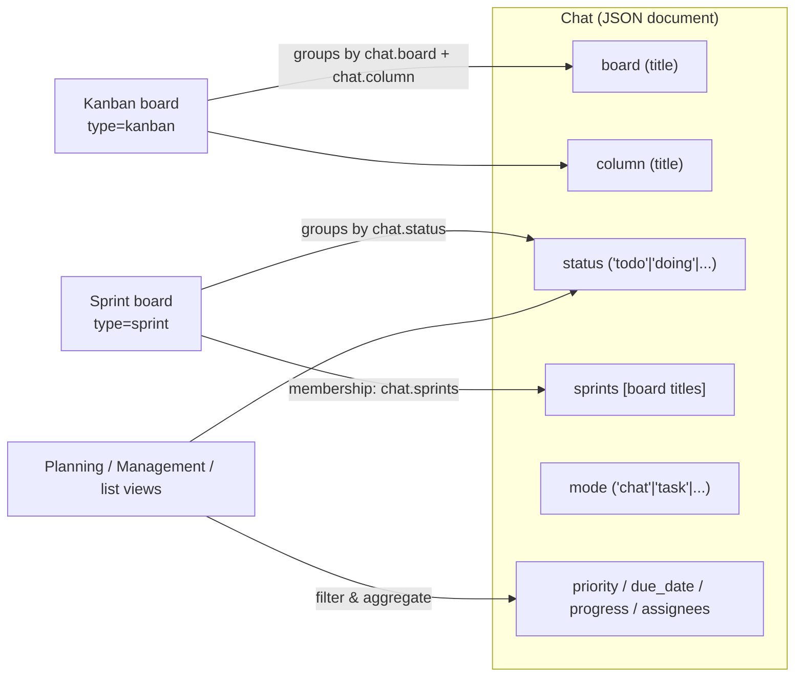
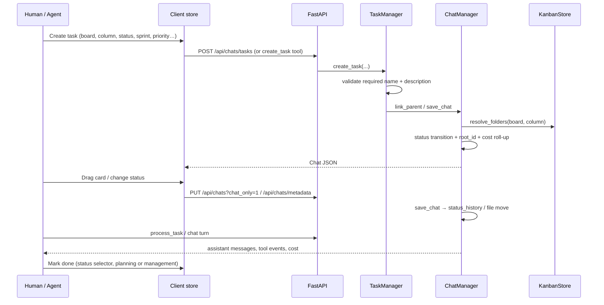

# Tasks, boards, sprints, statuses and columns

> **What this document is.** An engineering walkthrough of the work model of
> `codx-junior`: how a **chat** becomes a **task**, how **boards** and **columns**
> organise tasks, what **status** means (and does not mean), how **sprints**
> relate to boards, and how the different **work surfaces** (board, planning,
> management) read and write the same data.
>
> **What it is based on.** Static review of the working tree at commit
> `9654d953` (*"add kanban v2 storage and LRT-0 fixes"*), plus a direct check of
> the project's own `.codx/tasks` data and one runtime check of
> `KanbanStore._normalize_columns`. Line references are anchors, not contracts.
>
> **Audience.** Contributors changing the board, task, planning or management
> code; reviewers evaluating the data model.

---

## Contents

1. [The model in one paragraph](#1-the-model-in-one-paragraph)
2. [Entities at a glance](#2-entities-at-a-glance)
3. [Chat = task](#3-chat--task)
4. [Boards](#4-boards)
5. [Columns](#5-columns)
6. [Status](#6-status)
7. [Sprints](#7-sprints)
8. [End-to-end lifecycle of a piece of work](#8-end-to-end-lifecycle-of-a-piece-of-work)
9. [Read models and reporting](#9-read-models-and-reporting)
10. [Storage on disk](#10-storage-on-disk)
11. [Invariants and gotchas](#11-invariants-and-gotchas)
12. [Observed gaps and risks](#12-observed-gaps-and-risks)
13. [Where to change what](#13-where-to-change-what)
14. [Glossary](#14-glossary)

---

## 1. The model in one paragraph

A **`Chat`** is the atom. It is simultaneously a conversation, a work item and a
budget envelope. A **board** is a catalogue document that groups chats. A
**column** is a lane inside a board. Critically, the two board flavours group
chats by **different chat fields**:

* a **kanban** board groups chats by `chat.column`, and
* a **sprint** board groups chats by `chat.status`.

A **sprint** is therefore a board whose columns are a *view over statuses*, not a
separate physical place: sprint membership is a list on the chat (`chat.sprints`),
and moving a card across a sprint board rewrites `chat.status`. A task can sit in
one kanban column **and** in several sprints at the same time, because those are
orthogonal slices of the same `Chat` document.



**The single most important consequence:** renaming or reordering a *sprint
column* never moves a task file; it changes which status value the column
matches. Renaming a *kanban column* is a label change only — the tasks keep the
old `chat.column` string unless they are explicitly rewritten (see
[§12](#12-observed-gaps-and-risks)).

---

## 2. Entities at a glance

| Entity | Python / JS | Persisted as | Identity | Notes |
| --- | --- | --- | --- | --- |
| Chat / task | `Chat` (`api/codx/junior/db.py:327`) | one JSON file per chat | `id` (uuid), also encoded in the filename | Carries messages, cost, board/column, status, sprints |
| Board | plain dict in the kanban catalogue | `tasks/index.json` + `tasks/boards/<id>/board.json` | **title** for chats; `id` + `folder` for storage | `type`: `kanban` (default) or `sprint` |
| Column | plain dict inside the board document | `board.json` → `columns[]` | `id` in the document; **title** on the chat | Kanban columns are free-form; sprint columns map to a status |
| Status | `Chat.status` | chat JSON | canonical string | `todo`, `doing`, `onhold`, `done`, `rejected` |
| Sprint | board with `type == "sprint"` | board document + `chat.sprints` | board title | Membership is many-to-many |
| Status transition | `ChatStatusEvent` (`db.py:304`) | `chat.status_history[]` | `doc_id` | Append-only, written by `save_chat` |
| Planning event | `ActivityEvent` (`model/planning.py:163`) | `.codx/planning/events.jsonl` | `id` | Written only by `/api/planning/*` writes |

The catalogue (boards/sprints/columns) is **not** a database table: it is a small
tree of JSON files behind a project-wide `fcntl` lock
(`api/codx/junior/kanban/store.py`).

---

## 3. Chat = task

### 3.1 What makes a chat a "task"

There is no separate `Task` class. Two notions of "task" coexist:

* **Structurally**, any chat placed on a board is a task: the board views render
  it as a card, and `boardChats` selects it by `chat.board`. Board placement
  alone is enough here.
* **For the planning and management read models**, a chat is included only when
  it is not in `mode == "chat"`, **or** it carries `status`, `priority`,
  `due_date` or `assignees`. Board/column placement is **not** a planning
  signal.

The second rule is implemented twice with the same intent:

* `PlanningManager._is_task` — `api/codx/junior/planning_manager.py:248`
* `ManagementManager._is_task` — `api/codx/junior/management_manager.py:255`

Templates (`is_template`) are always excluded. A consequence worth knowing: a
default board card created in `mode="chat"` with an empty status, no priority,
no due date and no assignees is **visible on its board but absent from planning
and from the management "Work" table**. In this repository's own project that is
450 of 1,503 chats (about 30%); see §12.7.

### 3.2 "Task" the mode is not "task" the work item

`Chat.mode` controls the **behaviour of the conversation**, not whether the chat
is work:

| Mode | Meaning |
| --- | --- |
| `chat` | Normal conversation (the default, and the mode of most board cards) |
| `task` | *Document/refinement* mode: after a turn the engine hides every non-answer message (`chat_engine.py:1877`, `_is_refine` at `:82`), so the chat reads as a living document |
| `agent` | Tool-loop agent turn |
| `vibe` | Code + diff + preview workflow |
| `topic` / `channel` | Team conversation |
| `prview` | Pull-request review |
| `tutorial`, `browser`, `slides`, `preview` | Other specialised surfaces |

The canonical task factory, `TaskManager.create_task`
(`api/codx/junior/task_manager.py:187`), defaults to **`mode="chat"`**
(`task_manager.py:65`), despite the docstring saying "task by default". In other
words: **a task is a chat placed on a board; `mode="task"` is just one way to
converse.** Do not use `mode` to detect task-ness.

The client keeps the same distinction: the "New task" menu on a kanban column
offers *Chat* (`mode: 'chat'`), *Document* (`mode: 'task'`), *Topic* and
*PR Review* (`client/src/components/kanban/KanbanColumnView.vue:47`).

### 3.3 The fields that carry work state

All on `Chat` (`api/codx/junior/db.py:327`):

| Field | Line | Role |
| --- | --- | --- |
| `board`, `column` | `:373-374` | **Display labels** (board/column titles). Combined with `kanban_id`/`column_id` in older data. |
| `kanban_id`, `column_id` | `:371-372` | Legacy id fields; management reads `column_id` as a fallback (`management_manager.py:333`). |
| `sprints` | `:375` | Board **titles** of the sprints this task belongs to. |
| `status` | `:349` | Workflow state. Default is the empty string, not `todo`. |
| `priority` | `:388` | `high` / `medium` / `low`. |
| `due_date` | `:392` | ISO date. |
| `progress` | `:396` | 0–100. |
| `assignees` | `:400` | Usernames doing the work (distinct from `users`, who participate). |
| `sort_index` | `:404` | Manual order inside a column/board. |
| `mode` | `:370` | Conversation behaviour (see above). |
| `parent_id`, `root_id` | `:333-343` | Sub-task tree; `root_id` is the cached topmost ancestor. |
| `estimation_cost`, `cost` | `:417-438` | Budget and accumulated spend in cxjcoins. |
| `status_history` | `:350` | Append-only transition log. |
| `columns` | `:409` | Legacy/embedded column model — not used by the v2 catalogue. |

### 3.4 Task trees

A task can have sub-tasks (`parent_id`). `root_id` is a **cache of the
parent walk**, resolved/backfilled by `codx.junior.identity`
(`api/codx/junior/identity.py`). `TaskManager.create_task` stamps it through
`link_parent`, so every task of a tree resolves to the same main task.

The root owns the budget: `ChatManager` accumulates each message's cost into the
chat **and** rolls the same delta into `root_id`'s `cost`
(`chat_manager.py:99-105`, `:835`), so `estimation_cost` on the main task covers
descendants too.

---

## 4. Boards

### 4.1 Two flavours, one document

A board is an entry in the kanban catalogue:

```json
{
  "id": "432836c6-8494-5195-9249-5366d541c2b9",
  "title": "Gamification",
  "type": "kanban",              // or "sprint"
  "description": "",
  "parent_id": null,
  "folder": "Gamification",      // immutable storage folder
  "columns": [
    { "id": "…", "title": "Backlog", "color": "", "folder": "Backlog", "order": 0 }
  ]
}
```

* **`type`** decides how cards are grouped: `kanban` → by `chat.column`,
  `sprint` → by `chat.status`.
* **`title`** is the identity chats use (`chat.board` / `chat.sprints`) and the
  key the API returns boards under. Titles are compared **case-insensitively**
  in the client (`sameKey`/`compareKey` in `client/src/store/kanban.js:58-77`)
  and prohibited from colliding by the store's UI.
* **`id`** is the storage identity (the folder under `tasks/boards/`).
* **`folder`** is immutable: renaming a board *should* only edit `title`, so no
  chat is moved. This is the stated design of the v2 store
  (`kanban/store.py` module docstring, `resolve_folders` at `:276`).
* **`parent_id`** supports a board hierarchy (epics). It stores a board
  **title**, compared case-insensitively.
* Board-level extras used by the UI (`assignee`, `users`, `background`,
  `bookmark`, `project_id`) survive a store save because `_normalize_board`
  merges `{**stored, **entry}` (`kanban/store.py:501-516`).

### 4.2 The catalogue: v2 storage

```
.codx/tasks/
├── index.json                                  # { version: 2, boards: [ {id,title,type,parent_id,folder,order} ], tags }
├── boards/<board_id>/board.json                # full board definition incl. columns
├── <board_folder>/<column_folder>/<slug>.<chat_id>.json
└── .kanban.lock                                # fcntl lock, project-wide
```

* `KanbanStore.load()` (`store.py:213`) assembles the legacy-compatible shape
  `{version, boards: {"<title>": {...}}, tags}` so `/api/kanban` and the Vue
  client keep working.
* `KanbanStore.save()` (`store.py:518`) diffs the assembled document against
  the index, writes one `board.json` per board, removes the definitions of
  boards that disappeared, and writes `index.json` last — all under
  `KanbanStore.locked()` (`:130`) and with atomic `tmp` + `os.replace`.
* The v1 layout (a single `tasks/kanban.json`) is migrated on first access
  (`migrate_if_needed` → `api/codx/junior/migrations/kanban_v1_to_v2.py`). The
  legacy file is backed up as `kanban.v1.backup.json`. This repository's own
  project has already been migrated.
* `is_store_file()` (`kanban/model.py:75`) keeps `index.json`, `kanban.json` and
  everything under `boards/` from being parsed as chats.

### 4.3 Board membership and the virtual "Unassigned" board

A kanban task belongs to a board when `chat.board` matches the title
(case-insensitive) — `boardChats` in `client/src/store/kanban.js:441`.

At rest almost every chat has a board: `ChatManager.save_chat` defaults an empty
`board`/`column` to `kanban`/`tasks` (`chat_manager.py:1152-1155`). The client
still exposes a **virtual, read-only board** named `Unassigned`
(`NO_BOARD_ID`, `kanban.js:10-13`) that catches chats with no `board` at all
(legacy rows, partially written imports). It is never persisted and cannot be a
creation target.

The board order in the UI is the index order (`order`), with the virtual board
always last (`allBoards`, `kanban.js:389`).

### 4.4 Board lifecycle

* **Create:** `addBoard` (`kanban.js:1311`) → `POST /api/kanban`.
* **Edit:** `saveBoard` (`kanban.js:1340`). Renaming also rewrites `chat.board`
  on every task and fixes `parent_id` of child boards. Note that the edit
  payload contains title/description/background/assignee/users only — see
  [§12](#12-observed-gaps-and-risks).
* **Delete:** `deleteBoard` (`kanban.js:1412`). For a kanban board the UI offers
  "delete tasks too"; for a sprint the tasks are always kept and only lose the
  sprint membership (`deleteChats: false`, `SprintBoardModals.vue:1875`).
  Backend deletion is `ChatManager.delete_kanban`
  (`chat_manager.py:1300`), which removes the board folder and the catalogue
  entry.
* **Transfer/import:** `BoardTransferModal.vue` / `exportBoard`/`importBoard`
  produce a portable `codx-junior-board` document (version 1,
  `kanban.js:37-38`) and can move a board with all its tasks to another project.

---

## 5. Columns

### 5.1 Kanban columns group `chat.column`

For a `kanban` board:

* the task's lane is the **string** in `chat.column`;
* the board document lists the columns (`title`, `color`, `folder`, `order`)
  and their extras (`profiles`, `project_id`, `showSubTasks` in the client);
* the rendered column set is the **union** of stored column titles and the
  `chat.column` values actually found on the board's tasks (`columnList`,
  `kanban.js:457`). A chat whose `column` matches no stored column is rendered
  in a non-stored column with that title (`buildViewColumns`, `kanban.js:470`);
* chats with no `column` land in the virtual `--none--` column
  (`NO_COLUMN_ID`, `kanban.js:23`);
* moving a card writes `chat.column` (`moveTask`, `kanban.js:967`);
* ordering within a column uses `sort_index`, then `pinned`/`chat_index`
  (`kanban.js:490`);
* the column's **storage folder** is resolved from the catalogue
  (`KanbanStore.resolve_folders`) and is separate from the label, so a column
  rename *should* not move files.

### 5.2 Sprint columns group `chat.status`

For a `sprint` board:

* the board document may persist columns as
  `{ id, title, icon, color, status, profiles, project_id }`; `status` is the
  `chat.status` the column groups (falling back to `title`);
* boards that were never customised (and the virtual board) fall back to the
  canonical status list: *To Do, Doing, On Hold, Done, Rejected*
  (`defaultSprintColumns`, `kanban.js:272`);
* tasks are grouped by comparing `chat.status` to the column status
  **case-insensitively** (`sprintColumns`, `kanban.js:566`);
* every task the board cannot place — no status, or a status no column maps —
  is rendered in a virtual, always-present **Unassigned** status column
  (`NO_STATUS_ID`, `kanban.js:25-32`);
* dropping a card on a column writes `chat.status` (`moveSprintStatus`,
  `kanban.js:1031`); dropping it on the virtual column **clears** the status;
* no task file moves when a card changes sprint column.

### 5.3 Column operations

| Operation | Kanban | Sprint |
| --- | --- | --- |
| Add | `addColumn` (`kanban.js:812`) | `addSprintColumn` (`:1162`); materialises defaults first |
| Rename / edit | `updateColumn` (`:837`) — board document only | `updateSprintColumn` (`:1200`) — migrates tasks if the mapped status changes |
| Reorder | `syncColumnOrder` (`:875`) — writes `chat.column` for moved cards | `syncSprintColumnOrder` (`:928`) — order only |
| Delete | `deleteColumn` (`:858`) — deletes the column's tasks | `removeSprintColumn` (`:1249`) — reassigns tasks to a remaining column |
| Drop target | `moveTask` | `moveSprintStatus` |
| Virtual lane | `--none--` (no column) | `--no-status--` (no/unknown status) |

The client protects two invariants: a board must keep at least one column, and
two sprint columns must not map to the same status (`updateSprintColumn`
collision check, `:1221-1224`).

### 5.4 How columns are persisted

The store normalises every column it writes to
`{id, title, color, folder, order}` (`_normalize_columns`,
`kanban/store.py:417-470`). It inherits `id`/`folder` from the previously stored
column with the same title, which is what keeps files in place across renames.

**Only those five fields reach `board.json`.** Client-only column fields
(`status`, `icon`, `profiles`, `project_id`, `chats`) are not carried through
the store. This has a direct consequence for sprint boards and is covered in
[§12.2](#122-sprint-column-status-is-not-persisted).

---

## 6. Status

### 6.1 Canonical values

One closed set, defined in `planning_manager.py:62-78` and re-used everywhere:

| Status | Label | Meaning in the derived metrics |
| --- | --- | --- |
| `todo` | To do | Active |
| `doing` | Doing | Active; becomes *stalled* after 21 days without update (planning) / 14 days (management) |
| `onhold` | On hold | The only human-set "blocked" signal in management |
| `done` | Done | Closed; completion % |
| `rejected` | Rejected | Closed; counted separately |

The client mirrors this in `client/src/store/chats.js:22` (`CHAT_STATUS_CONFIG`
with icon/colors/button classes) and `client/src/store/planning.js:30`
(`TASK_STATUS` — note it omits `rejected`).

### 6.2 `status` is not `column`, and not `mode`

* **Status** answers *where is the work in the workflow?* It is board-agnostic.
* **Column** answers *where is the card on this board?* On a kanban board it is
  the lane; on a sprint board it *derives from* status.
* **Mode** answers *how does the conversation behave?* (see §3.2).
* **Progress** is a separate 0–100 number; nothing enforces consistency between
  `progress` and `status` except management's write path, which forces
  `progress = 100` when it sets `status = done` (`management_manager.py:1060`).

A chat can be `status = ""` (its default) and still be a perfectly valid task
card. Readers normalise the empty/unknown value to `todo` for metrics
(`_normalize_status`, `planning_manager.py:121`; `_decorate`,
`management_manager.py:279-281`), while the **sprint board** treats an empty
status as *Unassigned*, not as *To do*.

### 6.3 Who writes status

| Writer | Path | Notes |
| --- | --- | --- |
| Client status selector / sprint drag | `POST /api/chats/metadata` | `chats.js:889` → backend `update_chat_metadata` |
| Kanban/board card move | `PUT /api/chats?chat_only=1` (via `saveChatInfo`) | Only `column` changes for kanban |
| Planning view | `$storex.planning.updateStatus` (`planning.js:622`) | Also goes through `/api/chats/metadata` today |
| Planning API | `PATCH /api/planning/tasks/{id}` (`api/chat.py:1345`) | Emits an `ActivityEvent` |
| Management dashboard | `PUT /api/management/tasks/{id}` (`api/management.py:191`) | `blocked` ⇄ `onhold`; forces progress 100 on done |
| Agent tools | `create_task` / `project_manager` | Validated against `STATUS_ORDER` (`project_manager_tools.py:760`) |
| Imports | board transfer / `gitIssue` wizard | Copies whatever the document says |

**Nothing advances status automatically.** Finishing an agent run, a tool call
or a chat turn does not change `chat.status`: statuses are an explicit human (or
API) decision, which is consistent with the "humans keep direction" product
thesis.

### 6.4 Status history

`ChatManager.save_chat` detects a real transition and appends a
`ChatStatusEvent` to `chat.status_history` (`chat_manager.py:1067-1125`). The log
is merge-safe (dedup by `doc_id`), append-only, and sorted by timestamp.

Caveats visible in the code:

* the `user` argument is never passed by `save_chat`, so the history records the
  transition but **no actor**;
* the first save of a chat with a status records `from_status = None`;
* history is only written when going through `save_chat` — all current write
  paths do, but a direct file edit would bypass it.

---

## 7. Sprints

### 7.1 Definition

A sprint is **a board with `type == "sprint"`**. It is not a separate collection
and has no start/end dates of its own in the data model. Its columns are a
status projection (see §5.2).

### 7.2 Membership is on the chat

`Chat.sprints` is a list of **board titles** (`db.py:375`). The relation is
many-to-many:

* a task can be in several sprints;
* a sprint task can still live on a kanban board and column;
* child chats inherit the parent's sprints when they do not declare their own
  (`chats.js:1027-1035`);
* a task is "in a sprint" when `chat.sprints` contains the sprint title,
  compared case-insensitively (`sprintBoardChats`, `kanban.js:545`);
* add/remove membership: `addTasksToSprint` (`:1045`), `removeTaskFromSprint`
  (`:1062`); creating a task on a sprint also stamps `sprints: [boardTitle]`
  (`newSprintTask`, `:1071`).

### 7.3 What a sprint board changes compared with a kanban board

| Aspect | Kanban board | Sprint board |
| --- | --- | --- |
| Grouping field | `chat.column` | `chat.status` |
| Membership | `chat.board` | `chat.sprints` |
| Card move writes | `column` | `status` |
| Columns | Free-form, user-defined, can be deleted | Status lanes (defaults: the 5 canonical statuses), order/rename/icon/colour configurable |
| Virtual lane | `--none--` | `--no-status--` (unknown/empty status) |
| Extra panels | sidebar task list, per-column filter | dropdown switcher, stats (duration, avg ticket cost, tasks per user/profile), Gantt |
| Deletion | optional task deletion | tasks always kept, membership removed |

The sprint board UI lives in `KanbanBoardView.vue` (view tabs: board / table /
gantt) with `SprintBoardCanvas.vue`, `SprintBoardColumn.vue`,
`SprintBoardGantt.vue` and `SprintBoardModals.vue`; the kanban flavour reuses
the same shell with `KanbanBoardCanvas.vue` and a sidebar.

### 7.4 Cost and progress

Sprint headers aggregate the cost of their visible tasks
(`KanbanBoardView.vue` sprint header), and the stats panel derives duration,
average ticket cost and completion from `created_at`, `cost`, `status` and
`assignees`. These numbers are computed client-side over the loaded cards; see
§9.2 for why that matters.

---

## 8. End-to-end lifecycle of a piece of work



### 8.1 Creation

There are exactly three creation entry points, and all of them delegate to
`TaskManager.create_task` (`api/codx/junior/task_manager.py:187`):

1. `POST /api/chats/tasks` (`api/codx/junior/api/chat.py:898`),
2. the `create_task` LLM tool (`tools/create_task_tool.py:203`),
3. `project_manager(action="create_task")` (`tools/project_manager_tools.py`).

Rules enforced there:

* **`name` and `description` are mandatory**; there is no AI expansion or
  splitting of a task anymore (the old `/chats/sub-tasks` endpoint returns
  HTTP 410).
* **Nothing is inherited from the parent chat** — profiles, files, board,
  column, sprints, tags and content come from the arguments. Only the
  `parent_id` linkage and project fallbacks come from the parent.
* The **destination must exist**: `validate_task_destination` checks the board,
  column, sprints and status against the catalogue before writing
  (`project_manager_tools.py:1235`). The tool also validates board names as
  storage-safe folder names.
* Defaults when omitted: `board = "kanban"`, `column = "tasks"`, `status = ""`,
  `progress = 0`, `mode = "chat"` (`task_manager.py:63-65`,
  `create_task_tool.py:38-39`).

The client-side "New Task" path (`newTask`, `kanban.js:995`; `newSprintTask`,
`:1071`) creates the chat through `saveChatInfo` (`PUT /api/chats?chat_only=1`)
and supplies board/column/status/sprints in the payload.

### 8.2 Auto-placement (new chats)

A chat created without a destination is flagged `auto_initialize`. On the first
assistant response the engine (`chat_engine.py:1760`):

1. asks the model for a **name** (`CHAT_INIT_PROMPT`, name only),
2. runs `ChatOrganizer.organize_if_needed` (`organizer/service.py:199`) against
   the real board/column catalogue, taking the first confident engine (local
   structured engine, then the LLM fallback),
3. applies only the **missing** fields (`needs_organization`), so a destination
   set by a human always wins,
4. clears `auto_initialize`.

The organizer's decision is persisted through
`ChatManager.update_chat_metadata` — the same path as
`POST /api/chats/metadata` — and can set `board`, `column` and `priority`.

### 8.3 Doing the work

* A task is "processed" with `process_task` (`tools/process_task_tool.py`),
  which loads the chat and calls the normal chat pipeline, or by opening the
  card and chatting.
* The chat engine resolves mode, profiles, model and context per turn
  (`chat/chat_engine.py`); `mode="task"`/`"tutorial"` are *refine* modes,
  `vibe` is the code/diff mode.
* Tool events and lifecycle events are persisted on the assistant message;
  cost accumulates on the chat and rolls up to `root_id`.
* There is no automatic status transition at the start or end of a run.

### 8.4 Finishing

"Done" is a status write. The most explicit behaviours:

* management's `update_task` sets `progress = 100` when it writes
  `status = "done"` (`management_manager.py:1060`);
* planning's `update_task` does not touch progress;
* the client status selector writes only `status`.

---

## 9. Read models and reporting

Three surfaces read the same chats with different scopes. They are **not**
interchangeable, and two of them are currently duplicated on the client.

### 9.1 Board views (project, one board)

* `KanbanBoardView.vue` is the route target
  (`client/src/router/index.ts:140-143`) for `/:projectName/kanban/:board?/:boardName?`.
* It renders one board at a time from `$storex.kanban`:
  `boardChats` → `buildViewColumns` (kanban) or `sprintColumns` (sprint).
* Views: `board`, `table`, and `gantt` (sprint), plus global `planning` and
  `followup`.
* The legacy `KanbanContainer.vue`/`Kanban.vue` tree (used by `KanbanView.vue`
  and the vibe-coding chat panel) still reads `$projects` and is a second,
  older implementation of the same board.

### 9.2 Planning (project, all boards)

Two implementations exist:

| Layer | Where | Data source | Status |
| --- | --- | --- | --- |
| Client planning store | `client/src/store/planning.js` | `POST /api/chats/search`, paginated 100 at a time, filters/sorts/aggregates **in the browser** | Used by `PlanningView.vue` and `FollowupView.vue` |
| Server planning API | `PlanningManager` + `POST /api/planning/tasks/query`, `/planning/dashboard`, `/planning/activity`, `PATCH /planning/tasks/{id}`, `POST /planning/tasks/reorder` (`api/chat.py:1279-1415`) | `ChatManager.list_chats()` | **No client caller found** at this revision |

The server surface is the more complete one conceptually:

* filtering by range/boards/assignees/priorities/statuses/search/attention;
* server-side sorting (priority → due date → `sort_index`);
* **dataset-wide** metrics, board progress, attention queue and group counts
  (not just the loaded page);
* an event-sourced activity feed in `.codx/planning/events.jsonl`
  (`PlanningEventStore`, `planning_manager.py:149`);
* optimistic concurrency via `expected_updated_at`.

The UI, however, computes its own metrics from the pages it has loaded and
fabricates the activity feed from `chat.updated_at` (`taskToActivity`,
`planning.js:145`). So the "true counts over the whole dataset" guarantee does
not reach the current screen. This is drift to be aware of when changing either
side.

### 9.3 Management dashboard (cross-project, "Work" section)

`ManagementManager` (`api/codx/junior/management_manager.py`) reads every
project the user can see and exposes:

| Section | Endpoint | Content |
| --- | --- | --- |
| Pulse | `GET /api/management/overview` | metrics, attention, activity, forecast, team, cost |
| **Work** | `POST /api/management/tasks/query` | filtered, sorted, paginated tasks |
| Blockers | `GET /api/management/blockers` | attention queue |
| Delivery | `GET /api/management/delivery` | forecast per board + burndown |
| Team | `GET /api/management/team-load` | capacity/workload per assignee |
| Cost | `GET /api/management/cost` | AI consumption and budget |
| Write | `PATCH`/`PUT /api/management/tasks/{id}` | write-through to the owning project |
| Assistant | `POST /api/management/assistant` | rule-based answers over the same numbers |

Its board identity is `"<project_id>::<board>"` because board titles are not
unique across projects (`management_manager.py:332`). It derives:

* `blocked` = `status == "onhold"`;
* `stalled` = `doing` and untouched for 14 days;
* `overdue` / `due_today` from `due_date` (unless closed);
* load from active-task counts (there are no estimates), `* 4h` for display.

The client module (`client/src/api/modules/management.js`) is real (the stale
comment in `config/apps.js` still says it is mock-backed).

### 9.4 Status badges and lists

* `CHAT_STATUS_CONFIG` (`chats.js:22`) is the single source of truth for badge
  label/icon/colour; unknown statuses fall back to `todo` for display.
* `ChatSidebar.vue` filters by status, defaulting missing statuses to `todo`.
* `KanbanList.vue`/`TaskTableView.vue` expose status filters from the same
  config.

---

## 10. Storage on disk

```
<project>/.codx/
├── tasks/
│   ├── index.json
│   ├── boards/<board_id>/board.json
│   ├── .kanban.lock
│   ├── <Board title>/<Column title>/<slugified name>.<chat uuid>.json
│   └── kanban.v1.backup.json        # only after a v1 → v2 migration
├── planning/events.jsonl            # planning activity feed
└── …                                # profiles, knowledge, wiki, etc.
```

Chat file path is computed by `ChatManager.get_chat_file`
(`chat_manager.py:245`): resolve the **folders** from the catalogue by board and
column titles, then append `slugify(chat.name)` + `chat.id`. If the computed path
differs from the stored one, `save_chat` writes the new file and deletes the old
one (`chat_manager.py:1184-1190`).

`ChatManager.list_chats()` (`chat_manager.py:481`) walks the tree, skips the
catalogue files (`is_store_file`), and loads each chat with only its last message
(`chat_only=True`) — which is why "lists" are cheap but incomplete.

The board catalogue is **not** watched; chat files are (background service).
Nothing in the storage layer enforces that `chat.board`/`chat.column` still
exist in the catalogue — the UI is what keeps them consistent.

---

## 11. Invariants and gotchas

1. **Ids are canonical; titles are labels.** `Chat.kanban_id`/`column_id` and
   board/column `id`/`folder` exist for this reason (`identity.py:1-20`). Chats,
   however, reference boards and columns **by title**, so titles are also
   identity in practice.
2. **`board`/`column` on a chat are titles, not ids.** Renaming a board updates
   every `chat.board` (client-side); renaming a column does **not** update
   `chat.column`.
3. **Status is independent.** A chat's status does not have to match any column
   except when a sprint board renders it.
4. **The default status is `""`**, normalized to `todo` only for read models.
   Sprint boards show it in *Unassigned*.
5. **Every chat gets a board on save.** `kanban`/`tasks` defaults mean "no board"
   is mostly a legacy/partial-data state.
6. **A sprint is not a container.** It is a many-to-many tag whose board view
   groups by status.
7. **Moving a card is a metadata write**, not a file move, unless the board or
   column title changes.
8. **Deleting a board can delete tasks** (kanban, opt-in) or detach them; sprint
   deletion never deletes tasks through the UI.
9. **Column persistence is lossy for UI-only fields** — see §12.2.
10. **No automatic status changes** anywhere in the chat engine or agent loop.

---

## 12. Observed gaps and risks

These are code-level observations from static review (plus one direct call to
`_normalize_columns`), not necessarily bugs someone has reported.

### 12.1 Kanban column rename leaves `chat.column` behind

`updateColumn` (`client/src/store/kanban.js:837`) edits the board document only.
Tasks keep the old `chat.column` value. The rendered column set is the union of
stored titles and task column values (`columnList`, `:457`), so after renaming
"To do" → "Backlog" the board shows **both** *Backlog* (empty) and *To do*
(the tasks, as a non-stored column). Sprint columns do migrate their tasks on a
status change (`updateSprintColumn`, `:1200`); kanban columns do not.

### 12.2 Sprint column `status` is not persisted

The v2 store rewrites every column to
`{id, title, color, folder, order}` (`_normalize_columns`,
`kanban/store.py:417-470`). Client-only fields — `status`, `icon`, `profiles`,
`project_id`, `chats` — never reach `board.json`.

Verified directly:

```python
KanbanStore("...")._normalize_columns(
    [{"id": "todo", "title": "To Do", "status": "todo", "icon": "fa-x",
      "profiles": ["backend"], "project_id": "p1"}]
)
# -> [{'id': 'todo', 'title': 'To Do', 'color': '', 'folder': 'To Do', 'order': 0}]
```

Consequence: once a sprint board is edited (which calls
`materializeSprintColumns` and saves), a reload loses each column's `status`.
`SprintBoardModals` only pre-fills `status` from the effective value, and
`sprintColumnStatus()` then falls back to the **title**. Default titles ("To Do",
"On Hold") do not equal the canonical values ("todo", "onhold"), so after a
reload those columns no longer match their tasks and the cards fall into the
virtual *Unassigned* column. Columns whose titles happen to equal the status
value ("Doing", "Done") keep working.

This is the highest-impact integration seam in the whole work model: the client
sprint board and the v2 storage layer disagree about what a column is.

### 12.3 Agent-created sprint columns have no status mapping

`_new_board_entry` (`tools/project_manager_tools.py:920`) creates columns as
`{id, title, color}` with the default sprint titles `To do` / `Doing` / `Done`
(`:157`). Even before the persistence loss, "To do" does not equal `todo`, so
only statuses named exactly `doing`/`done` group correctly. The tool's own
catalogue does not carry column statuses, so `create_column` cannot set one
either.

### 12.4 Board rename can re-key the board and lose its columns

`saveBoard` (`kanban.js:1340`) rebuilds the renamed entry from
`kanban.boards[newName] || {}` *after* deleting the old key, and the edit modal
sends only `title/description/background/assignee/users`
(`SprintBoardModals.vue:1849`). So on a rename:

* the request has no `columns` and no board `id`;
* the backend cannot match the stored board by id or by the new title, so it
  assigns a new id and derives a new folder from the new title
  (`_normalize_board`, `kanban/store.py:472-516`);
* the old board file is removed by the save diff.

Because the client rewrites `chat.board` on every task **before** saving the
renamed catalogue, `get_chat_file` resolves a folder from the (still old)
catalogue, fails to find the new title, and falls back to the title as folder —
so the chat files move. This contradicts the "renaming changes nothing on disk"
design of `KanbanStore`. Case-only renames are safe (they match the catalogue
case-insensitively); real renames are not.

### 12.5 Two planning implementations

`POST /api/planning/*` (server-side, dataset-wide, event-sourced) has **no
client caller**; the Planning and Follow-up views use the older client store
built on `/api/chats/search`. Metrics, attention and "showing X of Y" therefore
come from the loaded pages, and the activity feed is synthesised from
`chat.updated_at` instead of `planning/events.jsonl`. The management dashboard
does read the event file, but management writes do not append to it, and the
current UI never calls the planning write endpoints — so the feed is largely
empty unless an external client uses the planning API.

### 12.6 Management's sprint detection is a heuristic

`management_manager.py:456` and `:624` classify a board as a sprint with
`any(task.column == "sprint")` and ignore `chat.sprints` and the board's `type`.
Board identity elsewhere is title-based. This will disagree with the board UI for
any sprint whose tasks do not have `column == "sprint"` (i.e. almost all of
them).

### 12.7 Real data already contains non-canonical statuses

This repository's own `.codx/tasks` (1,503 chats, 113 kanban + 10 sprint boards)
contains `status` values such as `loaded` (195), `saving` (81),
`uninitialized` (56), `ui` (25), `agent` (4) and `models` (1), alongside the
canonical ones and 840 empty values. Readers normalise them (planning and
management map unknown values to `todo`), and sprint boards put them in
*Unassigned*, but nothing migrates them. The `Chat.vue` guard that compares
`chat.status` to `ENTITY_STATUS.LOADING` (`Chat.vue:403`) suggests UI entity
states have leaked into task status at some point.

### 12.8 Smaller drift

* `Chat.status_history` records no user (the `user` parameter is never passed).
* `mode="task"` is described as "task by default" in `TaskManager` while the
  default is `chat` (`task_manager.py:65`).
* `planning.js` `TASK_STATUS` omits `rejected`, which `chats.js` and the backend
  do support.
* `KanbanBoardView` has a leftover `board?.columns?.chats`
  (`kanban.js:472`) — `columns` is an array, so that expression is always
  `undefined` and the `chat_index` fallback ordering is inert.
* Stale docstrings in `project_manager_tools.py` still describe
  `tasks/kanban.json` as the storage file; the code goes through `KanbanStore`.
* Legacy `Kanban.vue`/`KanbanContainer.vue` still render boards from
  `$projects`, in parallel with `KanbanBoardView.vue`.

---

## 13. Where to change what

| Goal | Start here |
| --- | --- |
| Change the canonical statuses or labels | `api/codx/junior/planning_manager.py:62` + `client/src/store/chats.js:22` (and `planning.js:30`) |
| Change how a task is created / validated | `api/codx/junior/task_manager.py`, `tools/create_task_tool.py`, `tools/project_manager_tools.py:1235` |
| Change board/column storage | `api/codx/junior/kanban/store.py`, `kanban/model.py`, `migrations/kanban_v1_to_v2.py` |
| Change how a card is grouped on a board | `client/src/store/kanban.js` (`buildViewColumns`, `sprintColumns`, `boardChats`) |
| Change drag & drop semantics | `client/src/store/kanban.js` (`moveTask`, `moveSprintStatus`), `KanbanBoardView.vue:1293` |
| Change the sprint definition | `client/src/store/kanban.js` sprint getters + `Chat.sprints` in `db.py:375`; backend only stores the list |
| Change auto-placement of new chats | `api/codx/junior/organizer/*`, `chat/chat_engine.py:1760` |
| Change project-level planning aggregates | `api/codx/junior/planning_manager.py` (+ `api/chat.py:1279`) — and wire the client if the UI should use it |
| Change cross-project "Work" | `api/codx/junior/management_manager.py`, `api/management.py`, `client/src/api/modules/management.js` |
| Change status history / metrics | `ChatManager._register_status_change` (`chat_manager.py:1067`) |

---

## 14. Glossary

| Term | Meaning here |
| --- | --- |
| **Chat** | The JSON document: conversation + work item + budget. |
| **Task** | A chat that is placed on a board and/or carries planning metadata. Not a distinct class. |
| **Board** | A catalogue entry (`type` + columns) that groups chats. |
| **Kanban board** | `type != "sprint"`; groups chats by `chat.column`. |
| **Sprint board** | `type == "sprint"`; groups chats by `chat.status`; membership via `chat.sprints`. |
| **Column** | A lane: a `chat.column` value (kanban) or a `chat.status` mapping (sprint). |
| **Status** | The workflow state (`todo`/`doing`/`onhold`/`done`/`rejected`). |
| **Mode** | Conversation behaviour (`chat`, `task`, `agent`, `vibe`, …); independent of status. |
| **Virtual board** | `Unassigned` — client-only catch-all for chats with no board. |
| **Virtual column** | `--none--` (no column) or `--no-status--` (no/unknown status); never persisted. |
| **Folder** | Immutable directory name under `.codx/tasks`; decoupled from the display title. |
| **Root task** | Topmost ancestor of a task tree; owns the rolled-up cost budget. |
| **Planning** | Project-scoped read/aggregate surface over tasks. |
| **Work (section)** | The cross-project task table of the management dashboard. |

---

*Reviewed from the working tree at commit `9654d953`. The project moves fast:
verify line anchors before relying on them.*
