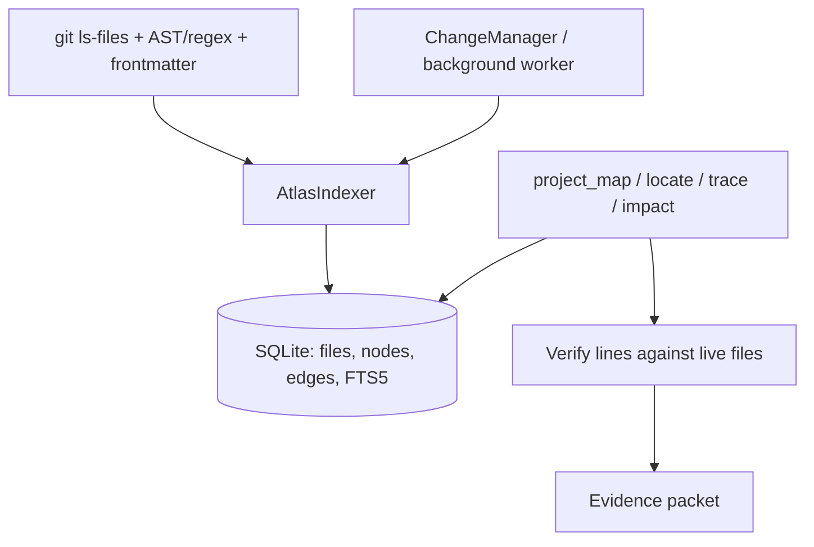

# Project Atlas

The atlas is codx-junior's navigation index for a project. It answers the
questions models used to answer with `grep`/`glob`/semantic search:

- where is a symbol, route, config key, error message or document?
- what are the project's domains, entry points and reading order?
- what calls or imports this, and what breaks if I change it?
- is the answer still true for the current working tree?

It is deliberately small: one SQLite database per project, no extra service.

```text
<project .codx>/atlas/atlas.db
```

## How it works



- **Files** come from `git ls-files` (honoring `.gitignore`) with an
  `os.walk` fallback.
- **Python** uses `ast` for classes, functions, methods, imports, calls and
  FastAPI/Flask-style routes with exact line ranges.
- **JS/TS/Vue** use focused regexes for classes, functions, imports, routes and
  the component itself.
- **Markdown** uses frontmatter plus headings; a `source:` field links a doc
  page back to the file it documents.
- **Edges** are high precision: `contains`, `imports`, `calls`, `handles`,
  `tests`, `documents`.
- **Search** is SQLite FTS5 over paths, names and bodies plus exact
  name/path/symbol scoring. Content hits are verified by reading the live file.

## Freshness

`ProjectAtlas.ensure()` checks the git HEAD and the working tree before a
query:

- HEAD moved → full rebuild;
- a few files changed → reindex only those files (and prune deleted ones);
- no changes → reuse the index (freshness check cached for
  `project_atlas_ttl_seconds`);
- index version changed → drop/recreate the schema.

Full builds run in the background worker (`ensure_project_atlas`) and after a
file change (`schedule_atlas_refresh`, debounced 3s). While a build is running,
the tools return a bounded fallback result and ask the model to retry, so the
first call never blocks on a full index.

## Tools

| Tool | Purpose |
| --- | --- |
| `project_map` | domains, entry points, key files, reading order, related projects |
| `project_locate` | ranked `path:line` evidence for symbols, strings, routes, docs, globs (`project=` searches other projects) |
| `project_trace` | imports/calls/routes flow from a symbol |
| `project_impact` | reverse dependencies, tests and docs before a change |
| `project_health` | coverage, freshness, commit, warnings |

When `project_atlas_enabled` is true (default), the atlas tools are injected
into any profile that can read project files. When `project_atlas_force` is
true (default), `project_grep`, `project_glob`, `project_search` and `project_structure` are
removed from the model's tool list. The legacy functions still exist for non-model
callers and tests, but they return a redirect when the atlas is enforced.

## Related projects

A project is rarely alone: it can contain **child** projects (a nested
`.codx/project.json`) and it can declare **dependency** projects by name
(`project_dependencies`). That resolution lives in
`CODXJuniorSettings.get_related_projects` and is shared with the knowledge
engine and the chat RAG pipeline.

The atlas keeps **one database per project** and never merges them, but the
tools are aware of the structure:

- `project_map` lists the related projects (name, relation, root and whether
their atlas is already built), so the model knows where it can search instead of
guessing;
- `project_locate(query, project="codx-api")` searches one related project;
- `project_locate(query, project="all")` searches this project and every
related one, and each section reports the root needed to open the files
(`project_read_file` accepts the absolute path);
- a child project's folder is **excluded** from the parent index because it owns
its own atlas. This also keeps the parent under `project_atlas_max_files` in a
monorepo. When `search_related_projects` is disabled the children stay in the
parent index, since no other project can reach them.

## Settings

| Setting | Default | Meaning |
| --- | --- | --- |
| `project_atlas_enabled` | `true` | Build/expose the atlas |
| `project_atlas_force` | `true` | Hide legacy discovery tools from models |
| `project_atlas_max_files` | `5000` | File cap per index |
| `project_atlas_ttl_seconds` | `5` | Reuse the freshness check for this long |

## API

The router exposes the same packets as JSON:

```text
GET  /api/atlas/health
GET  /api/atlas/map?query=&path=&limit=
GET  /api/atlas/locate?query=&kind=&include=&regex=
GET  /api/atlas/trace?symbol=&direction=&depth=
GET  /api/atlas/impact?paths=&depth=
POST /api/atlas/rebuild
```

## Tests

```bash
PYTHONPATH=api python3 -m unittest api.tests.test_atlas -v
```

The tests build a small git repository and cover symbol/content/route/doc/glob
locators, trace, impact, incremental refresh, health and the tool policy.
