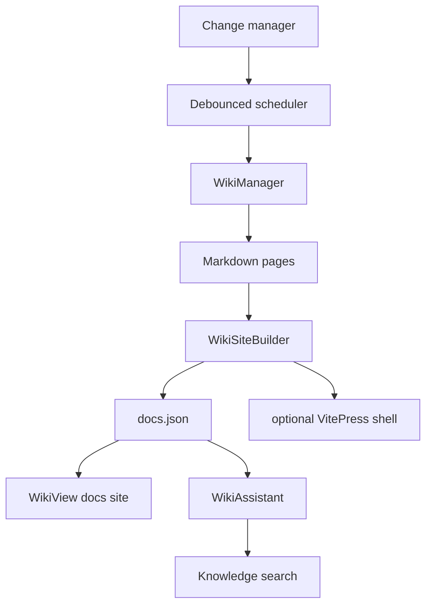
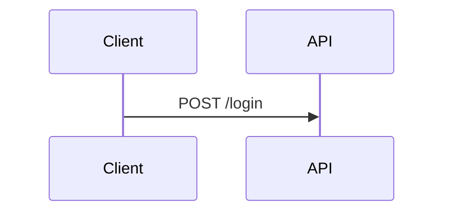

# Wiki

The wiki is a per-project documentation site generated from the repository and
kept fresh in the background.



## Components

| File | Responsibility |
| --- | --- |
| `wiki_manager.py` | Prompts, page generation, category tree, batch updates, compile. |
| `site.py` | Docs manifest: navigation, page metadata, landing page, child projects, `llms.txt`, VitePress config. |
| `scheduler.py` | Coalesces file changes per project and applies them after a quiet period. |
| `assistant.py` | Retrieval + AI answer with citations for the current project. |
| `wiki_domains.py` | Architecture/domain pages from the dependency graph. |
| `wiki_index.py` | Searchable index (including docs-manifest pages) in Milvus. |

## Page format

Generated pages use frontmatter plus a skimmable structure:

````markdown
---
title: Authentication
description: How signed tokens work
tags: [auth, security]
category: Guides
source: src/auth/service.py
---

# Authentication

> **TL;DR** — short summary.

## How it works

````

For code projects the prompt requires at least one Mermaid diagram and a
runnable example. Every project asks for callout hints (`> [!TIP]`,
`> [!WARNING]`).

## Background updates

`ChangeManager` (and the legacy wiki engine) enqueue changed files. The
scheduler waits for `wiki_update_debounce_seconds` of quiet, caps the wait at
`wiki_update_max_delay_seconds`, regenerates only the changed pages and rebuilds
the manifest once. Parent projects refresh their manifest when a child wiki
changes.

## Layout

```text
<project>/.codx/wiki/
  home.md
  docs.json              # generated manifest (gitignored)
  llms.txt               # generated LLM-friendly page list
  update_status.json     # generated scheduler status (gitignored)
  .vitepress/            # optional standalone VitePress shell
  <category>/<page>.md
  domains/<domain>.md
  modules/<module>.md
```
