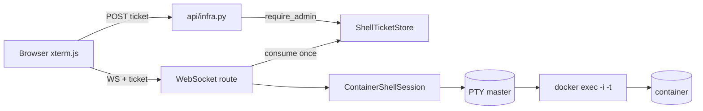

# Container web shell (admin only)

Interactive terminal into a running container — the browser equivalent of:

```bash
docker exec -it <container> /bin/sh
```

The feature is part of **Infrastructure** (`client/src/views/infra/`). It is
available only to users with the `admin` role, and only for containers that are
currently running.

---

## 1. Why a CLI + PTY instead of the Engine API?

The Docker Engine API does expose exec:

```text
POST /containers/{id}/exec
POST /exec/{id}/start      ← hijacked, bidirectional
POST /exec/{id}/resize
```

`/exec/{id}/start` upgrades the HTTP connection and then uses it in both
directions. The project's Docker client is `httpx` over a Unix socket, which
cannot half-close a request and keep writing to the hijacked socket. Speaking
that protocol by hand would mean writing a raw HTTP upgrade parser.

The `docker` CLI already implements it and ships in the codx-junior image (the
compose stack actions already shell out to `docker compose`). The backend
therefore:

1. allocates a local PTY (`pty.openpty()`);
2. spawns `docker exec -i -t …` attached to the PTY;
3. pumps bytes between the PTY master and the WebSocket.

Docker still enforces the container-side rules (TTY, user, capabilities). The
backend adds the codx-junior rules: admin role, running container, allow-listed
shell and single-use tickets.



---

## 2. HTTP contract

### 2.1 Issue a shell ticket

```http
POST /api/infra/containers/{container_id}/shell
Content-Type: application/json

{
  "shell": "/bin/sh",
  "host_id": "host-local",
  "cols": 120,
  "rows": 32
}
```

Requires the `admin` role. `container_id` may be a full id, a short id or a
name. Only running containers are accepted.

Response (**InfraShellTicket**):

```json
{
  "ticket": "…",
  "websocket_path": "/api/infra/containers/<id>/shell?ticket=…",
  "container_id": "canonical-id",
  "host_id": "host-local",
  "shell": "/bin/sh",
  "expires_in": 60
}
```

The ticket is:

* **single-use** — consumed atomically by the WebSocket handshake;
* **short-lived** — `CODX_JUNIOR_SHELL_TICKET_TTL` seconds (default 60);
* **bound** — to the admin, the container, the host and the shell;
* **not the JWT** — the long-lived token never appears in a URL or proxy log.

Error statuses: `400` invalid/empty values, `403` not an admin, `404` unknown
host/container, `409` container not running or paused, `429` too many open
shells, `503` Docker CLI/socket unavailable or the feature is disabled.

### 2.2 WebSocket

```text
WS /api/infra/containers/{container_id}/shell?ticket=…
```

The ticket is validated **before** the handshake is accepted. Frames are JSON
text frames; terminal payloads are base64 because a PTY is a byte stream and may
split a UTF-8 sequence.

| Direction | Frame | Meaning |
| :-- | :-- | :-- |
| client → | `{"type":"input","data":"<base64>"}` | keystrokes / pasted bytes |
| client → | `{"type":"resize","cols":120,"rows":32}` | terminal size (clamped) |
| client → | `{"type":"close"}` | end the session |
| client → | `{"type":"ping"}` | liveness check |
| server → | `{"type":"ready","container_id":"…","shell":"…","cols":120,"rows":32,"user":"…"}` | session opened |
| server → | `{"type":"output","data":"<base64>"}` | PTY output |
| server → | `{"type":"exit","code":0}` | child exited |
| server → | `{"type":"error","message":"…"}` | recoverable error |
| server → | `{"type":"pong"}` | answer to ping |

Close codes: `4401` invalid/expired/reused ticket, `4403` ticket/container
mismatch, `1011` the shell could not be started. A normal exit closes with
`1000` after the `exit` frame.

---

## 3. Security model

* **Admin-only.** The POST route uses `require_admin` and the ticket store
  re-checks the role when issuing. A non-admin cannot obtain a ticket, and the
  WebSocket only accepts a ticket (no direct JWT), so there is no second path
  to a shell.
* **No JWT in URLs.** URLs are logged by reverse proxies; tickets are not
  credentials to anything else and die on first use.
* **Running containers only.** The container is inspected before the ticket is
  issued, and again when the WebSocket starts the session.
* **Allow-listed shells.** `/bin/sh`, `/bin/bash`, `/bin/ash`, `/bin/zsh`,
  `/bin/dash` (and their bare names). The value is a single `argv` element, so
  `"sh -c …"` is rejected rather than executed.
* **No shell interpolation.** The container id and shell are passed as separate
  `subprocess` arguments; `shell=True` is never used.
* **Bounded resources.** Input frames are capped at 64 KiB; terminal sizes are
  clamped; concurrent sessions are capped by
  `CODX_JUNIOR_SHELL_MAX_SESSIONS` (default 20).
* **Audit trail.** Ticket issuance, session open/close and the admin, host and
  container are logged.

The shell still runs with the permissions of the container's configured user.
An admin who can open a shell can do anything that user can do inside the
container; this is intentional and matches `docker exec`.

---

## 4. Configuration

| Variable | Default | Purpose |
| :-- | :-- | :-- |
| `CODX_JUNIOR_CONTAINER_SHELL_ENABLED` | `1` | `0`/`false` disables the feature (503). |
| `CODX_JUNIOR_DOCKER_BIN` | `docker` in `PATH` | Docker CLI path used for `exec`. |
| `CODX_JUNIOR_SHELL_TICKET_TTL` | `60` | Ticket lifetime in seconds. |
| `CODX_JUNIOR_SHELL_MAX_SESSIONS` | `20` | Concurrent shell cap. |

The Docker CLI must be able to reach the selected host. Local hosts use the
default socket; remote hosts are passed through `docker -H <endpoint>`.
`https://` endpoints are mapped to `tcp://` with `DOCKER_TLS_VERIFY=1`; client
certificates, when needed, come from the CLI's usual `DOCKER_CERT_PATH`.

---

## 5. UI

* **Containers** table/cards: a terminal button appears for running containers
  when the caller is an admin.
* **Container detail** overlay: a **Shell** button in the header.
* **ContainerShellModal** (`client/src/views/infra/ContainerShellModal.vue`):
  shell selector, explicit warning/consent, xterm.js terminal, fit-on-resize,
  connection status, reconnect and disconnect.
* Terminal I/O is lazy-loaded with the Infrastructure view; the xterm bundle is
  not part of the application entry chunk.

The buttons are hidden for non-admins, but that is only UX: the backend rejects
ticket issuance for non-admins, and the WebSocket accepts only a ticket — never
a JWT directly.

---

## 6. Tests

`api/tests/test_infra_shell.py` covers:

* shell allow-list and argument construction (local, TCP, HTTPS);
* ticket admin check, single use, expiry and cap;
* running/paused/stopped container guard (404 mapping included);
* real PTY streaming, exit code, resize and input;
* base64 frame validation and size limits;
* route-level `403` for non-admins, `409` for stopped containers, `400` for an
  unlisted shell;
* the WebSocket handshake, invalid-ticket rejection and frame relay with a fake
  session (no Docker daemon needed).

Run them with the API virtualenv:

```bash
pytest -q api/tests/test_infra_shell.py
```

---

## 7. Limitations

* The feature requires the Docker CLI on the API host. The Engine API's hijacked
  exec stream is not implemented directly.
* The terminal is not persisted: closing the modal ends the `docker exec`
  process. Nothing survives an API restart either, because tickets are in
  memory.
* Remote hosts must be reachable by the CLI with the credentials configured for
  that endpoint (`-H` only; no per-host TLS material is injected by this code).
* A shell is tied to one container and one host. Changing the host selector
  while the modal is open does not retarget the session.

Made with ❤️ by codx-junior
