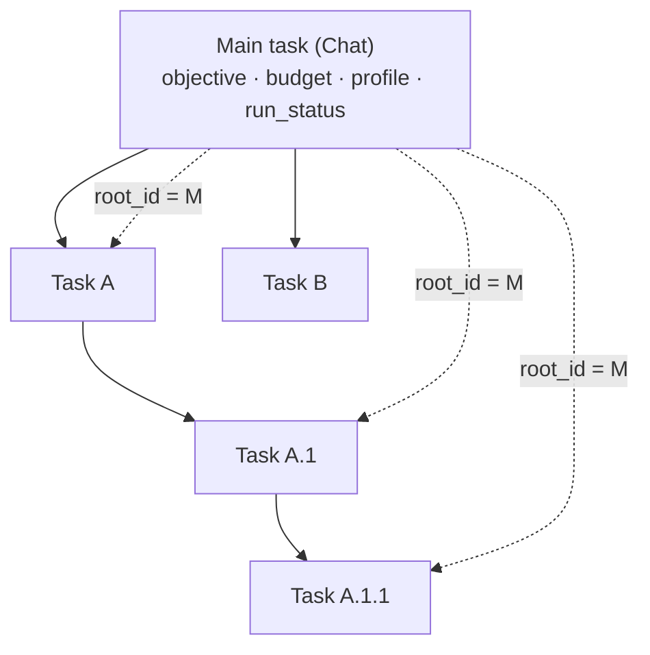
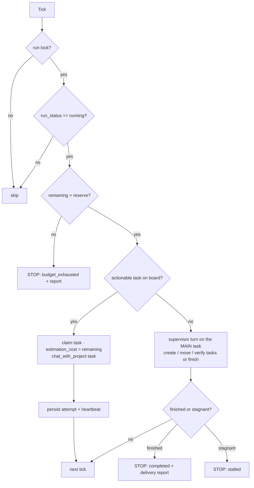

# Long running tasks (LRT) — design

> **Note (2026):** this is the original design draft. The shipped runtime is
> documented in [`docs/orchestration.md`](orchestration.md) and lives in
> `codx/junior/orchestration/`. It preserves the main-task/budget/supervisor
> model described here, stores the run state in an atomic dedicated document,
> adds context-isolated parallel workers and exposes the `orchestrator` and
> `delegate` tools.

> Status: **review v2** (incorporates the review notes of 2026-xx)
> Owner: ProjectManager · Implementation: `software_developer` / `py_senior`
> Prerequisite: milestone **LRT‑0** (preparation, see §10). LRT does not start before LRT‑0 is done.

#TL; DR;

A **long running task** is one **main task** (a normal kanban task) that carries an objective, a **budget** and a **managing profile**. The system splits the objective into small tasks, processes them one by one, lets the manager create more tasks while it runs, and stops only when **all tasks are done**, the **budget is spent** or a **user stops/pauses it**. Runs survive an app restart and resume alone — no "resume" click.

What changed in this review (the notes we received):

1. **The run is anchored on a main task**, not on a free‑text objective. The main task owns the objective, the budget, the managing profile and the pause/stop switch.
2. **All tasks of a run share the same ancestor** (the main task) at any depth — enforced, not assumed.
3. **Pause/Stop lives on the main task** and every descendant turn checks it before running (mid‑turn stop cancels the in‑flight turn). We reviewed encoding it in `Chat.mode` and **rejected it** (see §6).
4. **The blocking defects are fixed first**, in a preparation milestone (LRT‑0), before any LRT code lands.
5. **The kanban storage changes** (single `kanban.json` is too weak): one file per board, immutable ids, atomic writes with a lock, versioned migration.
6. **`AGENT_DONE_WORD` is removed** together with the agent‑iteration logic that depends on it.
7. **The worker runs in the background process only** (the one started with `CODX_JUNIOR_API_BACKGROUND`). The API process never runs the loop; a file lock guarantees a single worker anyway.

Decisions still needed from the user: budget unit (recommend cxjcoins), one task at a time per run (recommend yes), and whether the kanban storage v2 lands before LRT (recommend yes, it is inside LRT‑0).

---

## 1. Scope

**In scope (this feature)**

- Create a run from an existing or new **main task**: objective, budget, managing profile, board.
- Supervisor split → task creation → sequential processing → self‑expansion → completion, all on one board.
- Durable run state that survives restarts, power‑offs and the two‑process deployment.
- Pause / resume / stop from the main task; hard budget enforcement; stall and loop guards.
- API + tool + events so the UI and the managing profile can see and drive the run.

**Out of scope (explicitly)**

- Parallel task execution inside one run (single worker per run in v1; the tick shape allows it later).
- New orchestration infrastructure (Celery/APScheduler/queues). The existing daemon‑thread pattern is enough.
- AI sub‑task generation at creation time (`generate_tasks` stays removed: tasks are created with all their information).
- Multi‑project runs (a run lives in one project).
- A dedicated LRT UI page. v1 reuses the board + a run header on the main task.

---

## 2. Model: the main task *is* the run

```
Run  =  Chat(main task)  +  its descendant tree  +  the board it lives on
```

| Concept | Where it lives | Notes |
|---|---|---|
| Objective | `Chat.description` + first message of the main task | Human readable, AI readable |
| Budget | `Chat.estimation_cost` on the main task | cxjcoins, existing field — already enforced by the agent |
| Managing profile | `Chat.profiles` on the main task (`["project_manager"]` by default) | The profile that splits and declares completion |
| Run config | `Chat.run` (new optional dict on `Chat`) | `per_task_budget`, `supervisor_reserve`, `max_tasks`, `max_iterations`, `task_mode`, `board_id`, `column`, `verify_column` |
| Run state | `Chat.run_status` + `Chat.run_state` (new optional fields) | `running`/`paused`/`stopped`/`completed`/`budget_exhausted`/`failed`/`stalled`, `attempts`, `current_task_id`, `ticks`, `stop_reason` |
| Board | `Chat.kanban_id` (id, not name) | One board per run: the board *is* the run's task list |
| Ancestor | `Chat.root_id` (new, cached) | `root_id == main task id` for every descendant |

Why the main task and not a new entity: **tasks are already chats** (`Chat` has `parent_id`, `profiles`, `cost`, `estimation_cost`, `status_history`, `mode`), and the whole UI (board, planning, chat view, cost) already renders a chat. A second entity would duplicate persistence and break `/api/planning`.



---

## 3. Ancestry: every task shares the main task as ancestor

**Invariant:** for every chat that belongs to a run, walking `parent_id` up must reach the main task.

Implementation:

- **Cached field** `Chat.root_id` (optional). `TaskManager.create_task` sets it:
  `root_id = parent.root_id or parent.id` when a parent exists, `root_id = self.id` for the main task.
- **`codx/junior/identity.py`** exposes the two primitives every caller must use:
  - `resolve_root_id(chat, chat_manager)` — returns `chat.root_id`, walking `parent_id` when the cache is missing (legacy chats) and backfilling it.
  - `is_descendant_of(chat, root_id, chat_manager)` — the guard used by the runner and the API.
- **Board contents are a strict subset**: a task on the run board whose `root_id` is not the main task is *invalid* and the runner ignores it (logged as a catalogue error, never processed).
- Depth is unbounded: A → A.1 → A.1.1 … all resolve to the same main task.

---

## 4. Budget: defined on the main task, enforced everywhere

**Unit:** cxjcoins, using the existing `Chat.cost` (monotonic, survives message deletion) and `Chat.estimation_cost` (hard cap already honoured by `SmolAgent`).

Two mechanisms, both needed:

1. **Roll‑up (accounting).** `ChatManager._accumulate_message_cost` currently adds a message cost to *its own* chat. It also adds the same delta to the **root chat** (`resolve_root_id`), so the main task's `Chat.cost` is the run total. Consequence: the main task's own `estimation_cost` (= run budget) is already enforced by the agent for every turn the supervisor takes, with no new budget code.
2. **Push‑down (admission).** Before each descendant turn the runner sets the task's `estimation_cost = min(per_task_budget, remaining − reserve)`. A descendant can therefore never overspend the run, and the run can always afford the final report (`supervisor_reserve`).

Hard stop rule: if `remaining <= supervisor_reserve` the run finishes as `budget_exhausted` and the supervisor writes the delivery report **without another paid turn** (template + facts, no LLM).

`spent` is always **recomputed** from the chats of the run each tick; the persisted counter is informational only (protection against drift and manual edits).

---

## 5. Execution model: one tick at a time



- **Actionable task** = `root_id == main.id`, `status in (todo, doing)`, `attempts < MAX_ATTEMPTS (3)`, ordered by priority → due date → `sort_index`. **One at a time**, deliberately: predictable budget, no board/worktree contention.
- **Recovery**: if `current_task_id` is set, the process died and no cancellation token exists for it → `attempts += 1` and re‑run. After 3 attempts → `status="onhold"` + `request_help` comment.
- **Resumability**: state is on disk (the main task file), the only in‑flight unit is a single chat turn that is itself persisted incrementally (`ChatEventBridge`), and the tick re‑reads everything from disk. A restart resumes the same tick — nothing to re‑create.
- **Single worker**: `.codx/tasks/<project>/long_running/<main_task_id>.lock` created with `O_CREAT|O_EXCL` + `{pid, host, heartbeat}`; a stale lock (heartbeat older than `LOCK_TIMEOUT`) is taken over. Required because **two processes** are alive.

### Where the worker runs

The deployment runs **two independent processes**: the API without the flag, and the background service with `CODX_JUNIOR_API_BACKGROUND` set. Therefore:

- the loop (`check_long_running_runs`) is started from `background.start_background_services`, next to `check_projects`, and only when the flag is on;
- each run advances inside its own thread with `asyncio.run(runner.tick())`, mirroring `run_project_check_thread`;
- the API process only **writes intent** (start/pause/resume/stop) and **reads state** — it never executes a turn, so the 30 s request timeout (`GLOBAL_REQUEST_TIMEOUT_SECONDS`) is irrelevant;
- if no worker is running, the status endpoint must answer `"waiting for worker"` instead of pretending the run is progressing.

---

## 6. Control surface: pause / stop on the main task

**We reviewed encoding the run state in `Chat.mode` and rejected it.** `mode` is a *prompt selector*: `ChatEngine._resolve_chat_mode_flags` branches on it (`task`/`tutorial` → refine prompt, `agent` → agent prompt, `vibe` → pre‑search). Overloading it with `paused`/`stopped` would make the engine process **descendant tasks with the wrong prompt** and would collide with the mode the task actually needs.

| Action | Effect | Persisted where |
|---|---|---|
| Start | create main task (`mode="long_running"`), board, run fields, `status="todo"` → `run_status="running"` | main task |
| Pause | `run_status="paused"`, mirror `Chat.status="onhold"` | main task |
| Resume | `run_status="running"`, mirror `Chat.status="doing"` | main task |
| Stop | `run_status="stopped"`, mirror `Chat.status="rejected"`, cancel the in‑flight token | main task |
| Complete | `run_status="completed"`, `Chat.status="done"`, delivery report message | main task |

`mode="long_running"` is safe today: any mode other than `task`/`tutorial`/`agent`/`vibe` falls into the standard chat branch, so the supervisor turn is a normal chat turn with the managing profile composed into the system prompt.

**Descendant processing must be reviewed against the switch** — this is the note we received:

1. every tick reads the main task **from disk** before starting a turn (no cached state);
2. `runner._assert_root_running(task)` re‑checks immediately before `chat_with_project`;
3. pause/stop calls `CANCELLATION_REGISTRY.cancel(<in‑flight task doc_id>)` so a turn in progress aborts at the next yield point (`CancelledError` is already handled and persisted);
4. a descendant turn started **manually** (a human opens the task and asks something) is allowed but still counted against the budget, and the tick never touches that task while a token exists for it (`is_task_processing`).

`run_status` is the single source of truth; `Chat.status` is only the mirror the board and planning views already understand.

---

## 7. Completion and guards

- **Only the managing profile finishes a run**, by calling the tool `long_running(action="finish", summary=...)` on its own main task. Validated server‑side (chat is the run's main task **and** the caller's profile is in `main.profiles`).
- `finish` appends a **delivery report** message to the main task: what was built, how to test it, files touched, remaining gaps. This is the artefact a human reviews.
- Safety nets: `max_tasks`, `max_iterations`, **stagnation** (`STAGNATION_TICKS = 3` supervisor turns that neither create nor move a task → `stalled`), unrecoverable error → `failed`.
- The last task of every run should be a **"how to test"** task; the supervisor prompt requires it.

---

## 8. Kanban storage v2 (prerequisite)

Today: **one** `.codx/tasks/kanban.json` for every board, written read‑modify‑write with no lock (`ChatManager.save_kanban`), while the UI writes the same file; board **name is also the storage folder** (`get_chat_file`), so a rename `shutil.move`s a folder and rewrites every task. For LRT (which writes board config and run state continuously while the UI edits the same catalogue) this is not acceptable.

**v2 layout**

```
.codx/tasks/
  index.json                          { version: 2, boards: [ {id,title,type,parent_id,folder,order} ], tags }
  boards/<board_id>/board.json        { id,title,description,type,parent_id,folder,columns:[{id,title,color,order}],run?:{} }
  <folder>/<column_folder>/<slug>.<chat_id>.json    (chats unchanged on disk)
  long_running/<main_task_id>.lock                   (run lock)
```

- **One file per board**: a write touches a single small file → no cross‑board clobbering.
- **Atomic writes** (`tmp` + `os.replace`) and a project‑level file lock (`fcntl`) so the API process and the background process can both write.
- **Immutable identity**: `board.id`, `column.id`, `folder` never change. `title` is a label. **A rename no longer moves a folder and no longer rewrites tasks** (fixes the `shutil.move` + `_retarget_board_tasks` behaviour of `project_manager_tools`).
- **Task references by id**: `Chat.kanban_id`, `Chat.column_id` become the source of truth; `Chat.board`/`Chat.column` stay as display labels for backward compatibility until the UI is migrated.
- **Migration** (`codx/junior/migrations/kanban_v1_to_v2.py`): read the legacy `kanban.json` once, split into board files, assign ids/folders, map `Chat.board → kanban_id`, back up `kanban.v1.backup.json`, idempotent, runs on first load.
- **API compatibility**: `GET /api/kanban` keeps returning the assembled legacy shape (the current Vue client keeps working); `POST /api/kanban` writes through the new store (diff‑based). A v2 endpoint (`/api/kanban/boards/{id}`) is added for new work.
- Catalogue logic moves to **one** module (`codx/junior/kanban/catalogue.py`) used by `project_manager_tools`, the API and LRT — today the lookups live inside a 2 000‑line tool file.

---

## 9. API and tool surface

Identity in the URL, `project_id` as query param, bodies describe the resource only (project REST conventions).

| Method | Path | Effect |
|---|---|---|
| `POST` | `/api/long-running` | `{main_task_id}` (attach to an existing task) **or** `{name, description, budget_cxjcoins, profile, board?}` (create the main task + board) → `run_status="running"` |
| `GET` | `/api/long-running` | list runs (main task, run_status, spent/remaining, task counts) |
| `GET` | `/api/long-running/{main_task_id}` | detail: state, budget, current task, per‑task table, worker presence |
| `POST` | `/api/long-running/{main_task_id}/pause` \| `/resume` \| `/stop` | durable flag (+ cancel in‑flight token on stop) |
| `POST` | `/api/long-running/{main_task_id}/tick` | one manual tick (debug/testing; admin only) |
| socket | `codx-junior-long-running` | `tick`, `task_started`, `task_done`, `finished`, `budget_exhausted` |

Tool `long_running` (registered in `codx/junior/tools/__init__.py`, `session` + `project_settings` injected):

- `start` — turn the current chat into a run (objective + budget + profile);
- `status` — budget, task table, current step (for the managing profile);
- `finish` — **only** the run's own profile on its own main task may complete a run;
- `add_task` — thin alias over `project_manager(action="create_task")` with `parent_id = current task`, so the supervisor has one obvious verb and the ancestor invariant is kept automatically.

Supervisor profile (`codx/junior/profiles/long_running.profile`) rules: split only what is needed now; always leave a verifiable next step; always end with a "how to test" task; call `finish` only when the objective is demonstrably achieved; never exceed the remaining budget.

---

## 10. Milestone LRT‑0 — preparation (blocking)

**Nothing of LRT is written before this milestone is merged.** Each item is independently verifiable.

| # | Item | Why it blocks / matters | Acceptance |
|---|---|---|---|
| 0.1 | `codx/junior/kanban/__init__.py` imports `kanban.board_status_review`, which does not exist in the repo → `import codx.junior.kanban` raises | The kanban package is the natural home of the catalogue code LRT needs | `python -c "import codx.junior.kanban"` works; module implemented or the package removed |
| 0.2 | Kanban storage v2 + migration + lock (§8) | LRT writes the catalogue at the same time as the UI | boards load from `boards/<id>/board.json`; legacy file migrated with backup; two concurrent writers do not lose a board; rename does not move folders |
| 0.3 | `Chat.root_id` + `TaskManager` sets it + backfill + `identity.resolve_root_id` (§3) | The ancestor invariant is the foundation of the whole feature | every existing chat resolves a root; a 3‑level chain resolves to the same main task |
| 0.4 | Cost roll‑up to the root chat in `ChatManager._accumulate_message_cost` (§4) | Makes "the budget lives on the main task" literally true | spending in a child raises the root `Chat.cost` exactly once; deleting a message does not reduce it |
| 0.5 | Remove `AGENT_DONE_WORD` and the agent‑iteration logic: `globals.AGENT_DONE_WORD`, `chat_prompt_builder.append_agent_message` + `build_ai_prompt_messages(is_agent=...)`, `chat_engine` step 24 recursion + `_resolve_chat_mode_flags.is_agent` + `_build_ai_headers` agent tag, `CHAT_MODE_AGENT`, `get_agent_max_iterations` usage | Deprecated by decision; LRT replaces iteration‑by‑magic‑word with board budget + explicit `finish` | no reference to `AGENT_DONE_WORD` remains; a chat with `mode="agent"` behaves as a normal chat and can no longer loop |
| 0.6 | Delete the dead duplicate sub‑task generation: `engine/chat_engine_actions.generate_tasks`, `session.generate_tasks`, sio `codx-junior-subtasks`, legacy `codx/junior/engine.py` | Two sub‑task implementations contradict the new model and would be "reused" by mistake | `/api/chats/sub-tasks` stays 410; no `generate_tasks` symbol remains; sio no longer calls a missing method |
| 0.7 | Fix `CODXJuniorSession.chat_event` missing while `api/chat.py` and `sio.py` call it (`POST /api/chats` returns an error object instead of a chat) | LRT supervisor turns are `chat_with_project` calls; the surrounding API must actually work | `POST /api/chats` returns the processed chat |
| 0.8 | `ChatManager.find_by_id` matches `chat_id in path` (substring) → implement exact `<slug>.<id>.json` suffix match | Ancestor resolution must never load the wrong chat | two chats whose ids share a prefix are resolved correctly |
| 0.9 | Duplicated handlers: two `@app.on_event("startup")` in `app.py`, `PUT /chats/mark-seen/{chat_id}/{message_id}` defined twice in `api/chat.py` | The startup hook is where the LRT worker thread is added; duplicated code hides which one runs | one startup handler; one mark‑seen route |
| 0.10 | Smoke tests: import every router (`discover_routers`), catalogue round‑trip, ancestry, budget roll‑up | Prevents the next milestone from debugging old breakage | `pytest` green (`tests/`) |

**Deployable + demoable:** the app starts, boards load from the new store, the UI is unchanged, chat and board operations still work. Demo = open the board list, rename a board (no folder move), start a chat, show the run‑state fields present but inert.

*Found while reviewing, deliberately **not** in LRT‑0 scope (own tasks):* `_user_involved_in_chat` reads non‑existent `Chat.created_by`/`Message.created_by`; `chat_engine.py` imports `from engine.agent_runtime` (root‑level `engine/` package) instead of the `codx.junior.engine` package; `codx/junior/engine.py` (module) and `codx/junior/engine/` (package) coexist.

---

## 11. Increment plan

| Milestone | Deliverable | Deployable | Demoable | Status |
|---|---|---|---|---|
| **LRT‑0** Preparation (§10) | defects fixed, storage v2, `root_id`, cost roll‑up, agent logic removed | yes | yes — boards, rename, chat, no behaviour change | **ready to start** |
| **LRT‑1** Run skeleton | create run from main task (objective + budget + profile), board created, supervisor splits 2–3 tasks, runner processes them, state survives restart | yes (flagged to internal users) | yes — start a run on a tiny objective, watch tasks appear and complete, kill the API and see it resume | planned |
| **LRT‑2** Autonomy | self‑expansion, `finish` + delivery report, budget stop, stagnation stop, pause/resume/stop from the main task | yes | yes — stop mid‑run, resume, exhaust a small budget on purpose | planned |
| **LRT‑3** Visibility | board run header (budget bar, run status, task table), socket events, `long_running` tool for the supervisor | yes | yes — the whole run from the board UI | planned |

Each milestone is a vertical slice with a 5‑minute demo; feedback re‑orders the next one.

---

## 12. Dependencies and critical path

```
LRT-0.1 (kanban import) ─┐
LRT-0.2 (storage v2) ────┤
LRT-0.8 (find_by_id) ────┼─► LRT-0.3 (root_id + identity) ─► LRT-0.4 (cost roll-up) ─► LRT-1
LRT-0.7 (chat_event) ────┤
LRT-0.5/0.6 (agent & subtask removal) ─┘
```

Critical path: **0.2 → 0.3 → 0.4 → LRT‑1**. 0.5/0.6 can run in parallel, but 0.5 must land before the supervisor prompt (LRT‑1) because both touch the prompt builder.

External dependencies: none. Everything runs inside the two existing processes.

---

## 13. Risks

| Risk | Impact | Prob. | Mitigation | Owner |
|---|---|---|---|---|
| Storage v2 migration corrupts boards/tasks | high | low | idempotent migration, `kanban.v1.backup.json`, dry‑run mode, board count assertion | software_developer |
| Two writers (API + background) still race | high | medium | atomic writes + `fcntl` lock + one file per board | software_developer |
| Budget accounting drift | medium | medium | recompute `spent` from chats each tick; counter is informational | software_developer |
| Supervisor self‑expansion burns the budget | high | medium | `max_tasks`, `max_iterations`, stagnation stop, `supervisor_reserve` | project_manager |
| `root_id` cache diverges from `parent_id` | medium | low | `resolve_root_id` walks and repairs; a task on the board with a foreign root is never processed | software_developer |
| Agent‑logic removal breaks an existing chat flow | medium | medium | remove in LRT‑0 (before LRT), smoke tests, `mode="agent"` degrades to a normal chat | software_developer |
| Worker not running (flag off) → runs silently idle | medium | medium | status endpoint reports "waiting for worker"; visible in the board header | project_manager |
| Manual turns on a paused descendant | low | medium | allowed but budgeted; tick skips a task while a cancellation token exists | software_developer |

---

## 14. Decisions needed

1. **Budget unit** — cxjcoins via `Chat.estimation_cost`/`Chat.cost` (recommended) or a task counter ("N turns")? *Default if no answer: cxjcoins.*
2. **Concurrency** — strictly one task at a time per run (recommended) or `max_parallel` from day one? *Default: one.*
3. **Kanban storage v2 inside LRT‑0** (recommended) or a separate milestone before it? *Default: inside LRT‑0, since LRT depends on it.*
4. **Run state location** — on the main task (`Chat.run`/`run_status`, recommended, single source of truth) or a side file? *Default: on the main task + a lock file.*
5. **Manual turns on a paused descendant** — allowed and budgeted (recommended) or blocked while the run is paused? *Default: allowed and budgeted.*

---

## 15. Next checkpoint

**Demo (after LRT‑0):** board list loaded from the new store · rename a board with tasks (no folder move, tasks still visible) · `POST /api/chats` returns a processed chat · `grep -r AGENT_DONE_WORD` empty · `pytest` green.

**Needed to run it:** the background process started with `CODX_JUNIOR_API_BACKGROUND` on, and a project with at least two boards.

---

## Appendix A — Alternatives considered and rejected

| Alternative | Why not |
|---|---|
| Run described by a free‑text objective (v1 of this document) | Nothing to attach the budget, the profile, the stop switch or the ancestors to; the user asked for a main task |
| Run state in `kanban.json` | UI read‑modify‑write race; runtime noise in the board editor |
| Run state in a separate file only | The state belongs to the main task; a second store can diverge and needs reconciliation on restart |
| Encoding pause/stop in `Chat.mode` | `mode` selects the prompt flavour; it would corrupt descendant processing (see §6) |
| New `LongRun` entity in the DB | Chats already carry parents, cost, budget, status history and the whole UI |
| Re‑introducing AI sub‑task generation | Explicitly removed by design: tasks are created with all their information |
| Driving the run from `Chat.mode="agent"` recursion | Single chat, no board budget, no new tasks, not resumable per task — and it depends on `AGENT_DONE_WORD`, now removed |
| Celery / APScheduler | New infrastructure; the daemon‑thread pattern already exists and is enough for v1 |
| Keeping the single `kanban.json` | Cross‑process clobbering, whole‑file rewrites, name‑as‑folder coupling |

## Appendix B — Expected file inventory (LRT‑1 → LRT‑3)

**New:** `codx/junior/long_running/{__init__,models,service,runner}.py` · `codx/junior/api/long_running.py` · `codx/junior/tools/long_running_tools.py` · `codx/junior/profiles/long_running.profile`
**Modified:** `background.py` (worker thread) · `tools/__init__.py` (tool registration) · `db.py` (`root_id`, `run`, `run_status`, `run_state`) · `chat_manager.py` (cost roll‑up, catalogue delegation) · `task_manager.py` (`root_id`)
**Prepared in LRT‑0:** `codx/junior/identity.py` · `codx/junior/kanban/{__init__,catalogue}.py` · `codx/junior/migrations/kanban_v1_to_v2.py`
