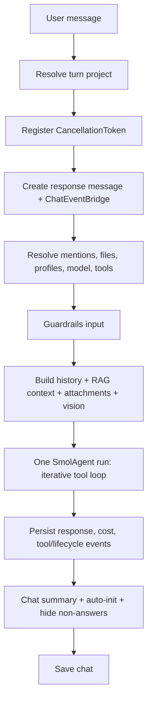
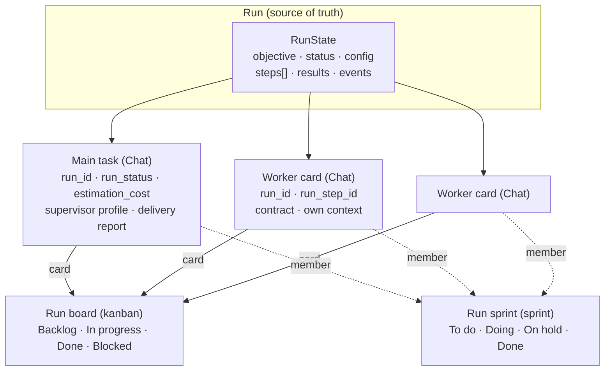
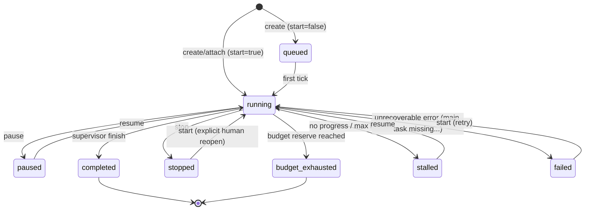
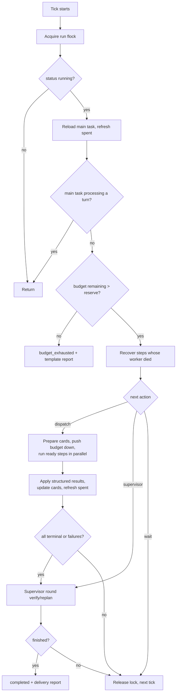

# Board-native orchestration — DSH-grade execution with codx-junior visibility

> **Status:** implemented (v1) · **Code:** `api/codx/junior/orchestration/`
> **Tools:** `orchestrator`, `delegate` · **Profile:** `orchestrator.profile`
> **API:** `/api/orchestration` · **Worker:** `CODX_JUNIOR_API_BACKGROUND`
> **Companion docs:** [`long-running-tasks.md`](long-running-tasks.md) (original
> LRT design) and [`long-running-tasks-plan.md`](long-running-tasks-plan.md)
> (original work packages). This document is the authoritative description of
> the shipped implementation; where it differs from the LRT drafts, this wins.

---

## 1. Executive summary

`codx-junior` already has almost everything needed to manage multiple tasks:

* **a chat is a task** (`Chat` carries messages, files, profiles, status, board,
  column, sprints, budget, cost, parent/root),
* **boards and sprints** are a first-class, file-backed catalogue,
* **one agent loop** (`SmolAgent`) with streaming, tool calls, caching, loop
  guards, cancellation and hard cost budgets,
* **one turn pipeline** (`ChatEngine`) that composes profiles, tools, files,
  knowledge, vision, guardrails and crash-safe persistence,
* **a background process** already used for project watching.

What it did **not** have was a way to **execute a complex objective across many
contexts**. A turn was exactly one AI request; all tools ran in the same
conversation; long work depended on a human creating cards and opening chats.
That is the gap DSH closes with goals, todos, subagents, workflows and
background continuation.

This change adds a **durable orchestration runtime** on top of the existing
work model:

| Capability | How it is delivered |
|---|---|
| Plan / goal persistence | `RunState` + `PlanStep` in `.codx/orchestration/runs/<id>.json` |
| Context isolation | every step is a **separate `Chat`**, run by its own `ChatEngine`/`SmolAgent` |
| Subagents / fan-out | `delegate` tool → child cards executed concurrently |
| Automatic continuation | background worker ticks the run until terminal |
| Verification loop | supervisor rounds compare results with acceptance criteria |
| Workflow phases | `depends_on` graph; ready steps are dispatched in parallel |
| Budget control | run budget → main `Chat.estimation_cost`; per-step push-down; supervisor reserve |
| Visibility | every step is a **kanban card** on a **run board** and in a **run sprint** |
| Human control | pause / resume / stop / wake via tool and REST |
| Crash safety | atomic run store, `flock` single-flight, chat event bridge, resumable ticks |

The important design choice: **the board is not a reporting side-effect, it is
the source of visibility**. The run state is the execution truth, and every
state transition is mirrored to a normal task card, so users keep using the
boards and sprints they already know. No new UI is required to follow a run.

---

## 2. How codx-junior works today (analysis)

### 2.1 The turn pipeline — `ChatEngine`

`ChatEngine.chat_with_project` (`api/codx/junior/chat/chat_engine.py:2010`) is
the entry point of every AI turn. A turn is a single AI request; the former
`AGENT_DONE_WORD` recursion was removed (`:2976`). The pipeline:



Key properties relevant to orchestration:

* **Profiles and tools are resolved per turn** (`_resolve_profiles_and_model`,
  `:551`). The active profiles come from the current user message or
  `chat.profiles`; linked profiles are expanded recursively; the `team`
  property only renders a table of people the model can use in *new* tasks
  (`_build_team_system_section`, `:420`).
* **Tools come from profiles** (`chat_tools = union(profile.tools)`). There is no
  built-in baseline; a chat without a tool-bearing profile gets no tools. A
  profile can also declare `scope="global"` tools, but the registry has none
  today (`tools/__init__.py:246`; all entries default to `chat`).
* **Two internal headers** are declared for the agent and stripped before the
  provider request: `profiles` (profile knowledge tools) and, since this
  change, `orchestration` (role supervisor/worker). See
  `_build_ai_headers` (`:504`) and `SmolAgent._strip_profiles_header` (`:534`).
* **Crash-safe events**: the response message is created *before* the AI call
  and `ChatEventBridge` persists it on every tool/lifecycle event, on throttled
  stream flushes, and on error/cancel (`chat/chat_event_bridge.py`).
* **Cost** is registered on the response message and accumulated into
  `Chat.cost`; a descendant's cost rolls up into the root chat
  (`chat_manager.py:_roll_up_cost_to_root`, `:835`).

### 2.2 The agent loop — `SmolAgent`

`SmolAgent.chat` (`ai/smol/smol_agent.py:610`) runs the iterative loop
(`_run_chat_loop`, `:683`):

1. build the system message (LLM settings + global instructions + profile
   content + caller `system`),
2. build OpenAI messages from the conversation,
3. select tools (profile tools + agent-injected profile tools),
4. stream a completion,
5. if the model requests tools: cache lookup, `LoopGuard`, execute each tool,
   append tool results, repeat,
6. stop on no tool calls or on a graceful loop/cost limit,
7. return a typed `AgentRunResult` (content, messages, cost, tool stats, cache
   stats).

Strengths:

* streaming + callbacks, cancellation, analytics, verbose provider errors,
* loop guard (iterations, tool count, stuck loop),
* per-conversation tool cache,
* dual-response tools (`ToolResponse`: user output + LLM feedback + logs + cost),
* tools can be sync or async; `settings`, `session`, `tool_cache` injected by
  signature (`_execute_tool`, `:1720`),
* hard budget: `Chat.estimation_cost` is checked before each round/tool.

Limits for complex work:

* **one context**. Every tool result (file contents, logs, search results) is
  appended to the same conversation; long objectives exhaust the window and
  degrade reasoning.
* **sequential tools**. Tool calls in a round run one by one; no fan-out.
* **no durable continuation**. When the run ends, nothing resumes it; the board
  budget idea existed only in the LRT draft.
* **no plan object**. The model can reason in text, but there is no persisted,
  queryable plan with statuses, dependencies and results.
* **tools are profile-gated**. A worker task with no profile has no tools.
* **tool cache can hide state**. A stateful tool (status/plan) would return a
  stale cached result; there was no opt-out.

### 2.3 Profiles and tools — the capability layer

Profiles are the unit of *role + prompt + model + tools + guardrails + team*
(`model/profile.py`). `ProfileManager` composes project → parents →
`codx-junior` and can enrich content per project. Relevant behaviours:

* `tools` are names from the single `TOOLS` registry (`tools/__init__.py`).
* `profiles` links compose other profiles recursively; `team` only offers names
  in the prompt (the model cannot actually call them).
* Profile knowledge tools (`profile_knowledge_search`, `profile_learning`) are
  injected **per run** by `SmolAgent` from the `profiles` header, never
  inherited from the profile definition (`chat_engine.py:465`,
  `smol_agent.py:583`). This is the pattern reused for orchestration tools.
* The model's ability to act is therefore exactly
  `union(profile.tools, agent-injected tools)` intersected with the registry.

The orchestration runtime needs:

* a **supervisor toolset** on the run main task regardless of the selected
  profile,
* a **worker baseline** so isolated workers can inspect/edit the project even
  when the planner forgets to assign a tool-bearing profile,
* **no orchestrator** for workers (no recursive planning),
* **no cache** for stateful control tools.

### 2.4 The work model — boards, sprints and tasks

* A `Chat` is simultaneously conversation, work item and budget envelope
  (`db.py:327`). It has `parent_id`, `root_id`, `board`, `column`,
  `kanban_id`, `column_id`, `sprints`, `status`, `priority`, `due_date`,
  `progress`, `estimation_cost`, `cost`, `mode`, `profiles`, `messages`.
* **Kanban boards** group chats by `board` + `column`.
* **Sprints** are boards with `type="sprint"`; membership is `chat.sprints`;
  sprint columns are a **view over `chat.status`**. A task can be on one kanban
  column and in several sprints at once (`docs/…`, project
  `TASKS_BOARDS_SPRINTS.md`).
* **Root ancestry**: `Chat.root_id` caches the walk to the main task
  (`identity.py`). The cost of every descendant rolls up to the root.
  `TaskManager` is the canonical task factory and stamps `root_id`
  (`task_manager.py:187`).
* **Storage v2**: one `board.json` per board, `index.json`, atomic writes and a
  project-wide lock (`kanban/store.py`). Renames no longer move folders.

This is precisely the substrate needed for orchestration: a plan step can *be*
a card, and a run can *be* a sprint.

### 2.5 Background process

`background.start_background_services` (`background.py:44`) starts the project
checker in a daemon thread only when `CODX_JUNIOR_API_BACKGROUND` is set. The
API process and the background process are independent; the draft LRT doc
already established that long work must run in the background process. The
orchestration worker follows the same pattern (`threading` + `asyncio.run`,
exactly like `run_project_check_thread`).

---

## 3. Gap analysis against DSH

| Capability | DSH | codx-junior before | codx-junior now |
|---|---|---|---|
| Goal persistence | `create_goal` + automatic rounds | none (one request per turn) | `RunState` + worker continuation, bounded by rounds/stagnation |
| Plan / todos | `todo_write` visible to user | ad-hoc text | `PlanStep[]` with statuses, dependencies, results; mirrored to cards |
| Subagents | `subagent` / `subagent_fork`, isolated context, returns result | none | `delegate` → child cards run by isolated `ChatEngine`; results summarized |
| Fan-out / workflow | `workflow` script with phases, parallel/pipeline, schema | none | `depends_on` graph + `max_parallel` dispatch; `delegate(tasks=[...], concurrency=N)` |
| Context isolation | each agent has its own context | all tools share one context | each step is its own `Chat` with `ignore_parent_knowledge` |
| Durable continuation | goal rounds continue after tool turns | none | background worker ticks runs until terminal |
| Verification loop | reviewer/adversarial patterns | none | supervisor round after each batch compares acceptance/evidence |
| Cost control | token/usage awareness | per-chat hard budget | run budget, per-step push-down, supervisor reserve, no-AI stop reports |
| Background jobs | `job_*` tools | `process_task` (broken wait semantics) | worker runs steps; run/step state queryable |
| Visibility | session log | boards/sprints (manual) | every step is a card on a board + sprint; run dashboard on main task |
| Restart recovery | session log | chat bridge per turn | atomic run store + `flock` + stale-step recovery |
| Human control | interrupt/steer | cancel chat | pause/resume/stop/wake, cancel in-flight tokens |

The result is not a reimplementation of DSH: it is the same **execution shape**
(plan → isolated workers → verify → finish) expressed in codx-junior's native
work model.

---

## 4. Design

### 4.1 Principles

1. **The run is anchored on a main task.** A run is one normal task (the
   dashboard) plus a plan; it is not a parallel entity with its own UI.
2. **The plan is the board.** Every step becomes a task card; the sprint is the
   pipeline view. Humans can move/review cards with the existing tools.
3. **Workers are isolated.** Each step runs in its own chat/context. Only the
   compact contract and the structured result cross the boundary.
4. **The supervisor plans, verifies and finishes; workers do.** No recursive
   planning inside workers.
5. **Everything is durable and bounded.** Atomic state, single-flight lock,
   budget, max steps/rounds/attempts/timeouts, stagnation guard, cancellation.
6. **No new infrastructure.** Standard library + existing pydantic/FastAPI/
   threading/`fcntl`; the worker runs in the existing background process.
7. **No AI call for terminal bookkeeping.** Budget/stall/stop reports are
   template reports; only supervisor/worker turns cost money.

### 4.2 Entities



| Entity | Persistence | Notes |
|---|---|---|
| `RunState` | `.codx/orchestration/runs/<run_id>.json` | authoritative plan/results/status/events |
| Main task | normal chat JSON | `run_id`, `run_status` mirror; budget; supervisor profile; report messages |
| Step card | normal chat JSON | `run_id`, `run_step_id`; first message = worker contract; own conversation |
| Run board | kanban catalogue | columns = phases; created on demand |
| Run sprint | kanban catalogue (`type=sprint`) | same cards, grouped by `Chat.status` |
| Lock | `.codx/orchestration/runs/<run_id>.lock` | `flock` single-flight |
| Worker heartbeat | `.codx/orchestration/worker.json` | API reports `worker.present` |

Why a dedicated run file instead of storing everything on `Chat`:

* the supervisor appends messages to the main chat while the worker updates the
  plan; one full-document chat writer would clobber the other,
* the run document is small and atomically written; a chat grows with the
  conversation,
* recovery/inspection does not require loading the conversation.

The `Chat.run_id` / `Chat.run_step_id` fields keep the board, sprint, planning
and management read models filterable, and make "which cards belong to run X"
a simple field check.

### 4.3 Run lifecycle



Terminal runs never advance on their own. Pause lets the in-flight worker turn
finish; stop cancels the registered cancellation tokens immediately. `start`
(ChatView's "Start") is the explicit human decision that reopens a stopped or
failed run; it keeps the persisted plan and completed steps.

### 4.4 One tick



`next_actions` (`models.py`) is the deterministic diagnosis:

* a step is running → `wait`,
* pending steps whose deps are done → `dispatch`,
* no plan / blocked deps / all terminal / failures → `supervisor` with a
  reason (`no_plan`, `blocked_steps`, `verify`, `failed_steps`, `no_progress`).

### 4.5 Plan graph

A step is:

```json
{
  "id": "s1a2b3c4",
  "title": "Add the endpoint",
  "objective": "Implement POST /api/x in api/... returning ...",
  "acceptance": "pytest tests/test_x.py passes; curl returns 200",
  "profile": "software_developer",
  "depends_on": ["s9f8e7d6"],
  "files": ["codx/junior/api/x.py"],
  "context": "The DB model was added by step s9f8e7d6; reuse it.",
  "priority": "high",
  "status": "pending",
  "attempts": 0,
  "chat_id": ""
}
```

Rules enforced by `models.normalize_steps` / `merge_plan`:

* `title` + `objective` mandatory (a task carries all its information),
* ids are stable; omitting an id reuses the existing step with the same title,
* `depends_on` accepts ids **or exact titles** (resolved after ids are known),
* unknown dependencies, self-dependencies and cycles are rejected,
* upsert semantics: existing steps not mentioned are kept; terminal steps are
  never resurrected implicitly (use `retry_step` or a new step),
* a running step can only have descriptive fields updated,
* `max_steps`, field length caps.

`ready_steps` returns pending steps whose dependencies are done/skipped, sorted
by priority. `blocked_steps` detects pending steps whose dependencies failed.
`merge_plan` re-validates the whole graph after every update.

### 4.6 Context isolation

The worker contract (`prompts.build_step_contract`) is the **only** information
a worker gets from the supervisor:

* run name + run objective,
* step title + objective,
* acceptance criteria,
* known files,
* extra context,
* rules and the exact JSON result contract.

The card is created with `ignore_parent_knowledge=True` and
`ignore_parent_files=True`, so `ChatEngine` does not inject the supervisor
conversation or its file list. The worker still has its own profile content,
project knowledge/RAG, and tools.

Result flow back:

1. worker final answer is parsed by `parse_step_result` (fenced JSON, balanced
   JSON, or raw fallback; runtime errors → `failed`),
2. the `StepResult` is stored in the run,
3. the card is updated (status/column/progress),
4. the supervisor's next prompt renders a **bounded** table of step results
   (summary/verification/files/follow-ups clipped per step),
5. the full worker conversation stays on the card for a human.

This is how a run handles more work than a context window: the supervisor only
carries compressed results, never the raw tool output.

### 4.7 Parallelism and budget math

* `RunConfig.max_parallel` (default 2, max 4) caps the batch.
* Independent ready steps are `asyncio.gather`-ed; each is a separate chat with
  its own cancellation token.
* Batch budget: `spendable = remaining − reserve`;
  `per_step = min(per_step_budget, spendable / batch_size)`.
  Because the split happens before dispatch, a parallel batch cannot overspend
  the run even though all workers start from the same root cost.
* The main task's `estimation_cost` = run budget, so the supervisor turn is
  also capped by `SmolAgent`.
* `supervisor_reserve` defaults to 10% of the budget; it is kept for the final
  verification/report so a run is never left without a conclusion.
* When `remaining <= reserve`, the run stops `budget_exhausted` and a template
  report is published **without an AI call**.
* `verification="supervisor"` (default) runs a verification/replan supervisor
  round after the steps; `verification="none"` closes the run with a template
  report as soon as every step is terminal (no extra AI turn).
* Cost is recomputed from `Chat.cost` (root) each tick; the stored counter is a
  mirror, not the source of truth. The parallel roll-up read-modify-write is
  serialized with an inter-process lock (`.codx/.cost-rollup.lock`), fixing a
  latent race in `ChatManager._roll_up_cost_to_root`.

### 4.8 Board / sprint mapping

| Step status | Chat.status | Board column (phase) | Sprint column |
|---|---|---|---|
| `pending` | `todo` | Backlog | To do |
| `running` | `doing` | In progress | Doing |
| `done` | `done` | Done | Done |
| `skipped` | `done` | Done | Done |
| `failed` | `rejected` | Blocked | Rejected column, or "Unassigned" when the sprint has no rejected column |
| `blocked` | `onhold` | Blocked | On hold |

* Default run board: `Orchestration` (configurable).
* Default run sprint: `Run: <name>` (configurable).
* Main task: keeps its board unless created by the API; it is always added to the
  run sprint so the run has a header card.
* The board is created on demand; existing boards are never replaced, only
  missing columns are appended.
* Renaming a board/column does not move tasks (storage v2).

The sprint board groups by `status`, so the same run appears as a status
pipeline; the kanban board groups by column, so it appears as phases. Both views
are native codx-junior views.

### 4.9 Supervisor and worker prompts

`prompts.SUPERVISOR_SYSTEM_PROMPT` states the contract:

* inspect before planning,
* plan 2-5 self-contained steps with acceptance, profile, dependencies,
* independent steps must not depend on each other (parallelism),
* use `orchestrator.status` before planning; never trust memory,
* verify results against acceptance; add remediation or finish,
* never repeat the exact same failed step; honest blocked report instead of
  looping,
* respect budget; reserve the final round,
* short visible answer; detail in tool arguments.

Each round's user message (`build_supervisor_prompt`) includes the reason
(`plan`/`verify`/`replan`/`resume`) and a bounded `RUN STATE` block
(objective, budget, counts, plan table, per-step results, recent events).

`prompts.STEP_SYSTEM_PROMPT` states the worker contract:

* own one step; the contract is complete; do not ask questions,
* inspect before changing; keep changes scoped and reviewable,
* verify (tests/build/manual) and say how,
* finish with the JSON result object.

`prompts.build_delivery_report`, `build_budget_report`, `build_stall_report`,
`build_failure_report`, `build_stopped_report` produce the human artefacts.

### 4.10 Tool surface

Two tools, registered in `tools/TOOLS`, both stateful and cache-disabled.

#### `orchestrator`

| Action | Effect |
|---|---|
| `start` | promote the current task to a run main task (objective, budget, board/sprint, profiles) |
| `plan` | upsert `steps` (title, objective, acceptance, profile, depends_on, files, context, priority) |
| `add_step` | add one step |
| `status` | plan table + budget + next action + worker presence |
| `finish` | complete the run and publish the delivery report (main task only) |
| `retry_step` | reset a failed/blocked step and queue it again |
| `remove_step` | remove non-running, non-complete steps |
| `pause` / `resume` / `stop` | control the run |

The tool is injected automatically for the **supervisor** of a run (via the
internal `orchestration` header), and is available to the `orchestrator` profile
for normal chats. Workers never receive it.

#### `delegate`

* `task` or `tasks` (max 8), optional `profile`, `files`, `context`,
  `concurrency` (1-4), `wait`, `timeout_seconds`.
* `wait=true`: each task becomes a card next to the parent and runs
  concurrently in isolated chats; structured results are returned in the turn.
* `wait=false`: a durable run is created with one step per task and the worker
  executes it; the call returns immediately with the run id.
* A run worker cannot delegate (the supervisor plans), and a delegated subagent
  cannot delegate again (single level) — this keeps the tree and the budget
  finite.

### 4.11 Persistence and recovery

```json
// .codx/orchestration/runs/<run_id>.json (shape)
{
  "version": 1,
  "run_id": "…",
  "name": "Auth refactor",
  "objective": "…",
  "main_chat_id": "…",
  "status": "running",
  "config": {"budget_cxjcoins": 25, "max_parallel": 2, "...": "..."},
  "steps": [{"id": "s1", "title": "…", "status": "done", "result": {"…": "…"}}],
  "rounds": 2,
  "supervisor_rounds": 2,
  "stagnant_rounds": 0,
  "spent_cxjcoins": 4.2,
  "report_written": false,
  "report_generation": 0,
  "events": [{"at": "…", "type": "step_finished", "message": "…"}]
}
```

* **Atomic writes**: temp file + `fsync` + `os.replace`; a crash never exposes a
  partial JSON.
* **Single flight**: `flock` on the run lock; the OS releases it on process
  death, so a stale lock cannot wedge a run.
* **Stale step recovery**: a step marked `running` without a live
  `CancellationToken` is considered interrupted. Attempts are counted; below
  `max_attempts` it is reset to pending, otherwise failed.
* **Resumability**: every tick reloads the main task and the run from disk; a
  restart resumes at the same point.
* **Control races**: a pause/stop that lands while a batch runs is adopted by
  `_reload_control` before the next save, so the worker never overwrites a
  human decision with its in-memory `running`.
* **Reports are idempotent**: `report_written` prevents duplicate delivery
  reports.

### 4.12 API

The API process only writes intent and reads state; it never executes a turn.

| Method | Path | Effect |
|---|---|---|
| `GET` | `/api/orchestration` | list runs (status filter optional) |
| `POST` | `/api/orchestration` | create a run (new main task or attach `main_chat_id`) |
| `GET` | `/api/orchestration/{run_id}` | detail: config, plan, results, events, worker presence, next action |
| `POST` | `/api/orchestration/{run_id}/steps` | add a step |
| `POST` | `/api/orchestration/{run_id}/finish` | complete + delivery report |
| `POST` | `/api/orchestration/{run_id}/start` | start / resume / reopen a stopped or failed run (UI action) |
| `POST` | `/api/orchestration/{run_id}/pause` | pause |
| `POST` | `/api/orchestration/{run_id}/resume` | resume |
| `POST` | `/api/orchestration/{run_id}/stop` | stop + cancel in-flight turns |
| `POST` | `/api/orchestration/{run_id}/tick` | wake the worker (admin only) |

`socket.io` event `codx-junior-orchestration` streams run events
(`run_created`, `supervisor_round`, `step_started`, `step_finished`,
`report`, `run_completed`, ...). REST polling remains the source of truth.

### 4.13 Worker

* Runs only when `CODX_JUNIOR_API_BACKGROUND` is set (same process as the
  project checker); the API process never runs it.
* One `OrchestrationWorker` singleton, a small thread pool (`max_runs`), each
  run tick in its own `asyncio.run` thread.
* Per-project heartbeat `.codx/orchestration/worker.json`; the API reports
  `worker.present`.
* Per-run `flock` prevents double processing across processes.
* Environment:

| Variable | Default | Meaning |
|---|---|---|
| `CODX_JUNIOR_ORCHESTRATION` | `1` | background worker feature switch |
| `CODX_JUNIOR_ORCHESTRATION_WORKER` | `1` | worker switch |
| `CODX_JUNIOR_ORCHESTRATION_TICK_SECONDS` | `5` | cycle interval |
| `CODX_JUNIOR_ORCHESTRATION_MAX_RUNS` | `2` | runs advanced concurrently |
| `CODX_JUNIOR_ORCHESTRATION_WORKER_TTL` | `45` | heartbeat staleness (seconds) |

---

## 5. Why this reaches DSH-level execution

### 5.1 Context efficiency

A single context is the main failure mode of complex agent work: file contents,
search results, test logs and reasoning accumulate until the model degrades. In
this design, each step starts with a compact contract and ends with a structured
summary; the supervisor only sees the summaries. Work that would need 100k+
tokens in one conversation is split into N bounded contexts.

### 5.2 Latency / throughput

Independent steps are dispatched in parallel (bounded by `max_parallel` and the
budget split), and the worker continues across ticks without a human. The run
does not block an HTTP request: the API returns immediately and the background
process advances it. This is the practical equivalent of DSH's subagent/workflow
fan-out, but durable.

### 5.3 Reliability

* plan/result state is atomic and survives restart,
* a dead worker is recovered (stale step detection),
* a control action is never lost to a concurrent save,
* every turn is cancellable and partially persisted by the existing bridge,
* budget/stall guards terminate runaway work without spending an extra AI turn,
* the run always ends with a human artefact (delivery/budget/stall/stop report).

### 5.4 Visibility

Every step is a real card with a real conversation, status, priority, files,
cost and progress. Users can open a card, read exactly what the worker did, move
it, comment, or take over. The run sprint shows the pipeline; the run board
shows phases; the main task holds the objective, budget and delivery report.
This is the property DSH's session log does not provide in codx-junior, and it is
why the orchestration state is mirrored to the existing work model.

### 5.5 Comparison at a glance

| Dimension | Single-turn `SmolAgent` | DSH | This orchestration |
|---|---|---|---|
| Context per unit of work | shared, grows | isolated (subagents) | isolated (one chat per step) |
| Parallel independent work | no | yes (workflow) | yes (`max_parallel`, `delegate`) |
| Resumes after restart | no | goal/session | yes (run store + worker) |
| Plan visible to humans | text only | todo/session | cards + sprint + run detail |
| Verification | model self-check | reviewer patterns | supervisor round + acceptance criteria |
| Budget | per chat | usage aware | run budget + push-down + reserve |
| Output artefact | chat answer | session | delivery report + per-card results |

---

## 6. Operations

### 6.1 Enabling

1. Deploy the API and the background process with
   `CODX_JUNIOR_API_BACKGROUND=1` (or any non-empty value).
2. Confirm the worker heartbeat: `GET /api/orchestration` → each run payload has
   `worker.present: true` after the first tick; or inspect
   `.codx/orchestration/worker.json`.
3. The `orchestrator` profile is a base profile (source tree), so it is
   available in every project. A project can override it by keeping a copy in
   `.codx/profiles/orchestrator/` (`orchestrator.profile` + `orchestrator.md`);
   the project copy wins over the built-in one, and both are readable through
   `GET /api/profiles/orchestrator`.

### 6.2 Starting a run

**From the UI / API:**

```bash
curl -X POST 'http://localhost:3080/api/orchestration?codx_path=/path/to/project' \
  -H 'Content-Type: application/json' \
  -d '{
    "name": "Auth refactor",
    "objective": "Replace the legacy session check with JWT ...",
    "budget_cxjcoins": 25,
    "max_parallel": 2,
    "board": "Orchestration"
  }'
```

This creates the main task, the board, the sprint and the run; the worker plans
the first steps on its next tick.

**From the ChatView (agent mode):** selecting **Agent** in a task's mode
selector is the product-level "make this a long-running task" action. ChatView

1. adds the `orchestrator` profile to the task when it is missing,
2. creates the run anchored on the task (`POST /api/orchestration` with
   `main_chat_id`), which persists `chat.run_id` (the long-running process id)
   and `chat.run_status`, and
3. renders the run bar with **Start / Pause / Stop**, the live status, progress,
   step counts, budget and worker presence.

Selecting Agent on a subtask is refused: a run is a budget root and cannot have
a parent. Tasks created with agent mode elsewhere show the same bar in
ChatView; pressing **Start** registers the run.

**From a chat:** select the `@orchestrator` profile (or start from a task that
already has it) and ask for the work. The supervisor calls
`orchestrator(action="start")` then `plan`.

**From a task:** any task with the orchestrator tool can promote itself; the
existing conversation becomes the run dashboard.

### 6.3 Watching

* `GET /api/orchestration/{run_id}` → plan table, per-step results, budget,
  next action, worker presence.
* Board `Orchestration` → phase view; sprint `Run: <name>` → status pipeline.
* Main task → supervisor round prompts, decisions and the delivery report.
* Socket event `codx-junior-orchestration` → live progress.

### 6.4 Control

* `start` — ChatView's single "go" action: an active run is returned unchanged,
  paused/stalled runs resume, and stopped/failed runs are reopened from their
  persisted plan. A completed run is refused; a budget-exhausted run must get a
  larger budget first.
* `pause` — let the in-flight turn finish, then stop advancing.
* `resume` — continue a paused/queued/stalled run.
* `stop` — cancel the in-flight tokens; a stop report is published.
* `tick` — wake the worker (admin); does not execute in the request.

The ChatView bar subscribes to `codx-junior-orchestration` and applies every
`status`/`progress` patch to the cached run; the store debounces a detail
refresh so the plan and step results stay current. REST remains the source of
truth when no socket event is available.

### 6.5 Troubleshooting

| Symptom | Check |
|---|---|
| run stays `running`, no cards | worker absent (`worker.present: false`); enable the background process / feature |
| run `stalled` | read the last supervisor round on the main task and the run events; add/retry a step then resume |
| run `budget_exhausted` | raise `estimation_cost`/budget on the main task or start a new run; cards are preserved |
| step `failed` | open the card; inspect the result contract/error; `orchestrator(action="retry_step")` reuses the card and appends a retry prompt |
| card deleted | the next dispatch recreates it from the step data |
| worker present but no progress | check `next_action` in the detail; a live manual turn on the main task makes the worker wait |

---

## 7. Implementation inventory

**New**

* `api/codx/junior/orchestration/__init__.py` — lazy public API.
* `api/codx/junior/orchestration/constants.py` — shared constants (dependency free).
* `api/codx/junior/orchestration/models.py` — run/step/result models, plan graph,
  result parser.
* `api/codx/junior/orchestration/store.py` — atomic run store, `flock`
  single-flight, worker heartbeat.
* `api/codx/junior/orchestration/board.py` — board/sprint/card materialization.
* `api/codx/junior/orchestration/executor.py` — isolated worker/supervisor turns,
  timeout, cancellation propagation, result parsing.
* `api/codx/junior/orchestration/prompts.py` — supervisor/worker prompts and
  reports.
* `api/codx/junior/orchestration/service.py` — lifecycle, plan, tick,
  delegation, finalization.
* `api/codx/junior/orchestration/worker.py` — background loop/singleton.
* `api/codx/junior/tools/orchestration_tools.py` — `orchestrator` / `delegate`.
* `api/codx/junior/profiles/orchestrator.profile` — base profile.
* `api/codx/junior/api/orchestration.py` — REST surface.
* `api/codx/junior/utils/file_lock.py` — inter-process lock (cost roll-up + runs).
* `api/tests/test_orchestration.py` — offline model/store/service tests.
* `api/docs/orchestration.md` — this document.

**Modified**

* `db.py` — `Chat.run_id`, `Chat.run_status`, `Chat.run_step_id`.
* `task_manager.py` — optional `estimation_cost`, `run_id`, `run_step_id`,
  `ignore_parent_knowledge`, `ignore_parent_files`; resolves a parent id before
  stamping `root_id`.
* `chat_manager.py` — inter-process lock around cost roll-up.
* `chat/chat_engine.py` — declares the internal `orchestration` header, adds
  `run:`/`step:` tags, strips the header and tools from auxiliary requests, and
  skips summary/auto-init AI calls for orchestration chats.
* `ai/smol/smol_agent.py` — parses the orchestration header, injects
  `orchestrator` for supervisors and the baseline worker tools for workers,
  strips the header, exposes the active cancellation token to tools, and lets
  tools opt out of the result cache (`cache=False`).
* `tools/__init__.py` — registers `orchestrator` and `delegate`; marks
  `process_task` async/cache-disabled.
* `tools/model.py` — `ToolSettings.cache`.
* `tools/process_task_tool.py` — `wait=True` now actually awaits the task turn;
  `wait=False` runs in a dedicated thread with its own event loop.
* `events/event_manager.py` — `orchestration_event`.
* `background.py` — starts/stops the orchestration worker.

---

## 8. Limitations and next steps

* **Supervisor history growth.** Every supervisor round is a message on the main
  task; `max_rounds` bounds it, but a very long run can still grow the prompt.
  Next: compact old orchestration rounds into a run summary (keep them on the run
  timeline, hide from the prompt).
* **No automatic retry/backoff.** A failed step is handed back to the supervisor,
  which decides (different approach or blocked). This is deliberate: blind retries
  burn budget.
* **One level of delegation.** `delegate` subagents cannot delegate again. A run
  can express deeper hierarchies through step dependencies; nested delegation is
  a future feature with a depth cap.
* **`delegate(wait=true)` blocks the parent turn.** On a REST-triggered chat the
  30 s HTTP middleware can time out; use `wait=false` (durable run) for long
  fan-out, or drive the chat through Socket.IO where turns are not HTTP-bound.
* **The run main task must be a root task.** The budget lives on the root cost
  accumulator, and a child chat's costs roll up to its root, so attaching a run
  to a task with a parent is rejected (start from the root or create a new task).
* **Worker tools include write operations.** A worker gets a baseline project
  toolset (inspect + edit) so it can act even when the planner does not assign a
  profile. This is the same capability a tool-bearing profile gives a chat, but
  it means runs are a privileged automation: create them in trusted projects.
* **Budget is cxjcoins.** The unit matches the existing `Chat.cost`; a token-based
  budget would need pricing changes.
* **Cost roll-up uses a file lock.** Correct across processes; a database-level
  atomic increment would be faster at very high concurrency.
* **No dedicated UI page.** v1 uses the board, the sprint, the main task and the
  API. A run header (budget bar, plan table, worker status) is the natural next
  client change.
* **Plan edits while a batch runs.** Steps added through the API while a worker
  batch is running are preserved (appended on the next save); removing/rewriting
  steps is best done while the run is paused, because the running batch owns the
  results of the steps it already started.
* **Worker process must be on.** Without it, a run stays `running` and the API
  reports `worker.present: false`; this is intentional (no hidden execution in
  the API process).
* **LRT docs.** The original `long-running-tasks*.md` documents described a
  similar feature with state on `Chat` and sequential execution. This
  implementation keeps the same concepts but stores state atomically in a
  dedicated document and supports bounded parallelism/context isolation; the LRT
  docs remain useful background and are superseded by this one.

---

## Appendix A — result contract

Workers must finish with:

```json
{
  "status": "done",
  "summary": "Implemented POST /api/x and covered it with tests.",
  "files": ["api/codx/junior/api/x.py", "api/tests/test_x.py"],
  "verification": "pytest api/tests/test_x.py -q (3 passed)",
  "followups": []
}
```

`status` ∈ `done | blocked | failed`. The parser also accepts an unfenced JSON
object and, when the model ignores the contract, uses the raw answer (status
`done`) or the runtime error (status `failed`). It never raises.

## Appendix B — end-to-end example

1. User (or API) creates a run with objective “Add rate limiting to the public
   API”, budget 20 cxjcoins.
2. Tick 1 — no plan → supervisor round: inspects the project, plans
   `s1 investigate middleware` → `s2 implement limiter` (depends on s1) →
   `s3 add tests` (depends on s2) → `s4 verify` (depends on s3).
3. Tick 2 — `s1` ready → card created in Backlog, moved to In progress, worker
   runs in its own chat, returns a structured result; card Done.
4. Tick 3 — `s2` ready → worker implements; `s3` waits.
5. Tick 4 — `s3` runs while the supervisor is not called (no need).
6. Tick 5 — all terminal → supervisor verify round: reads the results, checks
   acceptance, calls `orchestrator(action="finish", summary=...)`.
7. The main task gets the delivery report; the run is `completed`; the board
   shows four Done cards; the sprint shows the same pipeline by status.
8. If the budget runs out at tick 4, the run stops `budget_exhausted` with a
   template report listing what was completed and what remains; no extra AI
   call is made.

## Appendix C — design decisions (and rejected alternatives)

| Decision | Why |
|---|---|
| Run state in a dedicated JSON file | avoids chat/plan write races; atomic; recoverable |
| Main task is the dashboard | reuses chat, budget, board and UI; no new entity |
| Every step is a card | visibility is a requirement, not a side effect |
| Board + sprint per run | phases (kanban) and status pipeline (sprint) from the same cards |
| Supervisors and workers are separate chats | context isolation is the main performance lever |
| Dedicated run lock (`flock`) | API + background processes; OS releases on crash |
| Template reports for budget/stall/stop | no money spent to explain why the run stopped |
| Per-step budget split before parallel dispatch | prevents parallel overspend |
| `cache=False` for control tools | stateful tools must observe fresh state |
| Worker baseline tools | isolated workers must be able to act even without a profile |
| No recursive delegation | finite tree, predictable budget |
| No new queue/Celery | existing daemon-thread pattern is enough and already deployed |
| Reuse `SmolAgent` for each turn | streaming, tools, budget and crash safety already solved |

Made with ❤️ by codx-junior
