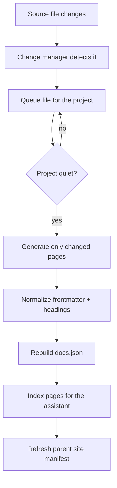
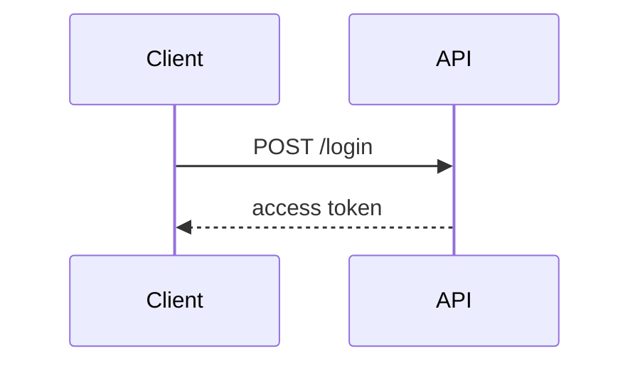
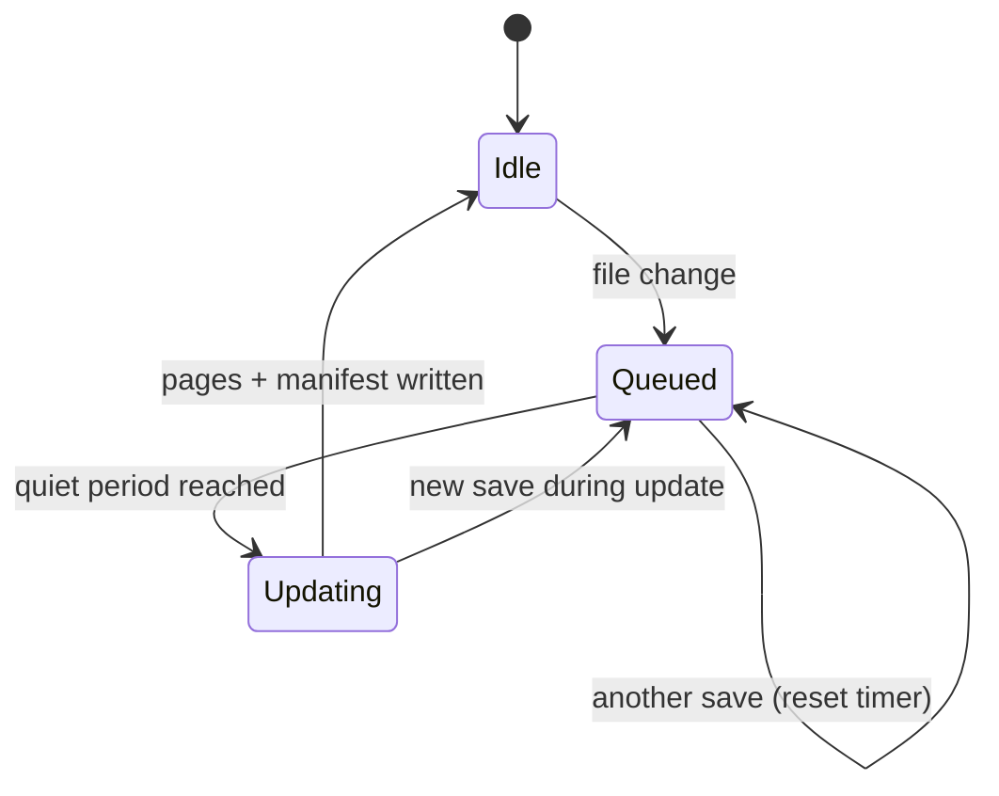
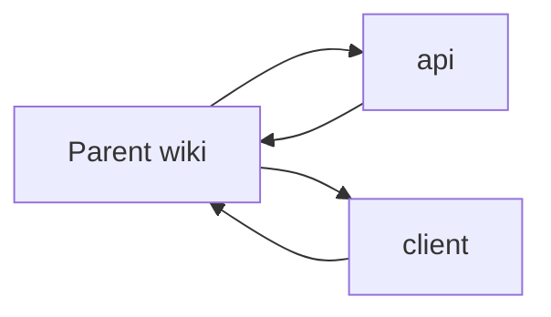

# Wiki

The wiki is a **living documentation site** generated from the project and kept
up to date in the background. Open it from the wiki tab to get a modern docs
experience: a grouped sidebar, searchable pages, Mermaid diagrams, copyable
examples, callout hints and a built-in AI assistant.

> [!TIP]
> Start with the landing page. It is generated from the project profile and the
> current section tree, so it doubles as a guided tour for new contributors.

## What the site gives you

| Area | What you get |
| --- | --- |
| **Navigation** | Sections grouped by purpose (Get started, Guides, Architecture, API reference, Operations) with page descriptions, icons and reading time. |
| **Pages** | YAML metadata, a TL;DR, "What you'll learn", Mermaid diagrams, runnable examples and `> [!TIP]` / `> [!WARNING]` hints. |
| **Search** | Local command palette (`⌘K` / `Ctrl+K`) across titles, descriptions, sections and tags. |
| **Assistant** | A per-project chat grounded in the generated wiki, with citations back to the pages it used. |
| **Ecosystem** | A parent project's sidebar lists its child projects and can open their wikis without leaving the docs site. |
| **Freshness** | A debounced background scheduler updates only the pages affected by recent edits. |

## How a page is produced



Each page is written as markdown with frontmatter that drives the site:

````markdown
---
title: Authentication
description: How login and signed tokens work
tags: [auth, security]
category: Guides
source: src/auth/service.py
---

# Authentication

> **TL;DR** — the API issues short-lived signed tokens.

## How it works


````

## Background updates without the refresh churn

Editing a project produces a stream of saves. Regenerating documentation on
every save would keep the wiki busy and consume AI tokens while the developer is
still working. The scheduler instead:

1. collects changed files per project,
2. waits for a **quiet period** (`wiki_update_debounce_seconds`, 60s by default),
3. caps the wait at `wiki_update_max_delay_seconds` (10 min),
4. regenerates **only the changed pages** and rebuilds the docs manifest once.



You can turn this off in **Project settings → Generate wiki**, or change the
quiet period and maximum delay there.

## The docs assistant

The assistant answers questions about the current project (and summarizes
related child projects). It retrieves the most relevant wiki pages, optionally
enriches them with **knowledge-base snippets**, and asks the configured model
for an answer with citations.

* **Wiki first:** the generated pages are the primary source. The manifest is
  rebuilt automatically when a page is newer than `docs.json`.
* **Codebase second:** with `use_knowledge` enabled it also runs the question
  through `KnowledgeDB.search`, so indexed source files, symbols and guides can
  appear as `source` citations. This is the project's knowledge index, not a
  live filesystem walk.
* Every answer returns `citations`, `pages_used` and a `context` summary
  (`wiki_pages`, `knowledge_documents`, `codebase_search`).
* If the model is unavailable, the assistant degrades to a deterministic
  "closest pages" answer instead of failing.
* Disable it per project with `wiki_assistant_enabled`.

> [!NOTE]
> A parent project only searches what its own knowledge index contains. If its
> `knowledge_file_ignore` excludes a child folder (for example `api/`), open that
> child project's wiki and use its assistant, or add the folder to the parent's
> knowledge scope.

## Child project wikis

A project's wiki is navigable from its parent. The docs manifest includes the
resolved child and dependency projects, so the parent sidebar can open each
child's documentation in place. When a child wiki changes, the scheduler
refreshes the parent manifest so counts, descriptions and links stay accurate.



## Wiki profiles keep the docs on-message

Each project has a **`wiki` profile**:

- `codx-junior`: public landing page, install and usage, app tour and DSH.
- `codx-junior-ui`: screens, sections, workflows and screenshots.
- `codx-junior-api`: internal architecture, setup and operations.

The profile is read on every generation (and re-read when it changes) and is
injected into category-tree, page, landing, domain and module prompts as the
**highest-priority specification** for goal, audience, tone, structure and image
policy. Page updates realign existing content to the profile when they conflict.

Changing the profile applies to the next generated pages. Use **Rebuild** to
realign the whole wiki immediately.

## Every project gets a wiki

Projects are not left without documentation. When a project is discovered, the
background worker creates a lightweight wiki automatically:

- a deterministic category tree from the repository layout,
- one overview page per category,
- the docs manifest and navigation.

The **Create wiki** button remains available for a project with no pages; it
also queues the first detailed AI pages. Opening the Wiki tab creates the
lightweight wiki on demand if it is still missing.

## Project hierarchy

The sidebar project tree is built from the filesystem hierarchy: the topmost
ancestor, the current project, siblings and every descendant project are shown.
Selecting a project opens its wiki in place.

## Child project search and assistant depth

Search and the documentation assistant can cross project boundaries:

- `wiki_search_children` includes child wiki pages and child knowledge in the
  search index and assistant retrieval.
- `wiki_search_depth` controls how many child levels are traversed (default 2).
- The search palette has an **Include child project docs** check.
- The assistant panel has the same check plus a depth selector per conversation.

Search results and assistant citations from another project show its project
badge; selecting one switches the docs view to that project.

## Enabling and rebuilding the wiki

1. Open **Project settings** and enable **Generate wiki**.
2. Open the wiki tab and use **Wiki settings** to build the category tree.
3. Run the **Dependency graph**, **Domains** and **Wiki index** steps to add
   architecture pages and make the content searchable by the assistant.
4. Use **Rebuild** for a full regeneration, or the refresh button in the docs
   site to rebuild the manifest and changed pages.

## Related files

- `api/codx/junior/wiki/wiki_manager.py` — page generation, prompts, batch updates.
- `api/codx/junior/wiki/site.py` — docs manifest, navigation, landing page, child projects.
- `api/codx/junior/wiki/assistant.py` — per-project documentation assistant.
- `api/codx/junior/wiki/scheduler.py` — debounced background updater.
- `client/src/views/WikiView.vue` — docs-site shell and assistant panel.
- `client/src/components/wiki/WikiMarkdown.vue` — callouts, Mermaid and wiki links.
